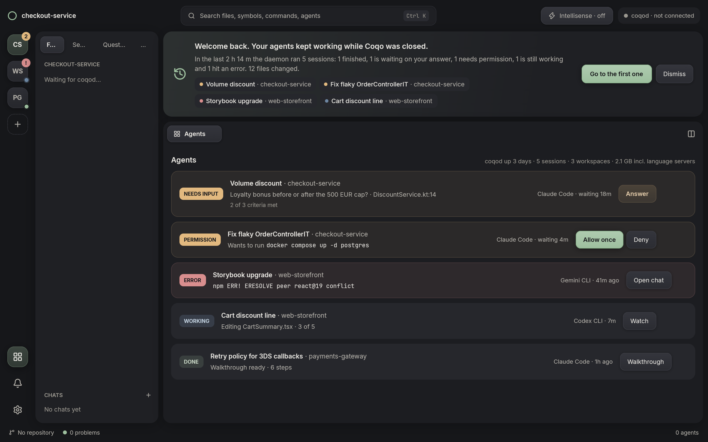
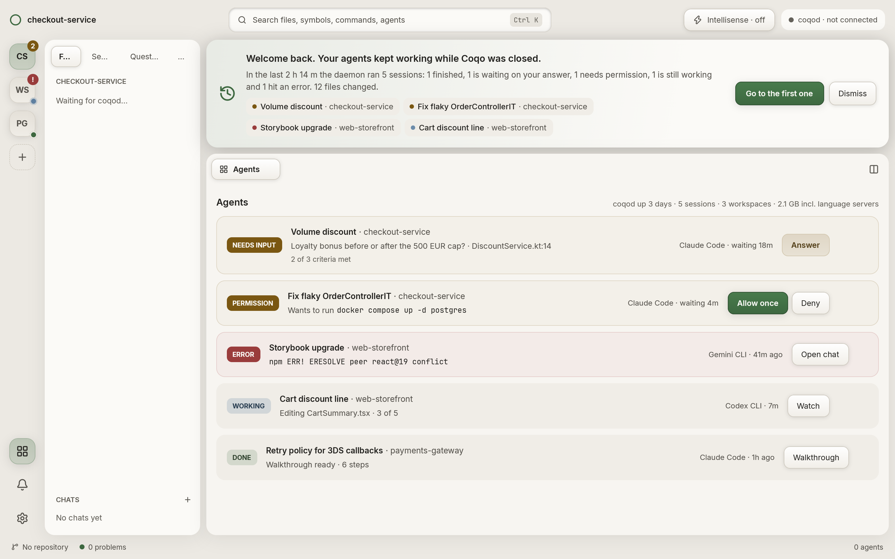

# Agents overview and welcome back

This doc covers one place to see every agent session in every workspace, and the summary of what happened while the UI was away (PLAN §7.9, design board 6, issues #79 and #265). The UI side is in `crates/coqo/src/agents/`: `view.rs` is the tab, `away.rs` is the welcome back, and `mod.rs` holds the order and the row texts. The sessions come from `AgentActivity` (`sessions/list` + `sessions/changes`, every workspace, resumable). Session states are described in [ADR 0015](../adr/0015-agent-state-and-status.md).

## Opening it

- **Rail button:** a 42 px button with a four-squares icon, above the bell. It is lit (the sage gradient of the current workspace's button) while the overview is the shown tab of a tab group. Its tooltip reads "Agents overview" with the shortcut.
- **`Ctrl Shift A`** (`Cmd Shift A` on macOS) does the same as the rail button.
- The overview is a tab of kind `agents`, keyed `agents`, so a window has at most one. If one is already open, showing the overview brings that tab forward instead of opening another. The tab is restored with the layout.

## The overview

- **Header:** "Agents" (15 px, semibold). On the right, in 12 px `text_subtle`: "coqod up 3 days · 5 sessions · 3 workspaces · 2.1 GB incl. language servers". The uptime and the memory come from `daemon/status`, which is fetched again every 30 s. The memory (`memory.rssBytes`) is the resident memory of `coqod` and every process it started: language servers, agents, terminals and process mods. On Linux it is read from `/proc/<pid>/stat`, and on macOS from `ps`. It reads "640 MB" below 1 GB and "2.1 GB" above. When the platform can't tell, it is left out.
- **Order:** board 6's order, top to bottom:
  1. What **needs you**: `needs_input`, `needs_permission` and `blocked`. The one that has waited longest comes first.
  2. **Errors.**
  3. **Working.**
  4. **Done**, then **idle**.

  Within groups 2–4 the most recent comes first. There are no group headers, because the badges already tell the groups apart. Closed sessions aren't listed.
- **Row:** a 14 px rounded card, laid out like this:
  - **Card colour:** needs-you rows sit on `panel_raised` mixed 6 % toward `sand`, with a 22 % sand hairline. Error rows use `rose` the same way. All other rows sit on `surface`.
  - **Badge** (10.5 px bold capitals): `NEEDS INPUT`, `PERMISSION` or `BLOCKED` on `sand`, `ERROR` on `rose`, `WORKING` in a blue tint, `DONE` in a sage tint, `IDLE` on `surface_strong`.
  - **First line:** the title (semibold), then " · workspace" in `text_muted`.
  - **Second line** (12.5 px, `text_muted`) depends on the state:
    - A question: its first line and file, for example "… · DiscountService.kt:14".
    - A permission request: "Wants to run" followed by the command in mono. A request that isn't a command reads "Asks to: …".
    - An error: the reason, in mono.
    - A done session that published a walkthrough: board 6's "Walkthrough ready · 6 steps".
    - Otherwise: the agent's status line with its progress ("Editing CartSummary.tsx · 3 of 5").
  - **Third line** (`text_xs`, `text_subtle`), only when there is something to show: "2 of 3 criteria met" and "1 open question".
  - **Right side** (12 px, `text_muted`): the provider and how long the state has lasted. A row that needs you reads "waiting 18m", a working one "7m", and the others "41m ago" or "just now". These times redraw every 30 s.
- **Actions**, board 6's primary action for each state:
  - **Answer** (a raised button tinted `sand`) opens the waiting question in its file with the popover focused, using the same path as F8.
  - **Allow once** (primary) and **Deny** answer the waiting permission request (`sessions/respondPermission`). The request is fetched with `sessions/get` when the session starts to need permission.
  - **Walkthrough** (raised) on a done session that published a walkthrough. It opens the session's newest walkthrough in the player at the first unread step (#100). The overview follows each workspace's walkthroughs (`walkthroughs/list` + `walkthroughs/changes`), so the button shows up as soon as one is published.
  - **Watch** for a working session, and **Open chat** for every other state (including a done session with no walkthrough), open the chat tab.
  - Two icon buttons show when the row is hovered or selected: **Stop** ■ cancels the running turn (`sessions/cancel`) and **Close** ✕ closes the session (`sessions/close`).
- **Clicking a row** opens its chat.
- **Keyboard:** ↑ and ↓ select a row, which gets a `blue` hairline. Enter takes the row's next step: it answers the question if one is waiting, opens a done session's walkthrough, and otherwise opens the chat.
- **Other workspaces:** a session from another workspace first switches the window to that workspace. If another window already shows it, that window is focused instead. Opening a session also marks its alerts read.
- **Empty state:** "No agent sessions yet." followed by the new-chat shortcut.

## Welcome back

- **When it appears:** when the UI attaches to `coqod` (at start, or on a reconnect) after being away for more than 10 minutes (`AWAY_AFTER`). It also appears when the UI stayed attached while the machine slept. It doesn't appear after a quick reconnect, or when nothing happened.
- **How "away" is measured:** the UI writes the time to `ui/presence.json` in its data directory every minute while attached (the heartbeat), and again when it quits. The gap between that time and the next attach is how long it was away.
- **After sleep:** timers don't run while the machine sleeps, so the first heartbeat after waking comes late by the wall clock. A heartbeat more than `AWAY_AFTER` after the previous one counts as an absence from that previous one. This covers, for example, a laptop that sleeps with a local socket open.
- **What it counts:** the summary is built from `sessions/list`, `alerts/list` and `agents/changedSince` at that moment:
  - every session that needs you or is working now;
  - sessions that finished or failed while the UI was away;
  - the files agents changed while the UI was away, each file counted once. This comes from the daemon's per-file change records (#286): a file counts when its latest agent change is from that time on;
  - alerts raised while the UI was away that are still unread.
- **Where it shows:** a banner at the top of the main column, above the tabs, in every window, until it is dismissed. Board 6 puts it in the same place.
- **Banner layout:** 18 px radius, a sage-tinted corner that fades into `panel_raised` at 135°, and the history icon in `sage`. Its contents:
  - **Title:** "Welcome back. Your agents kept working while Coqo was closed." After a reconnect it reads "…was disconnected." After sleep it reads "…while you were away." (board 6 labels the banner "While you were away").
  - **Sentence:** "In the last 2 h 14 m the daemon ran 5 sessions: 1 finished, 1 is waiting on your answer, 1 needs permission, 1 is still working and 1 hit an error. 12 files changed. 3 alerts are unread." The files part is left out when there are none.
  - **Chips:** up to four sessions, each with its state dot, title and workspace. Clicking a chip opens that session.
  - **Alerts link:** "3 unread alerts" opens the alert center.
  - **Buttons:** **Go to the first one** (primary) opens the session that needs you most and hides the banner. **Dismiss** only hides the banner.
