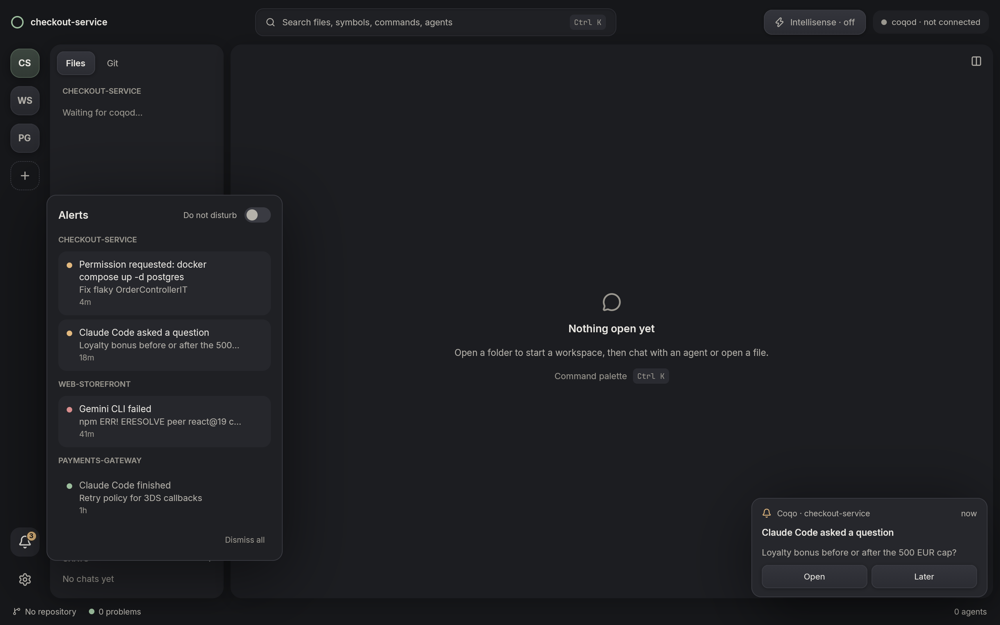
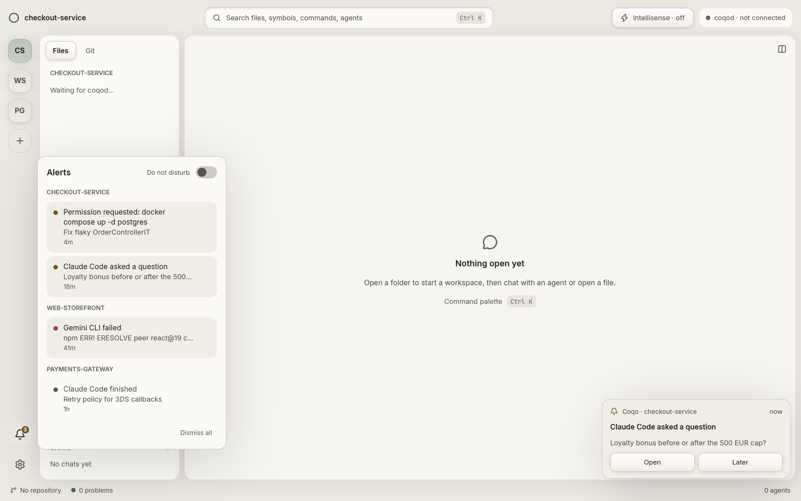

# Alerts

The bell, the alert center and the toast (PLAN §7.9, design board 6, issue #76). The UI side is in `crates/coqo/src/alerts/` (`AlertCenter` follows `alerts/list` + `alerts/changes` with `Resumable`) and the rail's bell in `crates/coqo/src/shell/rail.rs`; the engine is in the daemon, `crates/coqod/src/alerts/` ([ADR 0019](../adr/0019-alert-engine.md)).

## What raises an alert

Agent sessions, one standing alert per session: a permission request, a question, blocked (all **needs you**, sand), a failed turn (**error**, rose) and a finished turn (**done**, sage). The alert goes away by itself (resolved: read, kept as history until dismissed) when the session moves on, and comes back as news when it needs you again. Mods raise their own through `coqo.alerts@1`. Alerts are kept by the daemon, so the ones raised while the UI was closed are there when it opens.

## Bell

- A 42 px rail button with the bell icon, at the bottom of the rail above settings. Tooltip: "Alerts · 3 unread".
- **Badge:** the unread count in a 15 px pill (9.5 px bold text, a 1.5 px `ground` ring) at the top right, coloured by the most urgent unread alert: `sand` needs you, else `rose` error, else `blue` info, else `sage` done. Board 6 draws an 8 px dot there; Coqo shows the count, since the bell sums every workspace and the number is the point.
- The bell sits on `surface` while the center is open (and on hover). A click toggles the center; a click outside closes it.

## Alert center

- A popover anchored to the bell, 340 px wide, at most 520 px of list, on `panel_raised` with the popover's radius and shadow.
- **Header:** "Alerts" (15 px, semibold) and a **Do not disturb** switch on the right (38 × 22 px; the knob turns `sage` when on). Do not disturb keeps recording alerts but shows no toasts (and, with #77, no desktop notifications); it is stored in the daemon.
- **Grouped by workspace** (the workspace's name in capitals, semibold, `text_subtle`), groups ordered by their newest alert; alerts without a workspace are grouped under "Other". Board 6 groups by time ("TODAY"); a center that spans workspaces reads better grouped by where you'd go.
- **Row:** an 8 px dot in the kind's colour, the title (`text`, wraps), the body's first line (`text_muted`, truncated) and the age ("now", "4m", "2h", "3d") in `text_subtle`. Unread rows sit on `surface`; read and resolved ones on the popover. Hover lifts the row to `surface_selected` and shows a ✕ that dismisses it.
- **Click** opens the alert's target and marks it read: the chat tab of the session, or the file at the question's line. An alert from another workspace first switches the window there (or focuses the window that shows it).
- **Dismiss all** at the bottom right (12 px, `text_subtle`); "Nothing needs you right now." when the list is empty.

## Toast

- Only for a **needs you** alert as it arrives: not in do-not-disturb, not while the window is in the background, and not when that session's chat is already on screen.
- Bottom right of the window, 340 px, on the popover surface: a header line with the bell in the kind's colour, "Coqo · checkout-service" and "now" (`text_xs`, `text_muted`); the title in semibold; up to two lines of body in `text_muted`; **Open** and **Later** buttons side by side. A click anywhere but **Later** opens the alert; it hides by itself after 6 s and stays in the center.

## Marking read

Opening an alert marks it read. A chat tab that is visible in a focused window marks its session's alerts read, so a turn you watched finish never counts as unread.
