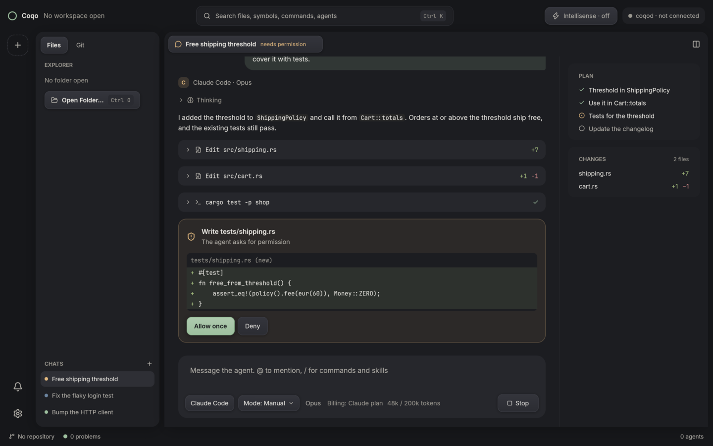

# Chat tab

A chat is a tab like any file (PLAN §7.3, design board 1). The code is in `crates/coqo/src/chat/`; it talks to the daemon's `sessions/*` methods ([protocol README](../../protocol/README.md), `coqo_protocol::methods::agents`).

## Layout

- **Reading column:** the transcript and the composer sit in a centred column at most 760 px wide. The transcript is a virtual list that follows the tail while you are at the bottom.
- **Session panel:** 300 px on the right of the tab, behind a hairline: **Plan** (the agent's todo list: sage check done, sand dot in progress, hollow circle pending) and **Changes** (every file a tool call edits or proposes to edit, with `+`/`−` line counts; a click opens the file). Acceptance criteria, open questions and "Review diff" join it with their features (#96, PLAN §7.5, board 4).
- **Tab label:** a chat icon and the title; when the session needs you, the icon turns sand (rose on error) and a small "needs input", "needs permission", "blocked" or "error" badge follows the title.

## Transcript rows

| Row | Look |
|---|---|
| Your prompt | Right-aligned bubble, sage at 16 %, 18 px radius with a 4 px bottom-right corner. Mentions show as mono chips. |
| Turn header | A sand letter tile and "Provider · model". |
| Agent message | Streaming Markdown (gpui-component's text view, wrapped as `coqo_ui::text::markdown`). |
| Thinking | Collapsed by default ("▸ Thinking"); a click shows the reasoning in muted text. |
| Tool call | A `surface` card, 12 px radius, mono 12 px: kind icon and title; on the right `+n −m` for edits, "running" in blue, "failed" in rose, or a sage check. A click expands it: locations as blue links (they open file tabs), the diff (green and rose line tints at 12 %), and up to 40 lines of output. |
| Permission request | A sand-tinted card with a sand hairline, the shield icon, the diff it is about, and one button per option the provider offers: "allow once" is the sage primary button, the others are raised. Options are ordered allow → reject, once → always, and the click answers with the option's id (`sessions/respondPermission`). Once answered it fades to `surface` and says which option was chosen. |
| Notice | One line: rose for errors, sand when the agent waits or stopped at a limit, muted for "Stopped" and "closed". |

## Composer

A `surface` field with an 18 px radius (`chat/tab/composer.rs`). **Enter** sends, **Shift+Enter** adds a line, **Esc** (or the **Stop** button that replaces **Send** while a turn runs) cancels the turn. The placeholder says "Message the agent. @ to mention, / for commands and skills". Below the text: the provider and mode chips, the model, the billing source from the provider's auth status, and context use. Cost appears only when it is a real charge (API key or cloud billing).

- **@-mentions.** `@` at the start of a word opens a popover above the composer with fuzzy matches from the session's workspace: up to 8 rows, each with the file glyph, the name with the matched letters in sage, and the folder in `text_subtle`. Matching is smart-case and favours the file name, runs and the starts of path segments. The file list comes from walking the workspace with `fs/list` (ignored files skipped, at most 20,000 files, refreshed when the popover opens after 30 s); the daemon file index of #162 can replace the walk later. Picking a file replaces `@query` with an atomic chip (`@src/cart.rs` in the text, `@cart.rs` on the chip, 12.5 px on `raised_top`, 6 px radius) that edits and deletes as one unit.
- **What a mention sends.** The prompt's text keeps `@path`, and each mentioned file adds a content block after it: an ACP `resource_link` (`file://` URI, file name, size), or an embedded `resource` with the file's text when the provider declares `embeddedContext` and the file is at most 64 KB. The blocks are provider-neutral, so ACP and native providers get the same structured context.
- **Slash commands and skills.** `/` at the start of the prompt opens the session's `available_commands` (the agent's built-in commands and the user's own skills and plugins): `/name` in mono, its argument hint, and its description. Name prefixes rank first. Tab or Enter completes `/name `, and the prompt is sent as text, as ACP expects.
- **Popover keys.** Up and Down choose (wrapping), Enter or Tab accepts, Esc closes. Esc keeps the popover closed until you leave that `@` or `/` word. With no matches the keys go back to the field, so Enter still sends.
- **Provider.** Until the first message, the provider chip is a dropdown (a chevron shows) of the daemon's providers: name, description, a sage check on the current one, unavailable ones dimmed. Picking another provider creates a new session on it (same folder and workspace), closes the empty one, and shows the new one in the same tab. After the first message the chip is a plain label: a chat keeps its provider, so start a new chat to use another.
- **Mode.** The mode chip is a dropdown of the session's modes with their descriptions (`sessions/setMode`), keyboard and mouse alike.
- **Model.** Read-only, from the provider's usage reports. The protocol doesn't list a provider's models yet, so there is no model picker.
- **History.** Up in an empty composer recalls the last prompt you sent in this chat, with its mention chips; Up and Down step through earlier ones, and Down past the newest empties the field. Editing the recalled text ends the recall.

Popovers and dropdowns share one card: `surface`, a `border_strong` hairline, a 14 px radius and the deep drop shadow of the bolt popover (`widgets::popover`). The selected row is `surface_selected` with a 10 px radius; a hint line in `text_subtle` 11 px closes the card.

When the provider needs a login, a sand banner says how to sign in to the agent's own tool (for Claude Code: run `claude` in a terminal and use `/login`). Coqo never handles the login.

## Sidebar

The CHATS section lists the current workspace's open sessions, newest first, with a 7 px status dot: sage for idle and done, sand when it needs input or permission or is blocked, rose on error, and a pulsing blue while working. The row of the active chat tab is `surface_selected`. The **+** next to CHATS and `Ctrl Shift N` (`Cmd Shift N` on macOS) start a chat in the workspace with the first available provider. Problems (no folder open, no provider installed, sign-in needed) show under the list in sand.

## Reattaching

A chat tab saves only its session id. When it comes back (a new window, a restart), it asks `sessions/get` for the session's info and subscribes to `sessions/updates` from seq 0, so the whole transcript replays, then the live stream follows. After a dropped connection it resubscribes from the last seq it applied; if the daemon can't replay that far (`RESUME_GAP`) it starts over from 0.

## Light appearance

To regenerate the screenshots, run `COQO_SHOT_DIR=<dir> cargo test -p coqo -- --ignored chat_screenshots` (offscreen, needs a GPU) and downscale the 2× PNGs to 1440×900 as `chat-<appearance>.png` and `composer-<appearance>.png`.
