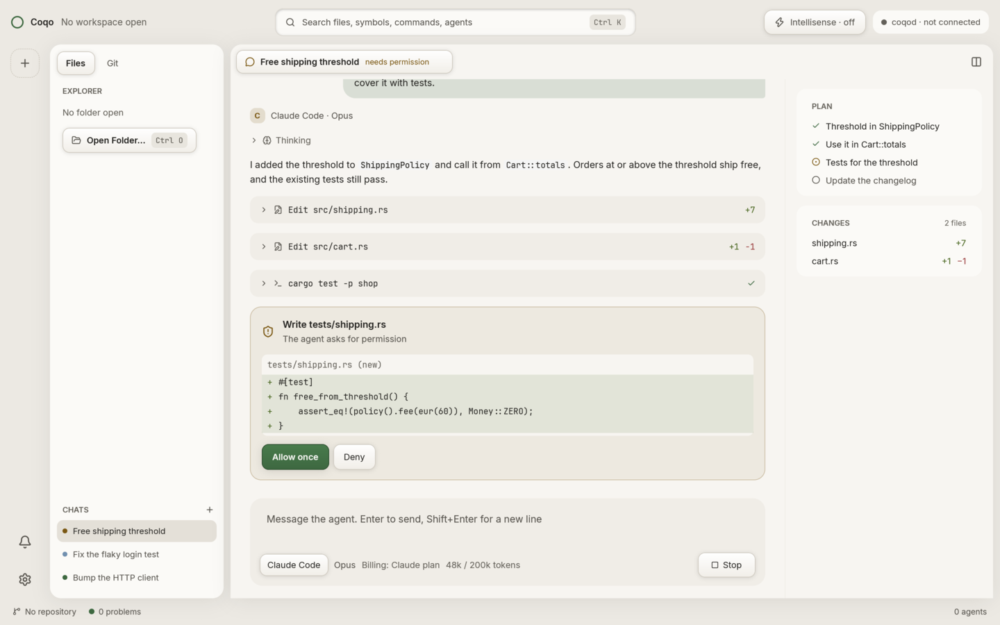

# Chat tab

A chat is a tab like any file (PLAN §7.3, design board 1). The code is in `crates/coqo/src/chat/`; it talks to the daemon's `sessions/*` methods ([protocol README](../../protocol/README.md), `coqo_protocol::methods::agents`).

## Layout

- **Reading column:** the transcript and the composer sit in a centred column at most 760 px wide. The transcript is a virtual list that follows the tail while you are at the bottom.
- **Session panel:** 300 px on the right of the tab, behind a hairline: **Plan** (the agent's todo list: sage check done, sand dot in progress, hollow circle pending) and **Changes** (every file a tool call edits or proposes to edit, with `+`/`−` line counts; a click opens the file). Acceptance criteria, open questions and "Review diff" join it with their features (#96, PLAN §7.5, board 4).
- **Tab label:** a chat icon and the title; when the session needs you, the icon turns sand (rose on error) and a small "needs input", "needs permission", "blocked" or "error" badge follows the title.

## Transcript rows

| Row | Look |
|---|---|
| Your prompt | Right-aligned bubble, sage at 16 %, 18 px radius with a 4 px bottom-right corner. Mentions show as mono chips. |
| Turn header | A sand letter tile and "Provider · model". |
| Agent message | Streaming Markdown (gpui-component's text view, wrapped as `coqo_ui::text::markdown`). |
| Thinking | Collapsed by default ("▸ Thinking"); a click shows the reasoning in muted text. |
| Tool call | A `surface` card, 12 px radius, mono 12 px: kind icon and title; on the right `+n −m` for edits, "running" in blue, "failed" in rose, or a sage check. A click expands it: locations as blue links (they open file tabs), the diff (green and rose line tints at 12 %), and up to 40 lines of output. |
| Permission request | A sand-tinted card with a sand hairline, the shield icon, the diff it is about, and one button per option the provider offers: "allow once" is the sage primary button, the others are raised. Options are ordered allow → reject, once → always, and the click answers with the option's id (`sessions/respondPermission`). Once answered it fades to `surface` and says which option was chosen. |
| Notice | One line: rose for errors, sand when the agent waits or stopped at a limit, muted for "Stopped" and "closed". |

## Composer

A `surface` field with an 18 px radius. **Enter** sends, **Shift+Enter** adds a line, **Esc** (or the **Stop** button that replaces **Send** while a turn runs) cancels the turn. Below the text: the provider, the mode (a click switches to the next mode), the model, the billing source from the provider's auth status, and context use. Cost appears only when it is a real charge (API key or cloud billing). @-mentions, slash commands and the provider and model picker come with #64.

When the provider needs a login, a sand banner says how to sign in to the agent's own tool (for Claude Code: run `claude` in a terminal and use `/login`). Coqo never handles the login.

## Sidebar

The CHATS section lists the current workspace's open sessions, newest first, with a 7 px status dot: sage for idle and done, sand when it needs input or permission or is blocked, rose on error, and a pulsing blue while working. The row of the active chat tab is `surface_selected`. The **+** next to CHATS and `Ctrl Shift N` (`Cmd Shift N` on macOS) start a chat in the workspace with the first available provider. Problems (no folder open, no provider installed, sign-in needed) show under the list in sand.

## Reattaching

A chat tab saves only its session id. When it comes back (a new window, a restart), it asks `sessions/get` for the session's info and subscribes to `sessions/updates` from seq 0, so the whole transcript replays, then the live stream follows. After a dropped connection it resubscribes from the last seq it applied; if the daemon can't replay that far (`RESUME_GAP`) it starts over from 0.

## Light appearance

To regenerate the screenshots, run `COQO_SHOT_DIR=<dir> cargo test -p coqo -- --ignored chat_screenshots` (offscreen, needs a GPU) and downscale the 2× PNGs to 1440×900 as `chat-<appearance>.png`.
