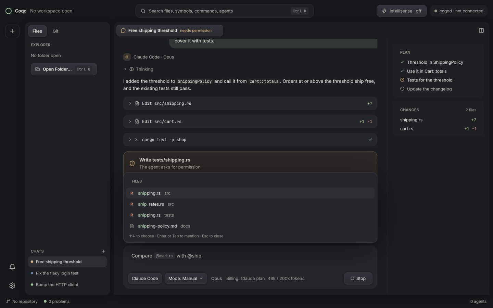
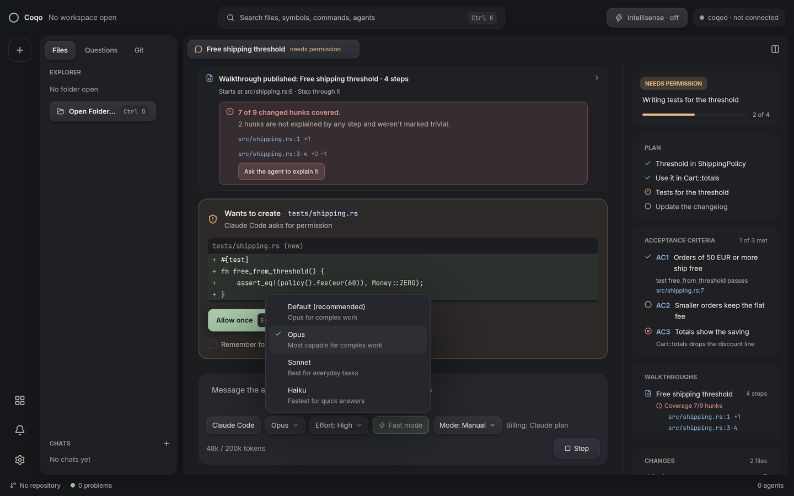
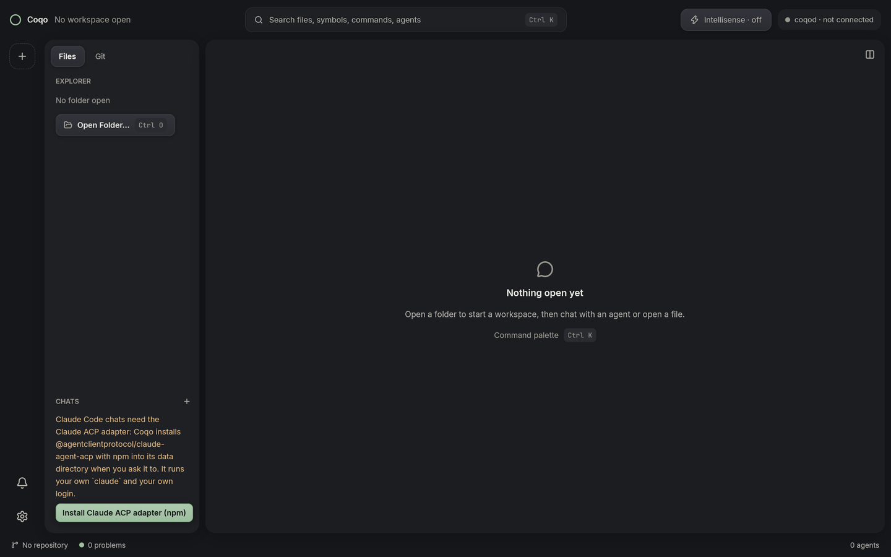
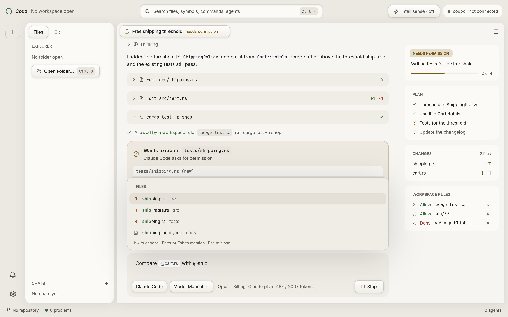
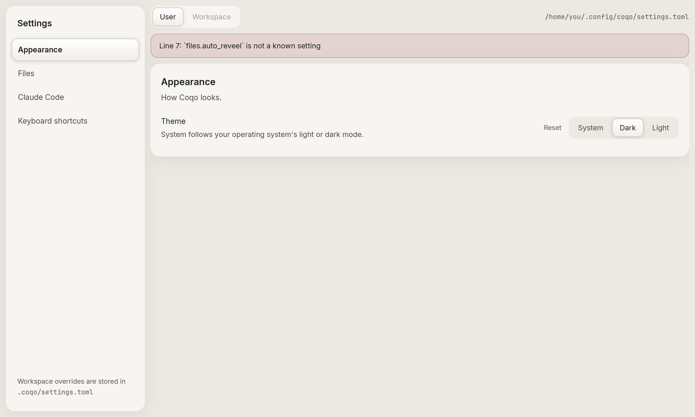

# Chat tab

A chat is a tab like any file (PLAN §7.3, design board 1). The code is in `crates/coqo/src/chat/`; it talks to the daemon's `sessions/*` methods ([protocol README](../../protocol/README.md), `coqo_protocol::methods::agents`).

## Layout

- **Reading column:** the transcript and the composer sit in a centred column at most 760 px wide. The transcript is a virtual list that follows the tail while you are at the bottom.
- **Session panel:** 300 px on the right of the tab, behind a hairline. First the **status card**: a pill with the session's state in capitals (`NEEDS PERMISSION`, `WORKING`, …) in its status colour on an 18 % tint of it (sage idle or done, blue working, sand when it needs you, rose on error, as board 6's agents overview), the agent's status line from `set_status` (else why it waits, else a quiet line such as "Ready for a prompt" in `text_subtle`), and a 4 px progress bar with "2 of 5" when the agent reports progress (else the plan's "Plan: 2 of 4 done" while the session is busy). Then **Plan** (the agent's todo list: sage check done, sand dot in progress, hollow circle pending), **Acceptance criteria**, **Walkthroughs** and **Changes** (every file a tool call edits or proposes to edit, with `+`/`−` line counts; a click opens the file). Open questions and "Review diff" join it with their features (PLAN §7.5, board 4).
- **Acceptance criteria** (#96, `set_acceptance_criteria`): the header has "1 of 3 met" on the right in `text_subtle`. Each row is the status glyph (sage check met, rose circled ✕ failed, sand hollow circle pending, `text_subtle` alert circle for "can't be checked here"), the id in semibold blue (`AC1`, as board 1) and the text beside it. Evidence sits under the text in `text_label` size and `text_muted`; one with a file adds its `path:line` in blue, and a click opens the file at that line. Clicking a glyph marks the criterion (pending → met → failed → pending); a criterion the user marked says "Marked by you" in `text_subtle`, and the agent sees it as "set by the user" in its next tool result. With none set it says "The agent hasn't set any yet".
- **Walkthroughs** (#97, `publish_walkthrough`): when the agent publishes a walkthrough the transcript shows a card on `panel_raised` with a hairline border: a blue file-code glyph, "Walkthrough published: <title> · n steps" in semibold, "Starts at path:line" in `text_label` / `text_muted` (and "Written to .coqo/walkthroughs for you to commit" for a committed one), and a chevron. The session panel's "Walkthroughs" card lists the session's, newest first: glyph, title (truncated) and "n steps" in `text_subtle`; with none it says "None yet: the agent publishes one when it finishes a change". The card and each row open the walkthrough player (#100, [walkthrough.md](walkthrough.md)). **Published again** (#253, the same walkthrough replaced in place): the card shows the latest, and the transcript adds one line instead of a second card: a hairline-bordered row, 10 px radius, a blue rotate glyph, "Walkthrough updated: <title> · n steps" in `text`, its "Coverage n/n hunks" (sage check, or rose with a circle-alert while incomplete) and a chevron; a click opens the player. The panel keeps one row per walkthrough. **Coverage** (#99): with every hunk covered the card adds "Coverage n/n hunks" in `text_label` / `text_muted` after a small sage check ("No changed hunks", "Coverage not checked" when there is no diff). With hunks uncovered it carries board 3's coverage banner instead: 10 px radius, `rose` at 12 % with a 30 % hairline, a rose circle-alert, "12 of 14 changed hunks covered." in semibold rose and, in `text_muted`, "path:lines (+a −r) is not explained by any step and wasn't marked trivial." (or "n hunks are not explained…" followed by up to six hunks as mono blue `path:lines` links with their `+a −r` in `text_subtle`), then an "Ask <agent> to explain it" button (rose 18 % fill, 35 % border) that sends the agent the list, or leaves it in the composer while a turn runs. A link opens the hunk's lines in a file tab without also opening the player. The panel row adds "Coverage 12/14 hunks" under the title, rose with a circle-alert when incomplete and the first three hunks as links, `text_subtle` otherwise.
- **Tab label:** a chat icon and the title; when the session needs you, the icon turns sand (rose on error) and a small "needs input", "needs permission", "blocked" or "error" badge follows the title.

## Transcript rows

| Row | Look |
|---|---|
| Your prompt | Right-aligned bubble, sage at 16 %, 18 px radius with a 4 px bottom-right corner. Mentions show as mono chips. |
| Turn header | A sand letter tile and "Provider · model", as board 1's "Claude Code · Opus". The model is the one chosen when the turn started (the session's `model` config option), else the one the provider's usage reports name. |
| Agent message | Streaming Markdown (gpui-component's text view, wrapped as `coqo_ui::text::markdown`). |
| Thinking | Collapsed by default ("▸ Thinking"); a click shows the reasoning in muted text. |
| Tool call | A `surface` card, 12 px radius, mono 12 px: kind icon and title; on the right `+n −m` for edits, "running" in blue, "failed" in rose, or a sage check. A click expands it: locations as blue links (they open file tabs), the diff (green and rose line tints at 12 %), and up to 40 lines of output. |
| Permission request | A sand-tinted card with a sand hairline and the shield icon. The title says what the agent wants, as on board 6: "Wants to run" with the command in a mono chip, or "Wants to edit/create/read/delete" with the workspace-relative path; other tools show the request's own title. Under it, "<provider> asks for permission", then the preview: the command (`$ cargo test -p shop`, mono, on `panel`) or the diff. One button per option the provider offers: "allow once" is the sage primary button, the others are raised; options are ordered allow → reject, once → always, and the click answers with the option's id (`sessions/respondPermission`). Key caps on the buttons show **Enter** (allow once) and **Esc** (deny once). When the daemon offers a rule, a tick box reads "Remember for this workspace: commands starting with `cargo test`" (or "edits of `src/**`"). Once answered the card fades to `surface` and says which option was chosen, and "remembered for this workspace" when it made a rule. |
| Rule's answer | A request a workspace rule answered never shows a card: one `text_sm` line with a sage check (rose ✕ for a deny rule), "Allowed by a workspace rule", the rule in a mono chip, and what it allowed ("run cargo test -p shop"). |
| Review sent | A user message that sent a code review from the diff (#95; it carries a `coqo://review` link): a right-aligned `panel_raised` card at 80% of the column, 18 px radius, `sage` hairline at 35%: a `MessageCircle` tile in `sage`, "Review sent: N comments" in semibold, "M threads · unstaged changes · replies land in the threads" muted, a raised **Open diff** (opens or focuses that diff's tab) and **Show** / **Hide** for the message itself, rendered as Markdown under a hairline. |
| Notice | One line: rose for errors, sand when the agent waits or stopped at a limit, muted for "Stopped" and "closed". |

## Permissions

- **Focus.** A new pending request takes the keyboard focus (and scrolls into view if you scrolled away), unless you are typing in the composer: then Enter still sends your message. **Enter** answers with the "allow once" option and **Esc** with "reject once", chosen by kind, never by position; with no "reject once" on offer, Esc stops the turn as usual. After the answer focus goes to the next pending request, or back to the composer.
- **The provider's "always".** Coqo passes whichever option you click to the agent unchanged, so Claude Code's own "always allow" keeps working its way (it saves the rule in Claude's settings). Coqo's rules are separate and only come from the "Remember for this workspace" tick, which works with any option: an allow option makes an allow rule, a reject option a deny rule.
- **Rules** live in the daemon, per workspace (`agents/permissionRules`), and survive restarts. The daemon answers a matching request before it reaches any UI, with the "allow once" option (else "allow always"), or "reject once" (else "reject always") for a deny rule, and the session never goes to `needs_permission`. A deny rule wins over an allow rule. It is an allowlist: anything no rule matches is asked. Rules only match what Coqo can read exactly: a simple command (no `;`, `&&`, pipes, redirections, `$`, backticks, globs, `~` or `..`, no absolute path outside the workspace, no `-c`/`-e`-style flags, and never `rm`, `sudo`, `curl`, a shell and the like), matched word by word as a prefix (`cargo test` matches `cargo test -p shop`, not `cargo testing`); or edits and reads of files that all resolve, symlinks included, inside the workspace's roots, matched by a root-relative glob (`src/**`). The tick box only appears for such requests. Suggested rules stay narrow: the program and its subcommand (`cargo test`, `npm run build`), or the edited file's folder (`src/**`).
- **Rules panel.** The session panel's WORKSPACE RULES card lists the rules: the tool's icon, "Allow" in sage or "Deny" in rose, the pattern in mono, and an ✕ that deletes the rule (`agents/deletePermissionRule`). With no rules it says that every request is asked.
- The tab label says "needs permission" and the sidebar dot turns sand while a request waits.

## Composer

A `surface` field with an 18 px radius (`chat/tab/composer.rs`). **Enter** sends, **Shift+Enter** adds a line, **Esc** (or the **Stop** button that replaces **Send** while a turn runs) cancels the turn. The placeholder says "Message the agent. @ to mention, / for commands and skills". Below the text: the provider chip, a chip for each of the session's settings (model, effort, Fast mode, mode, …), the billing source from the provider's auth status, and context use. Cost appears only when it is a real charge (API key or cloud billing).

- **@-mentions.** `@` at the start of a word opens a popover above the composer with fuzzy matches from the session's workspace: up to 8 rows, each with the file glyph, the name with the matched letters in sage, and the folder in `text_subtle`. Matching is smart-case and favours the file name, runs and the starts of path segments. The file list comes from walking the workspace with `fs/list` (ignored files skipped, at most 20,000 files, refreshed when the popover opens after 30 s); the daemon file index of #162 can replace the walk later. Picking a file replaces `@query` with an atomic chip (`@src/cart.rs` in the text, `@cart.rs` on the chip, 12.5 px on `raised_top`, 6 px radius) that edits and deletes as one unit.
- **What a mention sends.** The prompt's text keeps `@path`, and each mentioned file adds a content block after it: an ACP `resource_link` (`file://` URI, file name, size), or an embedded `resource` with the file's text when the provider declares `embeddedContext` and the file is at most 64 KB. The blocks are provider-neutral, so ACP and native providers get the same structured context.
- **Slash commands and skills.** `/` at the start of the prompt opens the session's `available_commands` (the agent's built-in commands and the user's own skills and plugins): `/name` in mono, its argument hint, and its description. Name prefixes rank first. Tab or Enter completes `/name `, and the prompt is sent as text, as ACP expects.
- **Popover keys.** Up and Down choose (wrapping), Enter or Tab accepts, Esc closes. Esc keeps the popover closed until you leave that `@` or `/` word. With no matches the keys go back to the field, so Enter still sends.
- **Provider.** Until the first message, the provider chip is a dropdown (a chevron shows) of the daemon's providers: name, description, a sage check on the current one, unavailable ones dimmed. Picking another provider creates a new session on it (same folder and workspace), closes the empty one, and shows the new one in the same tab. After the first message the chip is a plain label: a chat keeps its provider, so start a new chat to use another.
- **Settings (session config options).** Agents that offer ACP session config options (Claude Code: Model, Effort, Fast mode, Mode, and Agent when you have custom agents) get one chip per option after the provider chip, in the agent's order. A choice from a list is a dropdown chip like board 1's "Opus ▾": the model shows only its name ("Opus"), anything else its name and value ("Effort: High", "Mode: Manual"). The dropdown is the shared card: each entry's name and description, a sage check on the current one, group names as section labels when the agent groups its entries, and the option's description as the hint line; keyboard and mouse alike. An on/off option is a toggle chip with no chevron: raised and muted while off; while on, sage text on sage at 16 % with a 40 % sage hairline. A `speed` option (Fast mode) carries the zap glyph, others a check or an empty circle. A pick calls `sessions/setConfigOption`; the chips follow the agent's `config_options` updates, so a new model that offers other efforts changes the effort chip, and a change the agent makes itself shows up too. Options stay usable during a turn; if the agent refuses a change, the error shows above the composer.
- **Mode.** For an agent with a `mode` option, that option's chip is the mode chip. Otherwise the mode chip is a dropdown of the session's modes with their descriptions (`sessions/setMode`), keyboard and mouse alike.
- **Model.** Without a `model` option, the model is a read-only label from the provider's usage reports.
- **Kept across restarts.** The daemon keeps each session's options. When a session resumes (a daemon restart, an agent crash) and the agent reports a value it forgot (Claude's adapter keeps the model but not the effort), the daemon sets it again.

- **History.** Up in an empty composer recalls the last prompt you sent in this chat, with its mention chips; Up and Down step through earlier ones, and Down past the newest empties the field. Editing the recalled text ends the recall.

Popovers and dropdowns share one card: `surface`, a `border_strong` hairline, a 14 px radius and the deep drop shadow of the bolt popover (`widgets::popover`). The selected row is `surface_selected` with a 10 px radius; a hint line in `text_subtle` 11 px closes the card. A dropdown's list stops growing at 360 px and scrolls (Claude offers a dozen models), keeping the keyboard's choice in view.

When the provider needs a login, a sand banner says how to sign in to the agent's own tool (for Claude Code: run `claude` in a terminal and use `/login`). Coqo never handles the login.

## Sidebar

The CHATS section lists the current workspace's open sessions, newest first, with a 7 px status dot: sage for idle and done, sand when it needs input or permission or is blocked, rose on error, and a pulsing blue while working. Under the title, in `text_subtle` at label size, the agent's status line with its progress ("Running the tests · 2 of 5"), or why the session waits; rows without one stay one line. The row of the active chat tab is `surface_selected`. The **+** next to CHATS and `Ctrl Shift N` (`Cmd Shift N` on macOS) start a chat in the workspace with the first available provider. Problems (no folder open, no provider installed, sign-in needed) show under the list in sand.

Below a problem go the provider's buttons, in the primary style:

- When a provider isn't set up (Claude Code before its ACP adapter is installed), the list shows the provider's own message and its setup buttons, such as **Install Claude ACP adapter (npm)**. Nothing installs until the button is pressed. While it runs, the list says what is running. When it finishes, the chat starts.
- When the provider needs a login, the button is **Open `claude` in a terminal**. It opens a terminal tab in the workspace running the user's own `claude`, where they `/login`.
- The chat tab's sign-in banner carries the same button.

## Reattaching

A chat tab saves only its session id. When it comes back (a new window, a restart), it asks `sessions/get` for the session's info and subscribes to `sessions/updates` from seq 0, so the whole transcript replays, then the live stream follows. After a dropped connection it resubscribes from the last seq it applied; if the daemon can't replay that far (`RESUME_GAP`) it starts over from 0.

## Light appearance

To regenerate the screenshots, run `COQO_SHOT_DIR=<dir> cargo test -p coqo -- --ignored chat_screenshots` (offscreen, needs a GPU) and downscale the 2× PNGs to 1440×900 as `chat-<appearance>.png`, `composer-<appearance>.png`, `settings-<appearance>.png` and `setup-dark.png`.
