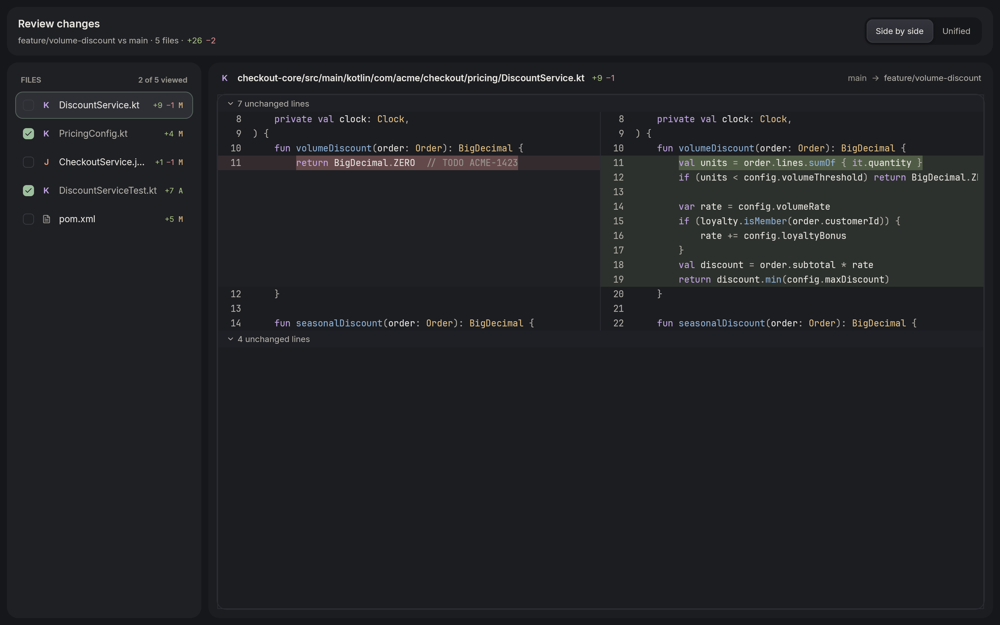
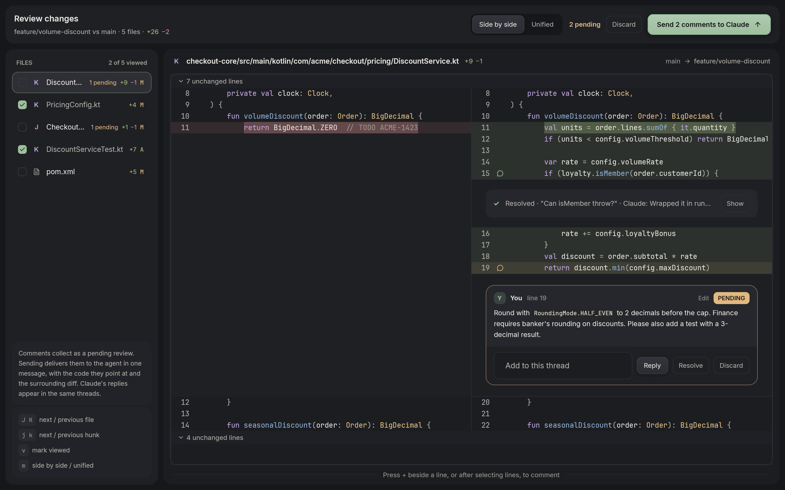
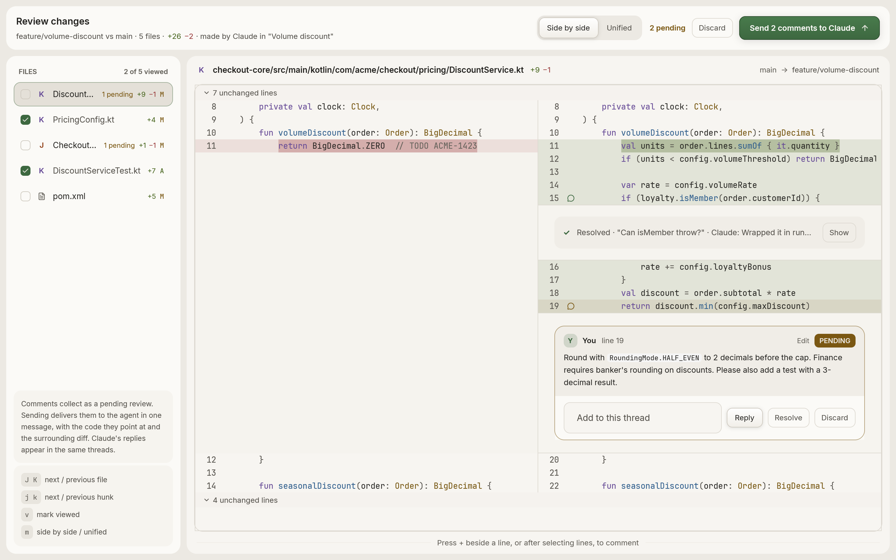
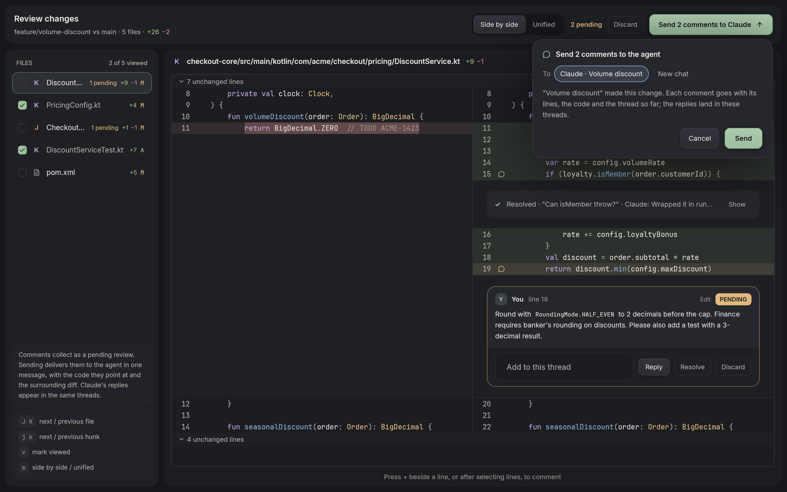
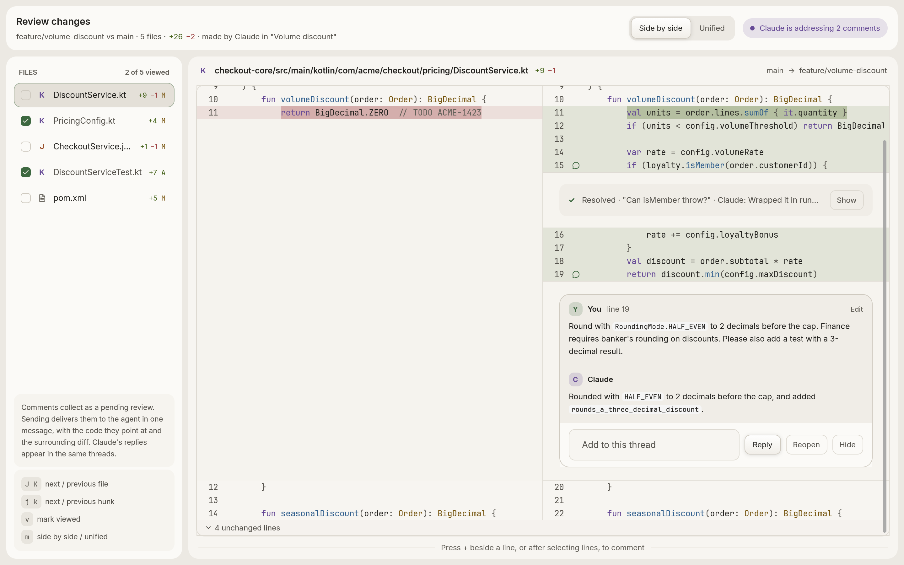
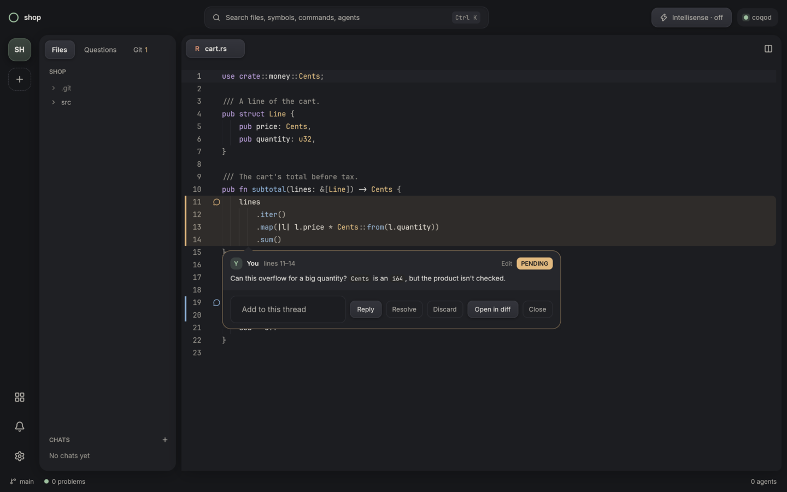
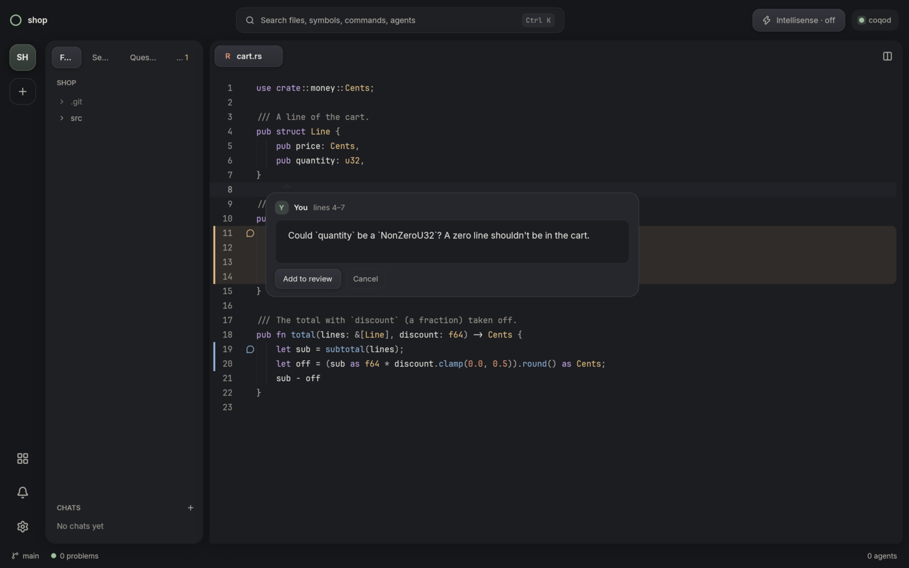

# Diff review

This page covers the review surface of board 4 ("Diff review"): a file list with "viewed" checkboxes, and one file's diff side by side or unified. It comes from PLAN §7.7, issue #93 and [ADR 0021](../adr/0021-diff-view.md).

- **Code:** `crates/coqo/src/diff/` (`DiffView`, the sources, hunks, viewed marks) on `coqo_ui::diff` (the body, over gpui-component's `Diff`).
- **Where it shows:** the `git-diff` tab, one per root and side (see [git.md](git.md)). Walkthroughs (#100) and pull requests (#103) reuse it with their own sources.
- **Screenshots:** offscreen renders from `diff_screenshots`:
  `COQO_SHOT_DIR=<dir> cargo test -p coqo -- --ignored diff_screenshots`.

## Layout

The tab is padded 10 px, with 10 px between its parts, as the board's window is.

- **Header card:** `panel_raised`, at the panel radius.
  - **Left:** "Review changes" at 15 px semibold. Below it, at 12 px in `text_muted`: `<head> vs <base> · N files ·`, then the total `+a` in `green` and `−d` in `rose`.
  - **Right:** the layout toggle, a segmented control on `ground` (3 px padding, radius 12). It holds "Side by side" and "Unified"; the chosen one is raised in `text`, the other is flat in `text_muted`.
- **Files card:** 280 px wide, `panel_raised`, with 12 px padding.
  - **Head row:** the `FILES` section label, and `n of m viewed` in `text_subtle` on the right.
  - **Rows:** radius 11, 13 px text. Each row holds:
    - the checkbox: 16 px, radius 5, a `border_strong` hairline, or `sage` with a `ground` check mark when viewed;
    - the file's language glyph (`files/glyph.rs`, as in the Files pane);
    - the file name, in `text`, or `text_muted` once viewed, cut with an ellipsis when it is too long. A name that appears twice in the list gets its folder's name in front (`pricing/mod.rs`); the full path is in the diff card's header;
    - on the right, `+a` in `green` and `−d` in `rose` (or `binary`), then the change letter in mono semibold: `M` in `sand`, `A` in `green`, `D` in `rose`, `?` in `text_subtle`, `T` in `lavender`.
  - **Row states:** the shown file is `surface_selected` with a `sage` hairline at 40%. Other rows get a `surface` hover.
  - **Clicks:** clicking a row shows that file. Clicking its checkbox only marks it.
  - **Key hints:** at the bottom, a `surface` card at 50%, with key caps: `J K` file, `j k` hunk, `v` viewed, `m` layout.
- **Diff card:** `panel`, at the panel radius.
  - **File header:** the glyph, the path in semibold, `+a −d`, then, on the right, `base → head` in `text_subtle` and `text_muted`. With lines selected in a stageable diff, a raised **Stage n lines** (or **Unstage n lines**) button sits before the sides.
  - **Error band:** a failed stage shows git's message on a `rose` 12% band under the header. Clicking the band dismisses it.
  - **Body:** in a card inset 12 px, with radius 14 and a `border` hairline.
  - **Footer:** in a stageable diff, a centred hint between two hairlines: "Drag line numbers to select lines, or use a hunk's button, to stage".

## The body

- **Type:** mono at 13 px on a 20.8 px row (gpui-component's 1.6 line height). Board 4 has 12.5 px on 23 px. The component sizes rows from the theme's mono size, and the editor's 13 px is kept for both.
- **Gutter:** line numbers in `text_muted`. In split mode, the old side's numbers are on the left and the new side's on the right.
- **Line tints:** removed lines are `rose` at 12% and added lines `green` at 12%. Changed words between paired lines are the same colour at 30%. Split mode shows no signs (as on the board), and unified mode shows `+` and `−`. A line with no counterpart in split mode gets an empty filler.
- **Syntax:** the editor's highlight theme (keywords `lavender`, types `bolt`, functions `blue`, strings `green`, comments `text_subtle` italic) on both sides.
- **Folds:** unchanged runs fold to three lines of context. A fold row holds "N unchanged lines" (opens all of them), plus up and down arrows that open 20 lines at a time when the run is longer than that.
- **Staging (git sources):** each hunk's first changed line has a button in the marker lane: `+` to stage or `−` to unstage, in `sage`, with a `surface_strong` hover. Drag over the line numbers to select lines; `Shift` extends the selection.

## Comment threads

Threads and the pending review come from #94, sending it to the agent from #95, and both are in [ADR 0022](../adr/0022-review-threads.md). The code is in `crates/coqo/src/threads/` (`WorkspaceThreads`, `ThreadsOverlay`), and the overlay is attached to every `git-diff` tab. Screenshots are offscreen renders from `threads_screenshots`:
`COQO_SHOT_DIR=<dir> cargo test -p coqo -- --ignored threads_screenshots`.

(`threads-send-light.png` and `threads-addressing-dark.png` are the other appearances.)

- **Starting one:**
  - The `+` beside the hovered line, or at the end of a selection (drag the line numbers), opens a composer under that line.
  - The composer is a `surface` card, radius 16, with a `border_strong` hairline. It holds a "You · line N" head, a "Leave a comment" field, a raised **Add to review** button and a flat **Cancel**. `Enter` adds, and `Esc` cancels.
  - A new comment is *pending*.
- **Where it shows:** a thread shows on the side whose file version it was made on, under its last line. A thread on the whole file, or one whose code changed away or is outside the diff, shows under the file's header ("Outdated", with the original code in mono).
- **Thread card** (as on board 4):
  - The card is `surface`, radius 16, with a `border_strong` hairline, or `sand` at 50% while pending.
  - **Each comment:**
    - a 22 px avatar (radius 8): the author's initial on their colour at 18%. The user is `sage`, an agent `lavender`, and GitHub `blue`;
    - the name in semibold, and "line N" on the first comment;
    - "edited", when the comment was edited;
    - on the right, **Edit** (the user's comments) and a `sand` **PENDING** pill with `ground` text;
    - the body, rendered as markdown.
  - **Footer band** (`panel_raised`):
    - the "Add to this thread" field (`Enter` adds a pending reply);
    - a raised **Reply** button;
    - flat **Resolve** or **Reopen**;
    - **Discard**, which drops the user's pending comments, and the thread with them if nothing else is left.
- **Resolved threads** fold to one `surface` row: a `sage` ✓, `Resolved · "first comment" · last comment`, and a **Show** button.
- **Gutter and tints:**
  - A `MessageCircle` marker on the thread's first line: `sand` while it has pending comments, `sage` once it is resolved, `blue` otherwise. Clicking it focuses the reply field, or opens a resolved thread.
  - Pending threads' lines are tinted `sand` at 10%.
- **The pending review:**
  - **Header, after the layout toggle:** "N pending" in `sand` semibold, a flat **Discard**, and the primary **Send N comments to Claude ↑** (the default chat's agent; #95).
  - **Send popover** (#95), under the button, as the ask popover (#229): a `MessageCircle` in `sage` and "Send N comments to the agent"; a "To" row of pills, one per chat ("Claude · <chat title>", the default first and selected in `blue`) and **New chat**; a muted note ("\"<chat>\" made this change. Each comment goes with its lines, the code and the thread so far; the replies land in these threads."); an error line in `rose` (a chat in a turn: "\"<chat>\" is in the middle of a turn. Wait for it to finish or pick another chat; your N comments stay pending."); raised **Cancel** and primary **Send** ("Sending…" while it goes). A click outside closes it.
  - **While the agent addresses the review:** a `lavender` pill at 14% in the header, a dot and "Claude is addressing N comments". Replies land in the cards live, with the agent's `lavender` avatar and name. A thread the agent resolves stays open until the turn ends, then folds; the folded row names the agent: `Resolved · "first" · Claude: last`.
  - **File rows:** "N pending" in `sand` before the stats.
  - **Note under the file list:** a `surface` card at 50% that explains the pending review (the board's text).
  - **Footer hint:** "Press + beside a line, or after selecting lines, to comment", joined to the staging hint.
  - The counts cover threads started in this diff.

## Keyboard

The keys work while the diff has focus (click the code or a file row):

- `j` / `k`: next and previous hunk;
- `Shift J` / `Shift K`: next and previous file;
- `v`: mark the shown file viewed, or not;
- `m`: side by side or unified.

The body's own keys also work: arrows and page keys scroll, `Ctrl C` / `Cmd C` copies the selection.

## State

- **Layout:** the last one chosen, per workspace (`ui.diff.mode`).
- **Viewed:** per workspace and diff (for example "this root's unstaged changes"). A mark holds the file's change: when the change differs (new edits, or a hunk staged out of it), the file is no longer viewed. The tab label shows `viewed/total`.

## In file tabs (#258)

Light: [file tab](screenshots/file-threads-light.png). Offscreen renders from `file_threads_screenshots`: `COQO_SHOT_DIR=<dir> cargo test -p coqo -- --ignored file_threads_screenshots`.

A thread is visible where the code is edited, not only in the diff.

- **Which threads:** those pinned to the **work tree** version of the open file (`version: worktree`, the new side of the unstaged diff), whose code was found. Threads pinned to the **index** or a **revision** are not shown in file tabs: their text is not what the tab edits, and their lines may not exist in it. The staged diff and the PR view show them. Orphaned threads ("Outdated") show in the diff only.
- **Marker:** a 13 px `MessageCircle` in the gutter gap on the thread's first line, as in the diff: `sand` while it has pending comments, `blue` when open, `sage` once resolved, with the 3 px strip over its lines and, while pending, the `sand` 10% band. **Resolved threads are hidden** unless "Toggle resolved review threads in files" (command palette, Review category) shows them; the choice is per workspace, for the session.
- **Where:** the daemon resolves a thread's anchor against the saved file. The marker follows edits in the tab while the daemon's lines stay what they were when it was placed; saving the file lists the threads again, and the new lines win.
- **Click:** opens the thread's card in place, under its lines (the same card as in the diff: comments, the reply field, **Reply**, **Resolve** / **Reopen**, **Discard** of pending comments, **Edit** of the user's own; a resolved thread does not fold), with the keyboard in the reply field, plus **Open in diff** (the root's unstaged diff, at the thread) and **Close**. `Esc` closes it (outside the field). A reply is pending, as in the diff, and shows there at once: both follow the workspace's `WorkspaceThreads`.
- **Stacking:** a review thread ranks below an agent's question and above a walkthrough step; a resolved one below everything (see [Markers on one line](walkthrough.md#markers-on-one-line)).

### Starting a thread in a file tab (#311)

Light: [composer](screenshots/file-comment-light.png). Offscreen renders from `file_comment_screenshots`: `COQO_SHOT_DIR=<dir> cargo test -p coqo -- --ignored file_comment_screenshots`.

- **Entry points:**
  - **Add review comment** (command palette, Review category), `Ctrl Shift M` (`Cmd Shift M` on macOS) in a file tab. It comments on the selected lines, or the cursor's line without a selection; a selection ending at the start of a line leaves that line out (as asking about code).
  - **Alt-click** (`Option`-click on macOS) on the gutter's blue ask button (#229, [questions.md](questions.md#asking-about-code-229)). A plain click still asks an agent: the one button keeps its one-click meaning, and the gutter gap stays one glyph wide. A menu on the button was considered and left out: it would cost asking a second click.
- **The composer:** the diff's own (the `surface` card, "You · lines 3–5", "Leave a comment", raised **Add to review**, flat **Cancel**), drawn over the code under the lines as the thread card is, with the keyboard in its field. `Enter` adds; `Esc` cancels, and the keyboard goes back to the code. Typing in the field fires no shortcut (the tab's keys are behind a modifier, and view keys are kept out of text fields, #266).
- **The thread:** `threads/create` on the **work tree** version of the file (`version: worktree`, `side: new`), the lines 1-based, `diff: git:<root>:index..worktree`, pending. So it is in the root's **unstaged diff**: its "N pending", the file row's count, and **Send N comments to <agent>** (#95) count it, and its card shows there.
- **Afterwards:** the composer gives way to the new thread's card at its sand marker, with the keyboard on the card (`Esc` closes it; a click in the field replies).
- **Unsaved edits:** the daemon pins a thread to the saved file, whose lines may differ from the tab's. While the tab has unsaved edits the composer opens anyway, with a `sand` note, "Save the file first: review comments are pinned to the saved file.", and **Add to review** waits. Saving (`Ctrl S` works from the field) lifts it. Coqo never saves for the user.
- **Not in** a walkthrough player's own tab, which shows no review threads.
- **Not yet:** threads on the index or a revision from a file tab.

## Not yet (later issues)

These parts of board 4 come with the issues that give them meaning:

- The **Walkthrough overlay** button. The walkthrough player (#100, [walkthrough.md](walkthrough.md)) shows its change in a `DiffView` of its own instead, with its steps as an overlay.
- Provenance ("made by Claude in …") in the header, and defaulting the send target to the session that made the change after its chat is closed (#286).
