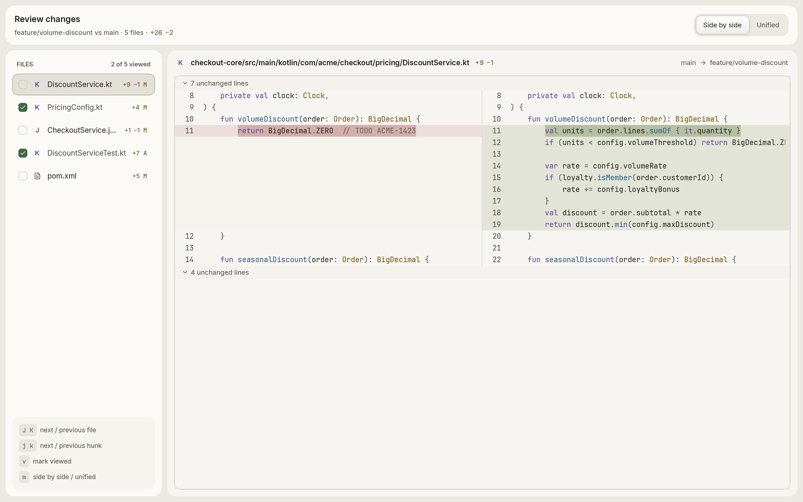

# Diff review

This page covers the review surface of board 4 ("Diff review"): a file list with "viewed" checkboxes, and one file's diff side by side or unified. It comes from PLAN §7.7, issue #93 and [ADR 0021](../adr/0021-diff-view.md).

- **Code:** `crates/coqo/src/diff/` (`DiffView`, the sources, hunks, viewed marks) on `coqo_ui::diff` (the body, over gpui-component's `Diff`).
- **Where it shows:** the `git-diff` tab, one per root and side (see [git.md](git.md)). Walkthroughs (#100) and pull requests (#103) reuse it with their own sources.
- **Screenshots:** offscreen renders from `diff_screenshots`:
  `COQO_SHOT_DIR=<dir> cargo test -p coqo -- --ignored diff_screenshots`.

## Layout

The tab is padded 10 px, with 10 px between its parts, as the board's window is.

- **Header card:** `panel_raised`, at the panel radius.
  - **Left:** "Review changes" at 15 px semibold. Below it, at 12 px in `text_muted`: `<head> vs <base> · N files ·`, then the total `+a` in `green` and `−d` in `rose`.
  - **Right:** the layout toggle, a segmented control on `ground` (3 px padding, radius 12). It holds "Side by side" and "Unified"; the chosen one is raised in `text`, the other is flat in `text_muted`.
- **Files card:** 280 px wide, `panel_raised`, with 12 px padding.
  - **Head row:** the `FILES` section label, and `n of m viewed` in `text_subtle` on the right.
  - **Rows:** radius 11, 13 px text. Each row holds:
    - the checkbox: 16 px, radius 5, a `border_strong` hairline, or `sage` with a `ground` check mark when viewed;
    - the file's language glyph (`files/glyph.rs`, as in the Files pane);
    - the file name, in `text`, or `text_muted` once viewed, cut with an ellipsis when it is too long. A name that appears twice in the list gets its folder's name in front (`pricing/mod.rs`); the full path is in the diff card's header;
    - on the right, `+a` in `green` and `−d` in `rose` (or `binary`), then the change letter in mono semibold: `M` in `sand`, `A` in `green`, `D` in `rose`, `?` in `text_subtle`, `T` in `lavender`.
  - **Row states:** the shown file is `surface_selected` with a `sage` hairline at 40%. Other rows get a `surface` hover.
  - **Clicks:** clicking a row shows that file. Clicking its checkbox only marks it.
  - **Key hints:** at the bottom, a `surface` card at 50%, with key caps: `J K` file, `j k` hunk, `v` viewed, `m` layout.
- **Diff card:** `panel`, at the panel radius.
  - **File header:** the glyph, the path in semibold, `+a −d`, then, on the right, `base → head` in `text_subtle` and `text_muted`. With lines selected in a stageable diff, a raised **Stage n lines** (or **Unstage n lines**) button sits before the sides.
  - **Error band:** a failed stage shows git's message on a `rose` 12% band under the header. Clicking the band dismisses it.
  - **Body:** in a card inset 12 px, with radius 14 and a `border` hairline.
  - **Footer:** in a stageable diff, a centred hint between two hairlines: "Drag line numbers to select lines, or use a hunk's button, to stage".

## The body

- **Type:** mono at 13 px on a 20.8 px row (gpui-component's 1.6 line height). Board 4 has 12.5 px on 23 px. The component sizes rows from the theme's mono size, and the editor's 13 px is kept for both.
- **Gutter:** line numbers in `text_muted`. In split mode, the old side's numbers are on the left and the new side's on the right.
- **Line tints:** removed lines are `rose` at 12% and added lines `green` at 12%. Changed words between paired lines are the same colour at 30%. Split mode shows no signs (as on the board), and unified mode shows `+` and `−`. A line with no counterpart in split mode gets an empty filler.
- **Syntax:** the editor's highlight theme (keywords `lavender`, types `bolt`, functions `blue`, strings `green`, comments `text_subtle` italic) on both sides.
- **Folds:** unchanged runs fold to three lines of context. A fold row holds "N unchanged lines" (opens all of them), plus up and down arrows that open 20 lines at a time when the run is longer than that.
- **Staging (git sources):** each hunk's first changed line has a button in the marker lane: `+` to stage or `−` to unstage, in `sage`, with a `surface_strong` hover. Drag over the line numbers to select lines; `Shift` extends the selection.

## Keyboard

The keys work while the diff has focus (click the code or a file row):

- `j` / `k`: next and previous hunk;
- `Shift J` / `Shift K`: next and previous file;
- `v`: mark the shown file viewed, or not;
- `m`: side by side or unified.

The body's own keys also work: arrows and page keys scroll, `Ctrl C` / `Cmd C` copies the selection.

## State

- **Layout:** the last one chosen, per workspace (`ui.diff.mode`).
- **Viewed:** per workspace and diff (for example "this root's unstaged changes"). A mark holds the file's change: when the change differs (new edits, or a hunk staged out of it), the file is no longer viewed. The tab label shows `viewed/total`.

## Not yet (later issues)

These parts of board 4 come with the issues that give them meaning:

- Comment threads and the "pending" counts in the file list (#94).
- **Send N comments to Claude** and the pending-review note under the file list (#95).
- The **Walkthrough overlay** button. The walkthrough player (#100, [walkthrough.md](walkthrough.md)) shows its change in a `DiffView` of its own instead, with its steps as an overlay.
- Provenance ("made by Claude in …") in the header.
