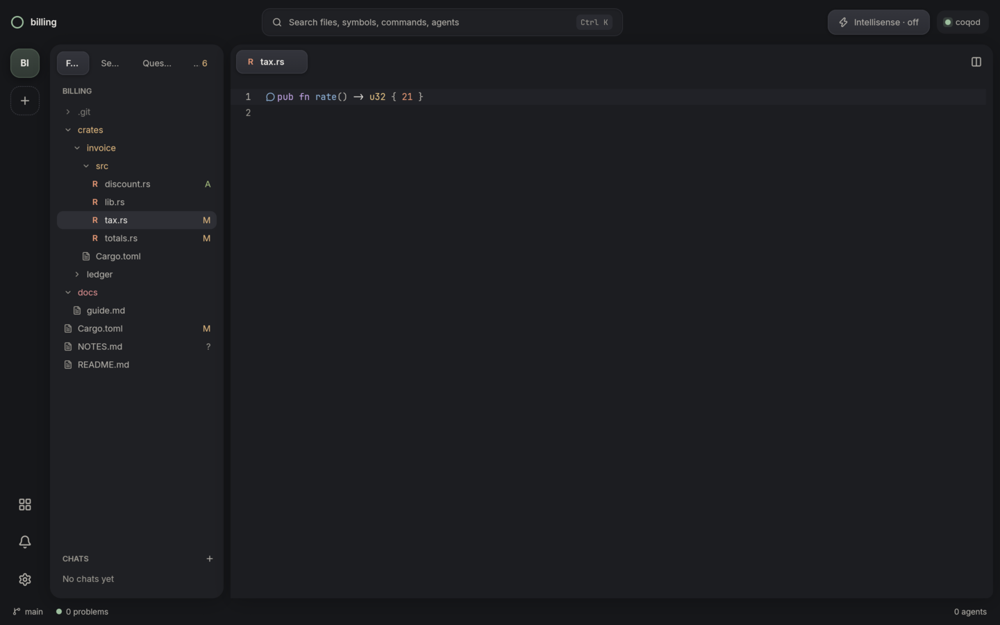
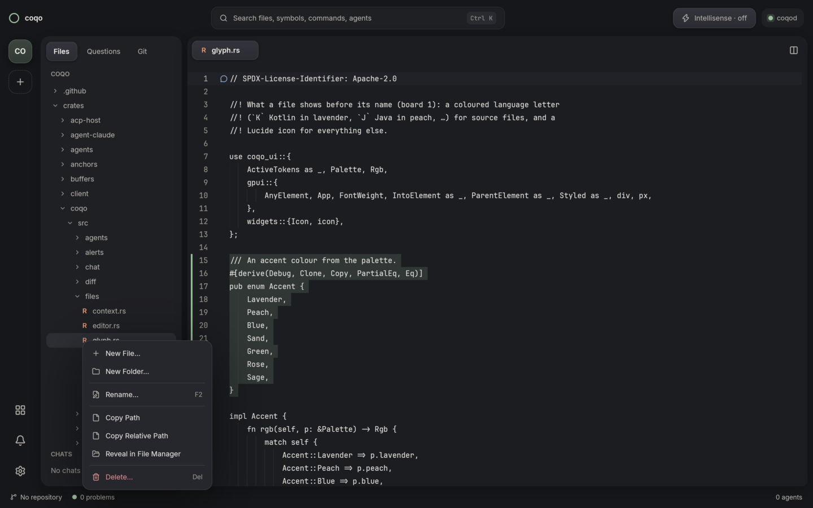
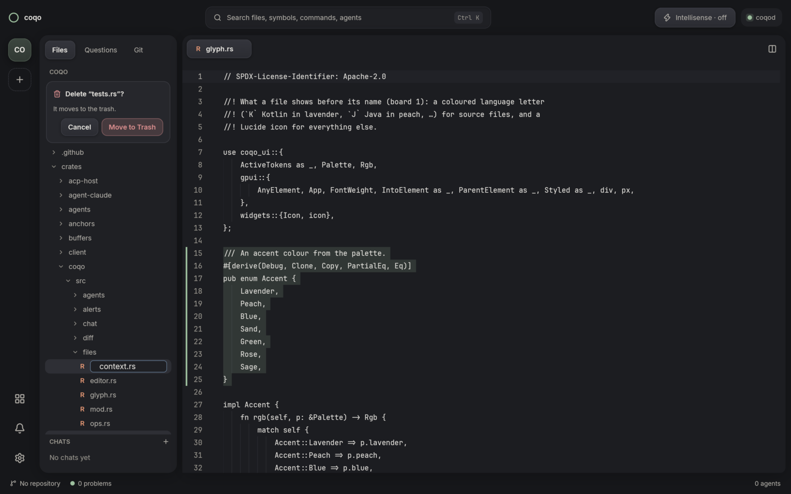
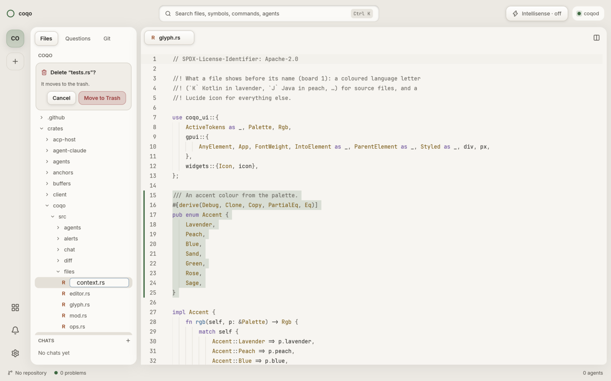
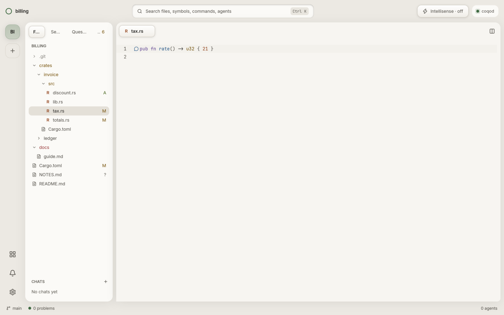

# Files pane and file tabs

The Files sidebar pane and the `file` tab kind (design board 1, PLAN §6 `files`). The code is in `crates/coqo/src/files/`; it moves into a `files` mod once the mod API carries UI contributions.

## The tree

- **Header:** the workspace name as an upper-case section label (`COQO`).
- **Rows:** 26 px, `text_sm`, `text_muted`, 8 px left padding plus 13 px per level, rounded 9 px. The selected row is `surface_selected` with `text`; a hovered row is `surface`.
- **Folders:** a 12 px Lucide chevron (`chevron-right` / `chevron-down`) in `text_subtle`, then the name. Folders come first, then files, each sorted by name (the daemon's order).
- **Files:** a 16 px glyph slot, then the name. Source files get a coloured language letter as on the board: `K` Kotlin in `lavender`, `J` Java and `R` Rust in `peach`, `TS`/`Py`/`Go`/`C` in `blue`, `JS` in `sand`, and so on (`files/glyph.rs`). Other files get a muted Lucide icon: `file-text` for docs and config, `image` for images, `file-code` for other code, `file` otherwise.
- **Ignored entries** (`.gitignore`, `.git/info/exclude`, global excludes, `.git`, and folders that stand apart: nested repositories and worktrees, `CACHEDIR.TAG` caches such as `target/`, `node_modules`) are listed but dimmed: `text_subtle` at 75% opacity. They can be expanded, but nothing inside them is watched, so they don't refresh live ([ADR 0027](../adr/0027-watcher-ignored-folders.md)).
- **Git status:** a changed file's row ends in its `git status` letter, right-aligned in the row's font: `M` in `sand`, `A` in `green`, `D` in `rose`, `?` (untracked) in `text_subtle`, `U` (conflict) in `rose` and `T` (type change) in `lavender`. The work tree's change wins over the staged one, and a rename is a `D` and an `A` (git's status, ADR 0018). A folder with changes inside has its name tinted in the colour of the strongest one: a conflict, then a modification, a deletion, a type change, then new files (added or untracked) in `green`. A deleted file has no row, so its folder's tint is what shows it. In a multi-root workspace each root has its own letters, and a root's row is tinted too. The letters follow `git/changes`, so a commit or a checkout made anywhere updates them.
- **No folder:** "No folder open" and a raised **Open Folder…** button with its shortcut.

**Row decorations.** The tree doesn't know about git: it draws what row decoration providers give it (`files/decorations.rs`), a letter and a colour (a palette role) per path and a tint per folder, per root. The git status letters are one provider (`git/decorations.rs`), fed by the window's `GitModel`. When the mod API carries UI contributions (#147), this becomes the files mod's contribution point.

**Reveal.** **Reveal active file in tree** (palette) expands the file's folders, selects and scrolls to its row and moves the keyboard to the tree. With **auto-reveal** on, switching to a file tab does the same without moving the focus (not while a name is typed or a delete waits in the tree). It's off by default: `auto_reveal = true` under `[files]` in `settings.toml` (Coqo's config directory, PLAN §8, read at start until the settings service, #26) turns it on, and the palette's **Toggle auto-reveal active file in tree** flips it for the running app.

The tree is virtualised (`uniform_list`): only the rows on screen are laid out, so a folder with tens of thousands of entries scrolls like a small one. Folders are listed with `fs/list` the first time they're expanded. `fs/changes` re-lists the loaded folders it touches (all of them on `rescan`), and the tree re-lists everything it shows after a daemon reconnect.

### 200k entries

`files_scroll_benchmark` (an ignored test, `cargo test -p coqo -- --ignored files_scroll_benchmark --nocapture`) makes 200 folders of 1,000 empty files under `target/` (deleted afterwards), expands them all (200,200 rows) and times whole-window frames (`render_frame`, offscreen, no GPU raster) while scrolling three rows a frame like a wheel and while jumping across the list like a scrollbar drag. On a Ryzen 5 7600, debug build:

| | p50 | p95 | max |
|---|---|---|---|
| 200 rows (folders collapsed), wheel, 600 frames | 6.74 ms | 6.82 ms | 7.73 ms |
| 200,200 rows, wheel, 600 frames | 6.81 ms | 6.88 ms | 8.77 ms |
| 200,200 rows, jumps, 300 frames | 6.80 ms | 6.91 ms | 7.62 ms |
| Rebuilding the 200,200-row list (a folder collapsed or expanded, a listing landing) | 44.1 ms | 46.0 ms | 46.0 ms |

A frame costs the same with 1,000 times the rows, well inside 16.7 ms (60 Hz), so scrolling is smooth. What grows with the tree is the flat row list, rebuilt on each change: 44 ms in a debug build for 200k expanded rows (expanding the 200 folders one by one took 7.3 s, as each listing rebuilds it; #330 makes it incremental). The test fails if a 200k-row frame costs more than 1.5× a 200-row one, and, in a release build, if the p95 is over 16.7 ms.

## Keyboard

With the tree focused (click a folder, or move with the arrows; opening a file puts the keyboard in its tab): `Up`/`Down` select, `Right` expands a folder or steps into it, `Left` collapses a folder or selects its parent, `Enter` opens a file or toggles a folder. `F2` renames the selected entry in place, `Delete` (also `Cmd Backspace` on macOS) asks to delete it, and `Escape` closes a menu, a confirmation or an error. These are plain keys only in the tree (`coqo_ui::keys::binding`), so they never fire while a name is being typed. `Ctrl O` (`Cmd O` on macOS) opens a folder from anywhere in the window, and `Ctrl P` (`Cmd P`) finds a file by name ([the file finder](palette.md#the-file-finder)).

## File operations

- **Context menu** (right-click a row; the empty space below the rows is the root): New File…, New Folder…, Rename… `F2`, Copy Path, Copy Relative Path, Reveal in File Manager (Finder on macOS), and Delete… `Del` in `rose` below a separator. Roots of a multi-root workspace have no Rename or Delete. The menu is the `popover` card (`surface`, `border_strong` hairline, 14 px radius) at the pointer, 230 px wide, with 14 px `text_muted` Lucide icons and the shortcut right-aligned in `text_subtle`, like the rail's workspace menu.
- **Naming in place.** New entries and renames are typed in the row itself: a 22 px field on `panel_raised` with a `blue` hairline (`rose` while the name is refused), in a `surface_selected` row. A new entry's row sits at the top of its folder, with a muted `file` or `folder` icon. `Enter` sends, `Escape` cancels, clicking elsewhere sends. A name may contain `/` (`docs/guide.md` makes `docs` too). The new or renamed entry is selected; a new file opens in a tab.
- **Delete** asks first, in a card above the rows that names the entry ("Delete “tests.rs”?", "Delete the folder “src”?") and says where it goes: the OS trash. **Move to Trash** is `rose` (18% fill, 45% hairline), **Cancel** is raised; `Enter` confirms, `Escape` cancels. If an open tab has unsaved edits in what would be deleted, a `sand` line says they stay in the tab. If the trash refuses (no trash on that file system), the card offers **Delete Permanently** instead.
- **Drag a row onto a folder** (or a file in it, or the empty space for the root) to move it; the target row is tinted `blue` at 16% while hovered.
- **Errors** (a name that exists, no permission) show in a `surface` line with a `rose` alert icon above the rows.
- **Open tabs follow.** A rename or move keeps the tab's buffer, unsaved edits and undo; its title, key, language and saved path change (the daemon moves the buffer, `fs/rename`). Everything anchored to the file follows too: questions and notes (their markers stay on their lines), the user's threads, review threads, walkthrough steps and the editor context agents see, also for a folder's move and, on Linux while the tree is open, for a rename made outside Coqo ([ADR 0013](../adr/0013-anchors.md)). After a delete, a clean tab shows "File not found"; a tab with unsaved edits keeps them, with a `sand` bar: saving writes the file again.
- **In the command palette** (category File): New file…, New folder…, Rename…, Delete…, Copy path, Copy relative path and Reveal act on the tree's selection, or, from a file tab, on its file: the Files pane comes up with the file revealed and the operation runs in the tree. **Reveal active file in tree** expands the file's folders, selects it and moves the keyboard to the tree ([palette.md](palette.md#what-it-lists)).
- **Undo / redo of file operations.** While the tree has focus (not its name field, not an editor, where the keys undo text), `Ctrl Z` / `Cmd Z` undoes the window's last create, rename, move or delete, and `Ctrl Shift Z` / `Cmd Shift Z` (also `Ctrl Y` off macOS) redoes it; the palette has **Undo file operation** and **Redo file operation**. A small `popover` toast at the bottom of the pane says what happened for 4 s ("Undid rename of “a.rs” → “b.rs”"), and the context menu starts with **Undo …** / **Redo …** rows (`History` icon). A rename or move goes back, and everything anchored follows again. A new entry still empty is removed; one that changed since asks first, in the delete card ("Undo the creation of “x”?"), and goes to the trash. A delete comes back from the OS trash (Linux, Windows) or, on macOS, from a copy Coqo keeps of entries up to 16 MiB; one that can't come back (deleted for good, too large) shows greyed in the menu with why, and `Ctrl Z` says so in the toast. The history holds the last 100 operations, per window, and starts again with each workspace.

## File tabs

Clicking a file opens a `file` tab, keyed by workspace, root and path, so opening it again shows the open tab. The tab label is the file's glyph and name, followed by a 7 px `text_muted` dot while the buffer has unsaved changes. Binary and non-UTF-8 files, files over 4 MiB, and deleted files show a centred message instead of the editor.

## The editor

The tab is an editor on the daemon's replicated buffer (`files/editor.rs`, ADR 0006, ADR 0010), built on `coqo_ui::editor::CodeEditor` (gpui-component's editor, ADR 0002 and ADR 0008). It matches the code area of design board 2:

- **Text:** JetBrains Mono 13 px on 23 px lines, on the `panel` surface, no border. Line numbers are right-aligned in `text_subtle` (the cursor's line in `text_muted`), 20 px from the code. Indent guides are on, soft wrap is off, and the cursor's line has a faint `surface` band.
- **Syntax:** tree-sitter, for Rust, TypeScript/TSX, JavaScript/JSX, Java, Kotlin, JSON, TOML, Markdown, YAML, HTML, CSS and XML, picked by file name, extension or `#!` line from `coqo-syntax`'s registry (`editor::language_for`, ADR 0011); other files are plain text. Keywords are `lavender`, types `bolt`, functions `blue`, strings `green`, numbers and constants `peach`, comments `text_subtle` italic, punctuation and operators `text_muted` (`theme::highlight_theme`).
- **Changes made elsewhere** (agents, other programs, other windows and splits) land live, and the cursors stay on their text. Changes by an agent are tinted `sage` (16% fill, plus a gutter mark) for 2.5 s, changes by other programs `peach`, and a change that overlapped unsaved edits `sand`. Other windows' typing isn't tinted.
- **Undo / redo** (`Ctrl Z` / `Ctrl Y`, `Cmd Z` / `Cmd Shift Z`) revert only this tab's own edits, never an agent's or another window's.
- **Save** is `Ctrl S` / `Cmd S`. If the file changed on disk since it was read, the change is merged into the buffer and a `surface` bar with a `sand` alert icon offers **Reload from disk** (drop the unsaved edits; undo brings them back) and **Overwrite**. Other save errors show in the same bar with a `rose` icon and **Dismiss**.
- **Questions and notes** an agent pinned to the file show as gutter markers with a tinted range, and open in a popover anchored to the code ([questions.md](questions.md)).
- **Find** is gpui-component's search panel: `Ctrl F` / `Cmd F`, replace with `Ctrl H` / `Cmd Shift F`. Folding and multi-cursor (add a cursor above or below) are gpui-component's too.

Remote changes wait while an IME composition is in progress and apply when it ends. After a reconnect the tab reopens its buffer with the same replica id and resyncs (buffer ids don't survive a daemon restart), resending any edits the daemon didn't get.

## Light appearance

To regenerate these screenshots, run `COQO_SHOT_DIR=<dir> cargo test -p coqo -- --ignored files_screenshots` (offscreen, needs a GPU) and downscale the 2× PNGs to 1440×900 as `files-<appearance>.png` (and `coqo-editor-dark.png` as `editor-dark.png`, `coqo-files-menu-dark.png` as `files-menu-dark.png`, `coqo-files-ops-<appearance>.png` as `files-ops-<appearance>.png`). The git status screenshots come from `files_status_screenshots` the same way (`coqo-files-status-<appearance>.png` as `files-status-<appearance>.png`).
