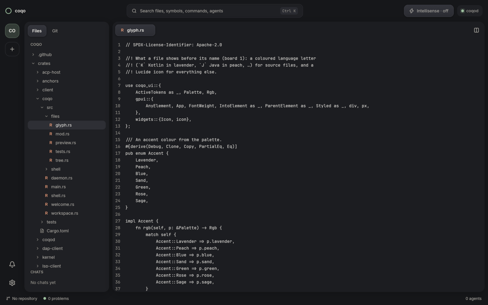
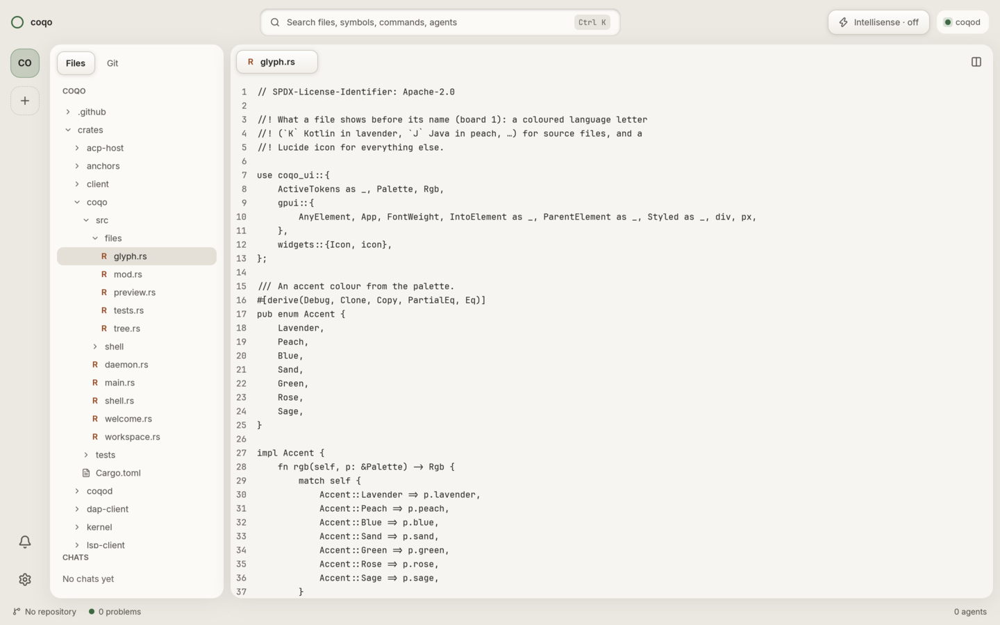

# Files pane and file tabs

The Files sidebar pane and the `file` tab kind (design board 1, PLAN §6 `files`). The code is in `crates/coqo/src/files/`; it moves into a `files` mod once the mod API carries UI contributions.

## The tree

- **Header:** the workspace name as an upper-case section label (`COQO`).
- **Rows:** 26 px, `text_sm`, `text_muted`, 8 px left padding plus 13 px per level, rounded 9 px. The selected row is `surface_selected` with `text`; a hovered row is `surface`.
- **Folders:** a 12 px Lucide chevron (`chevron-right` / `chevron-down`) in `text_subtle`, then the name. Folders come first, then files, each sorted by name (the daemon's order).
- **Files:** a 16 px glyph slot, then the name. Source files get a coloured language letter as on the board: `K` Kotlin in `lavender`, `J` Java and `R` Rust in `peach`, `TS`/`Py`/`Go`/`C` in `blue`, `JS` in `sand`, and so on (`files/glyph.rs`). Other files get a muted Lucide icon: `file-text` for docs and config, `image` for images, `file-code` for other code, `file` otherwise.
- **Ignored entries** (`.gitignore`, `.git/info/exclude`, global excludes, `.git`) are listed but dimmed: `text_subtle` at 75% opacity.
- **No folder:** "No folder open" and a raised **Open Folder…** button with its shortcut.

The tree is virtualised (`uniform_list`): only the rows on screen are laid out, so a folder with tens of thousands of entries scrolls like a small one. Folders are listed with `fs/list` the first time they're expanded. `fs/changes` re-lists the loaded folders it touches (all of them on `rescan`), and the tree re-lists everything it shows after a daemon reconnect.

## Keyboard

With the tree focused (click a row): `Up`/`Down` select, `Right` expands a folder or steps into it, `Left` collapses a folder or selects its parent, `Enter` opens a file or toggles a folder. `Ctrl O` (`Cmd O` on macOS) opens a folder from anywhere in the window.

## File tabs

Clicking a file opens a `file` tab, keyed by workspace, root and path, so opening it again shows the open tab. The tab label is the file's glyph and name. For now the tab is a read-only preview: the text from `fs/read` in JetBrains Mono at `text_sm`, 20 px lines, line numbers right-aligned in `text_subtle`, virtualised like the tree. It reloads when the file changes on disk. Binary files, files over the 4 MiB read limit, and deleted files show a centred message instead. The editor (#41) replaces this view under the same tab kind.

## Light appearance

To regenerate these screenshots, run `COQO_SHOT_DIR=<dir> cargo test -p coqo -- --ignored files_screenshots` (offscreen, needs a GPU) and downscale the 2× PNGs to 1440×900 as `files-<appearance>.png`.
