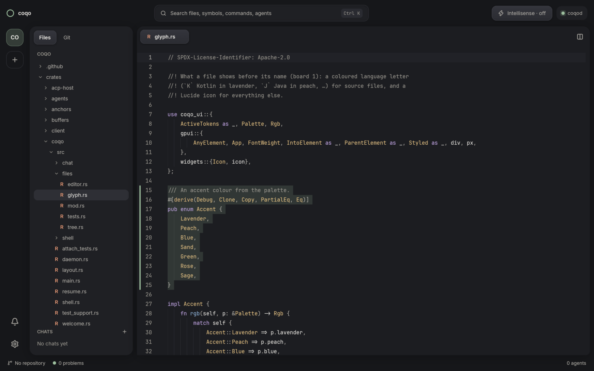

# Files pane and file tabs

The Files sidebar pane and the `file` tab kind (design board 1, PLAN §6 `files`). The code is in `crates/coqo/src/files/`; it moves into a `files` mod once the mod API carries UI contributions.

## The tree

- **Header:** the workspace name as an upper-case section label (`COQO`).
- **Rows:** 26 px, `text_sm`, `text_muted`, 8 px left padding plus 13 px per level, rounded 9 px. The selected row is `surface_selected` with `text`; a hovered row is `surface`.
- **Folders:** a 12 px Lucide chevron (`chevron-right` / `chevron-down`) in `text_subtle`, then the name. Folders come first, then files, each sorted by name (the daemon's order).
- **Files:** a 16 px glyph slot, then the name. Source files get a coloured language letter as on the board: `K` Kotlin in `lavender`, `J` Java and `R` Rust in `peach`, `TS`/`Py`/`Go`/`C` in `blue`, `JS` in `sand`, and so on (`files/glyph.rs`). Other files get a muted Lucide icon: `file-text` for docs and config, `image` for images, `file-code` for other code, `file` otherwise.
- **Ignored entries** (`.gitignore`, `.git/info/exclude`, global excludes, `.git`) are listed but dimmed: `text_subtle` at 75% opacity.
- **No folder:** "No folder open" and a raised **Open Folder…** button with its shortcut.

The tree is virtualised (`uniform_list`): only the rows on screen are laid out, so a folder with tens of thousands of entries scrolls like a small one. Folders are listed with `fs/list` the first time they're expanded. `fs/changes` re-lists the loaded folders it touches (all of them on `rescan`), and the tree re-lists everything it shows after a daemon reconnect.

## Keyboard

With the tree focused (click a row): `Up`/`Down` select, `Right` expands a folder or steps into it, `Left` collapses a folder or selects its parent, `Enter` opens a file or toggles a folder. `Ctrl O` (`Cmd O` on macOS) opens a folder from anywhere in the window.

## File tabs

Clicking a file opens a `file` tab, keyed by workspace, root and path, so opening it again shows the open tab. The tab label is the file's glyph and name, followed by a 7 px `text_muted` dot while the buffer has unsaved changes. Binary and non-UTF-8 files, files over 4 MiB, and deleted files show a centred message instead of the editor.

## The editor

The tab is an editor on the daemon's replicated buffer (`files/editor.rs`, ADR 0006, ADR 0010), built on `coqo_ui::editor::CodeEditor` (gpui-component's editor, ADR 0002 and ADR 0008). It matches the code area of design board 2:

- **Text:** JetBrains Mono 13 px on 23 px lines, on the `panel` surface, no border. Line numbers are right-aligned in `text_subtle` (the cursor's line in `text_muted`), 20 px from the code. Indent guides are on, soft wrap is off, and the cursor's line has a faint `surface` band.
- **Syntax:** tree-sitter, for Rust, TypeScript/TSX, JavaScript, Java, Kotlin, JSON, TOML, Markdown and YAML (`editor::language_for_path`); other files are plain text. Keywords are `lavender`, types `bolt`, functions `blue`, strings `green`, numbers and constants `peach`, comments `text_subtle` italic, punctuation and operators `text_muted` (`theme::highlight_theme`).
- **Changes made elsewhere** (agents, other programs, other windows and splits) land live, and the cursors stay on their text. Changes by an agent are tinted `sage` (16% fill, plus a gutter mark) for 2.5 s, changes by other programs `peach`, and a change that overlapped unsaved edits `sand`. Other windows' typing isn't tinted.
- **Undo / redo** (`Ctrl Z` / `Ctrl Y`, `Cmd Z` / `Cmd Shift Z`) revert only this tab's own edits, never an agent's or another window's.
- **Save** is `Ctrl S` / `Cmd S`. If the file changed on disk since it was read, the change is merged into the buffer and a `surface` bar with a `sand` alert icon offers **Reload from disk** (drop the unsaved edits; undo brings them back) and **Overwrite**. Other save errors show in the same bar with a `rose` icon and **Dismiss**.
- **Find** is gpui-component's search panel: `Ctrl F` / `Cmd F`, replace with `Ctrl H` / `Cmd Shift F`. Folding and multi-cursor (add a cursor above or below) are gpui-component's too.

Remote changes wait while an IME composition is in progress and apply when it ends. After a reconnect the tab reopens its buffer with the same replica id and resyncs (buffer ids don't survive a daemon restart), resending any edits the daemon didn't get.

## Light appearance

To regenerate these screenshots, run `COQO_SHOT_DIR=<dir> cargo test -p coqo -- --ignored files_screenshots` (offscreen, needs a GPU) and downscale the 2× PNGs to 1440×900 as `files-<appearance>.png` (and `coqo-editor-dark.png` as `editor-dark.png`).
