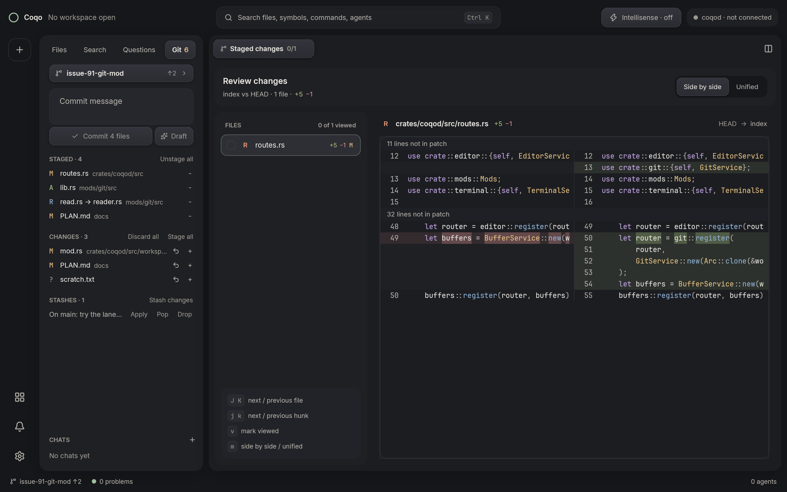
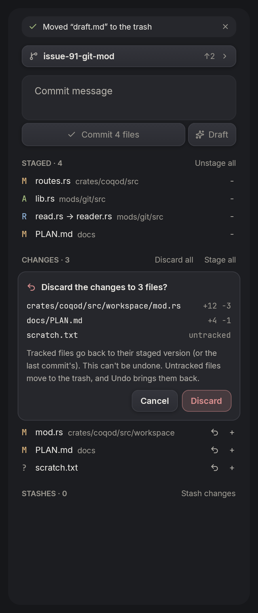

# Git pane and diff tabs

This page covers the Git sidebar pane (board 1's "Git" tab) and the `git-diff` tab kind, from PLAN §7.7, #91 and #93.

- **Code:** `crates/coqo/src/git/`. It moves into the git mod once the mod API carries UI contributions (#147).
- **Data:** the daemon's `git/*` methods and `git/changes` (ADR 0018).
- **Screenshots:** offscreen renders from `git_screenshots` and `git_discard_screenshots` (#226).

Light: [pane](screenshots/git-light.png), [discard](screenshots/git-discard-light.png).

## The pane

From top to bottom:

- **Root chips:** shown only when the workspace has more than one root that is a repository. The chip for the root being shown is raised.
- **Branch button:** a raised button with the `git-branch` icon, the branch name in semibold `text`, and `↑n ↓m` against the upstream in `text_subtle` at `text_xs`.
  - A detached `HEAD` shows `detached at <short oid>`.
  - Clicking the button opens the picker below it:
    - the local branches, with a sage check on the current one; clicking another branch switches to it;
    - a "New branch name" field; `Enter` creates the branch at `HEAD` and switches to it.
- **Commit box:** a `PromptInput` (2–8 rows) on `surface`, with the field radius and a `border` hairline.
  - `Enter` commits and `Shift+Enter` adds a newline.
  - Below it are two buttons:
    - **Commit** fills the row. With something staged and a message typed, it is the sage primary button "Commit N files"; otherwise it is raised, in `text_subtle`.
    - **Draft** sits to its right (#224, ADR 0024). It is raised, with the sparkles icon, and asks an agent (the user's own Claude Code) for a conventional-commit message for what is staged. The tooltip names the agent.
      - While it works, it reads "Drafting…" in `sand` with a loader icon. A click cancels, and the commit box keeps what it had.
      - The reply replaces the commit box's text, to edit before committing.
      - With nothing staged, no agent available, or coqod down, it is in `text_subtle` and does nothing; the tooltip says why.
      - A failed draft shows under the buttons in `rose`. A click dismisses it.
      - The command palette's "Draft commit message" (Git) shows the pane and starts a draft.
- **Groups:** an upper-case section label with the count (`STAGED · 3`, `CHANGES · 3`, and `CONFLICTS · n` only when there are conflicts), plus a "Stage all" or "Unstage all" link in `text_subtle` on the right. "Changes" also has "Discard all" before it, which turns `rose` on hover.
- **File rows:**
  - Sizing: 26 px tall, `text_sm`, radius 9, with a `surface` hover.
  - Status letter: mono semibold, 14 px wide. `M` is `sand`, `A` is `green`, `D` and `U` are `rose`, `T` is `lavender`, `R` (renamed, #226) is `blue`, and `?` is `text_subtle`.
  - After the letter comes the file name in `text`, then its folder in `text_subtle` at `text_xs`, then a 20 px `+` (stage) or `−` (unstage) button.
  - A rename reads `old → new`: the old name if the file stayed in its folder, else its old path. Staging or unstaging a rename moves both paths together.
  - An unstaged row that can be discarded has a 20 px discard button (`undo-2`, `text_muted`) before `+`. Intent-to-add files, unstaged renames, conflicts and nested repositories have none.
  - Clicking a row opens its diff tab.
- **Discard confirmation:** discarding always asks first, in a card under the "Changes" label. It uses the file tree's delete-card language: `surface`, a `border_strong` hairline, the field radius and 12 px padding.
  - **Title:** "Discard the changes to “a.rs”?", or "Move “new.txt” to the trash?" when only untracked files are discarded. The icon is in `rose`.
  - **Files:** one mono `text_xs` line per file, up to six, then "and n more". Each line has the path, then, on the right in `text_subtle`, what the file loses:
    - `+a −d` (index → work tree);
    - "untracked";
    - "brings it back", for a deleted file;
    - "binary change".
  - **Detail**, in `text_muted`:
    - tracked files go back to their staged version (or the last commit's), and this can't be undone;
    - untracked files move to the trash, and Undo brings them back.
  - **Unsaved edits:** open tabs with unsaved edits to these files are named, with a `sand` alert icon.
  - **Buttons:** Cancel is raised. **Discard** (or **Move to Trash**) is `rose` at 18% with a 45% `rose` border.
- **Discard note:** after a discard, a `surface` band at the top of the pane shows a `green` check and says what happened, for example "Discarded the changes to “a.rs”" or "Moved “new.txt” to the trash".
  - While the trashed files are still the newest entries in the window's file history, a `sage` **Undo** link restores them. The file tree's undo does the same.
  - An `x` closes the band.
- **Stashes:** `STASHES · n`, a "Stash changes" link (untracked files included), and one row per stash with Apply, Pop and Drop links.
- **Errors:** a failed write shows git's message on a `rose` 12% band above everything else. Clicking the band dismisses it.

The pane keeps itself current from `git/changes`, which covers edits, `git` runs in a terminal and other tools. A window's `GitModel` holds the state, and `GitModel::letter(root, path)` gives the same letters to the file tree (#163).

## Tab badge and status bar

These describe the root the pane shows (`GitModel::shown_root`: the picked root chip, else the first repository). Both update live, even while another sidebar pane is open (#227, `crates/coqo/src/git/chrome.rs`).

- **Tab badge:** the sidebar's "Git" tab reads "Git N", where N is the number of changed files (staged, unstaged, untracked or conflicted, each file once) in `sand`, 4 px after the title. A clean tree, or a folder that isn't a repository, shows no number.
- **Status bar:** the `branch` item at the start of the status bar shows the `git-branch` icon and the branch, with `↑n ↓m` against the upstream (`detached at <short oid>` for a detached `HEAD`). Without a repository it reads "No repository".

## Diff tab

The `git-diff` tab kind shows a root's changes in the review surface of board 4 ([diff.md](diff.md), #93): one tab for the unstaged changes (index → working tree, untracked files included) and one for the staged ones (`HEAD` → index).

- **Opening:** clicking a file row in the pane opens its side's tab, or switches to it, and shows that file.
- **Label:** the `git-branch` icon, "Changes" or "Staged changes", and `viewed/total` in `text_subtle`.
- **Staging:** hunk buttons and line selections stage (in "Changes") or unstage (in "Staged changes") through `git/stage` / `git/unstage`.
- **Discarding lines:** in "Changes", a line selection also offers **Discard n lines…** ([diff.md](diff.md)).
- **Renames:** a rename is listed under its new path, and the header reads `old → new`. The diff compares the old path's content with the new path's.
- **Updates:** the tab reloads when `git/changes` reports the sides it shows.
