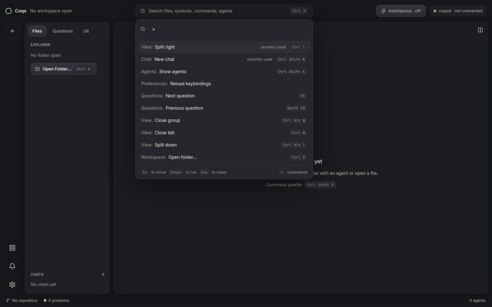
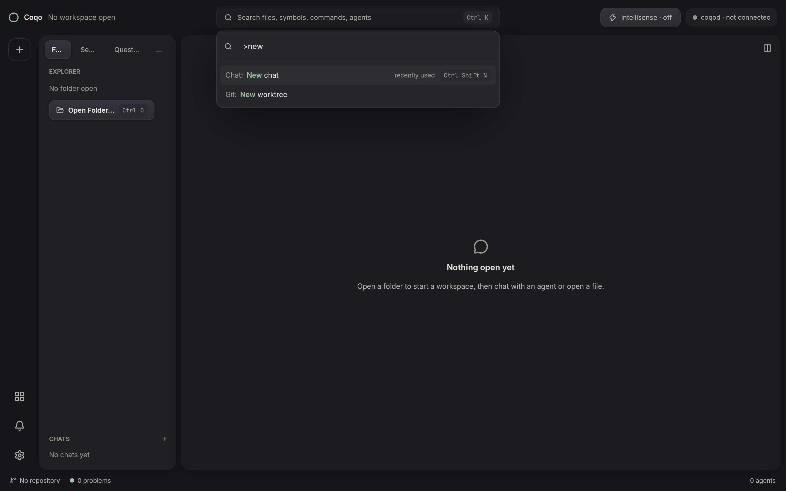
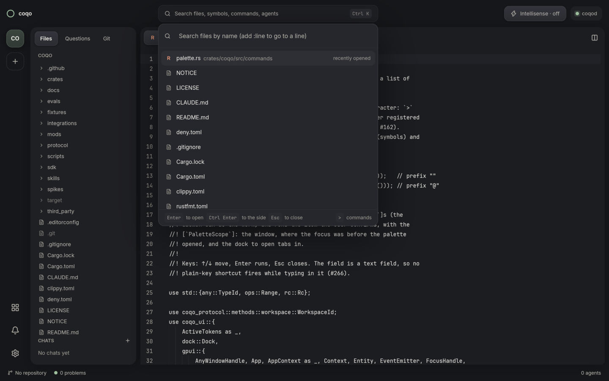
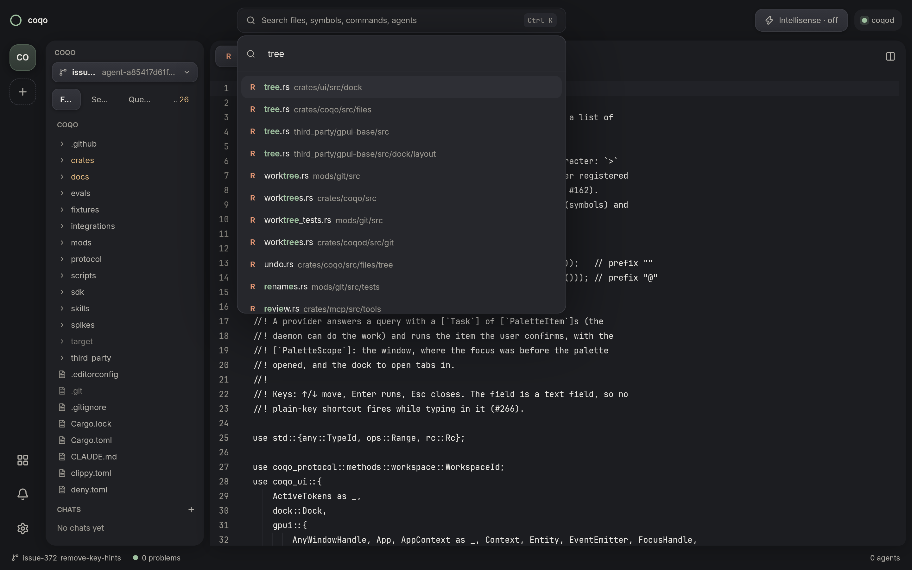
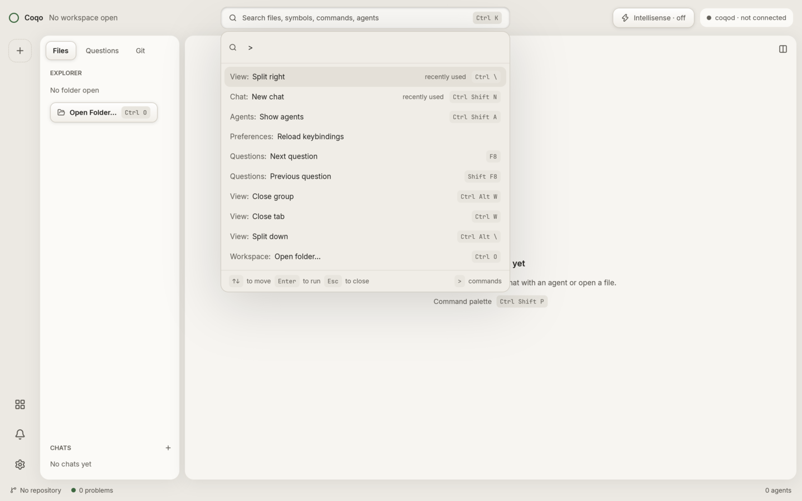
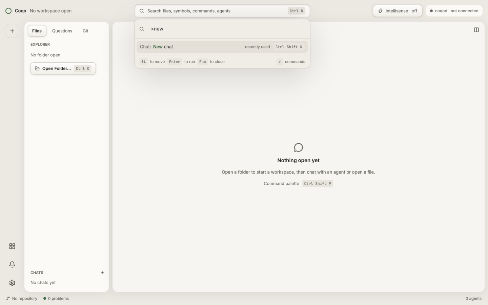
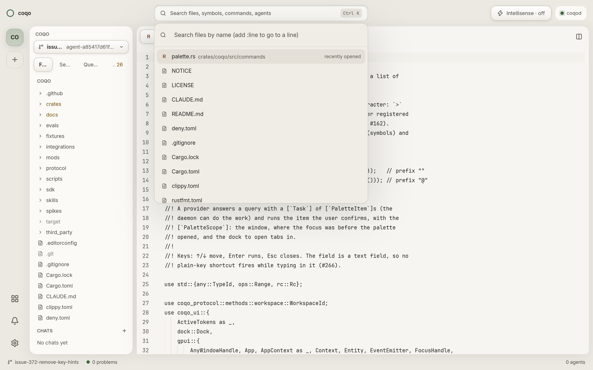
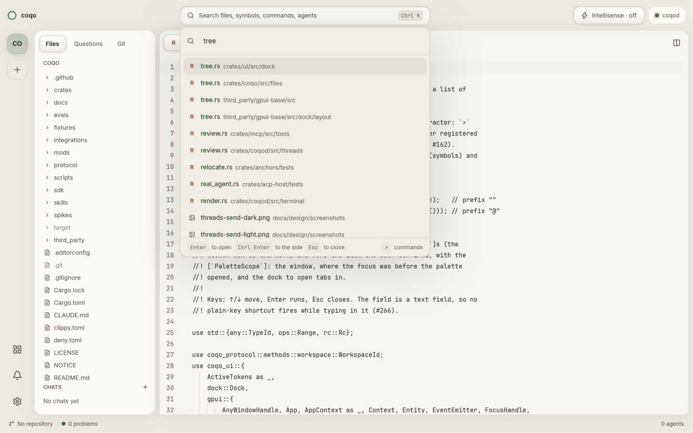

# Command palette and keybindings

The command palette opens from the top bar's command search (design board 1). Every command, its keys and the user's `keybindings.toml` are covered here. The code is in `crates/coqo/src/commands/`, and the decisions are in [ADR 0023](../adr/0023-commands-and-keybindings.md).



## Opening it

- **`Ctrl Shift P`** (`⌘⇧P` on macOS) opens it on the commands. The field starts with `>`.
- **`Ctrl P`** (`⌘P`), **`Ctrl K`** (`⌘K`, the key the search field shows) and a **click on the search field** open it in its default mode: the [file finder](#the-file-finder).
- Pressing the same key again closes it. Pressing the other one switches mode.
- **Esc** or a click outside closes it, and the focus goes back to where it was.

## Layout

- **Card:** a popover (`surface`, `border_strong` hairline, 14 px radius, deep shadow). It hangs 44 px below the top of the command search, as wide as the search (at least 420 px), and above everything else in the window.
- **Field:** a search icon in `text_muted` and a one-line field at `text_md`, 14 px side padding, with a `border` hairline under it. The placeholder belongs to the default mode ("Search files by name (add :line to go to a line)").
- **Rows:** 10 px padding and a `radius_control` corner.
  - The category comes first in `text_subtle` ("Diff:"), then the title in `text`, with the matched characters semibold in `sage`.
  - At the right: "recently used" in `text_subtle` (`text_xs`) and the command's first key sequence as a key cap.
  - The selected row is `surface_selected`. A hovered row is `surface_strong`.
  - The list scrolls past 380 px and keeps the selection in view.
- **Empty:** "No command matches here" in `text_subtle`.
- **Problems:** if `keybindings.toml` has problems, a `sand` line says how many and points to the log.
- **Footer:** key caps for `↑↓`, `Enter` and `Esc` with "to move / to run / to close", and the `>` mode hint at the right (outside the commands), all `text_xs` in `text_subtle` above a `border` hairline. A mode with a second way to run an item (the finder's split) shows `Ctrl Enter` and its hint in place of the arrows.



## What it lists

- **Only what works where the focus was.** A command's key context (`DiffReview`, `FileEditor`, `Dock`, `ChatTab`) has to match the focus path, and something on that path has to handle the command's action. Diff commands appear in a diff, Save in a file tab, and the split and close commands when the focus is in the tab area.
- **File commands** (category File) act on the tree's selection with the focus in the tree, and on the tab's file from a file tab. From a tab, the Files pane comes up with the file revealed and the operation runs there: Rename names it in its row, Delete asks above the rows, New file and New folder name the new entry in the file's folder. Rename and Delete are a command each in the tree (with `F2` and `Delete`) and in a file tab (without keys: those keys edit text there).
- **Mods' commands always appear**, under their category (the sample mod's **Hello: Say hello**). They run in the daemon.
- **Ranking:**
  - With an empty query, the recently used commands come first (the last 30, kept in `<data dir>/ui/recent-commands.json`), then the rest by category and title.
  - With a query, results are fuzzy matches on "Category: Title" (the chat composer's matcher, smart case), and recently used commands get a small bonus.
- **Keys:** `↑`/`↓` move (wrapping), `Enter` or a click runs the command, `Esc` closes. The field is a text field, so typing never fires a plain-key shortcut such as the diff's `j` (#266).

## Modes

The field's first character picks the provider (`commands::PaletteProvider`):

| Prefix | Mode | State |
|---|---|---|
| `>` | Commands | #25 |
| none | Default: files | The file finder, #162 (`Ctrl/Cmd+P`) |
| `@` | Symbols | Free |
| `#` | Free | Free |

A provider returns a `Task` of items, so a daemon query (`fs/find`) fits. It also gets the `PaletteScope` (window, previous focus, dock, workspace) to open what the user picks. `confirm_secondary` is `Ctrl/Cmd+Enter` (the same as Enter unless the mode has a second way):

```rust
commands::palette::register_provider(cx, Rc::new(FilesProvider::default())); // prefix ""
```

## The file finder



The palette's default mode finds a file by its path (`crates/coqo/src/files/finder.rs`). The daemon does the searching (`fs/find`): it keeps an index of the workspace's files that the ignore rules keep, built when the workspace opens and kept current from the watcher, and returns the best 60 matches with their matched positions. A 200k-file repository is ready 0.4–1.5 s after it opens, and answers in 2–23 ms.

- **Rows:** the file's glyph (the tree's, `files/glyph.rs`), then the file name in `text` with the matched characters semibold in `sage`, then its folder at `text_sm` in `text_subtle`. In a multi-root workspace the folder starts with the root's name (`api · src/handlers`; just `api` for a file at the root).
- **No query:** the workspace's recently opened files first, up to 20, labelled "recently opened", then the files nearest the roots. Every file tab opened counts (from the tree, the finder, an agent's link or a restored layout). The last 100 are kept in `<data dir>/ui/recent-files.json`, and they follow the tree's renames and deletes.
- **A query:** fuzzy over the whole path, smart case, whitespace ignored. Matches at the start of a folder or name, after `_ - .`, at camelCase humps, in runs and in the file name rank higher, and so does a query that is the file name or its stem. Shorter paths win ties. Recently opened files get a small bonus.
- **`path:line`** (`main.rs:42`, also `main.rs:42:7` for a column) puts the cursor on that line. The rows show the line after the name (`main.rs:42`).
- **Keys:** `Enter` opens the file in the active group, or shows its tab if it's open. **`Ctrl Enter`** (`⌘Enter`) opens it in a new group to the right (a second view if it's open already). `Esc` closes. The footer says so: "Enter to open, Ctrl Enter to the side, Esc to close, > commands".
- **Empty:** "No file matches", or "Open a folder to find its files" without a workspace. While the daemon is still building the index, the list waits for it.



## Commands

Views register commands in their `init` with `commands::register`, in place of binding keys themselves:

```rust
commands::register(cx, [
    Command::new("diff.next_hunk", "Next change", "Diff", NextHunk)
        .key("j")
        .context("DiffReview"),
]);
```

| Id | Title | Default keys (Linux; `Cmd` replaces `Ctrl` on macOS) | Where |
|---|---|---|---|
| `command_palette.open` | (opens the palette on `>`) | `Ctrl Shift P` | anywhere |
| `command_palette.search` | (opens the default mode) | `Ctrl K` | anywhere |
| `files.find` | Go to file… | `Ctrl P` | anywhere |
| `command_palette.reload_keybindings` | Reload keybindings | | anywhere |
| `workspace.open_folder` | Open folder… | `Ctrl O` | anywhere |
| `window.new` | New window | `Ctrl Alt N` | anywhere |
| `chat.new` | New chat | `Ctrl Shift N` | anywhere |
| `chat.cancel_turn` | Stop the agent | `Esc` | `ChatTab` |
| `agents.show` | Show agents | `Ctrl Shift A` | anywhere |
| `terminal.new` | New terminal | `Ctrl` + backtick (all platforms) | anywhere |
| `questions.next` / `questions.previous` | Next / Previous question | `F8` / `Shift F8` | anywhere |
| `questions.ask_about_code` | Ask an agent about the selection | `Ctrl Shift /`, `Ctrl ?` | `FileEditor` |
| `threads.add_review_comment` | Add review comment | `Ctrl Shift M` | `FileEditor` |
| `file.save` | Save | `Ctrl S` | `FileEditor` |
| `files.new_file` / `files.new_folder` | New file… / New folder… | | `FileTree`, `FileEditor` |
| `files.rename` / `files.delete` | Rename… / Delete… | `F2` / `Delete` (also `Cmd Backspace` on macOS) | `FileTree` |
| `files.rename_active` / `files.delete_active` | Rename… / Delete… (the tab's file) | | `FileEditor` |
| `files.copy_path` / `files.copy_relative_path` | Copy path / Copy relative path | | `FileTree`, `FileEditor` |
| `files.reveal` | Reveal in File Manager (Finder on macOS) | | `FileTree`, `FileEditor` |
| `files.reveal_in_tree` | Reveal active file in tree | | `FileEditor` |
| `dock.split_right` / `dock.split_down` | Split right / down | `Ctrl \` / `Ctrl Alt \` | `Dock` |
| `dock.close_tab` / `dock.close_group` | Close tab / group | `Ctrl W` / `Ctrl Alt W` | `Dock` |
| `diff.next_hunk` / `diff.previous_hunk` | Next / Previous change | `J` / `K` | `DiffReview` |
| `diff.next_file` / `diff.previous_file` | Next / Previous file | `Shift J` / `Shift K` | `DiffReview` |
| `diff.toggle_viewed` | Mark file viewed | `V` | `DiffReview` |
| `diff.toggle_mode` | Toggle side by side / unified | `M` | `DiffReview` |
| `walkthrough.next_step` / `walkthrough.previous_step` | Next / Previous step | `N`, `→` / `P`, `←` | `WalkthroughPlayer` |
| `walkthrough.toggle_understood` | Mark step understood | `U` | `WalkthroughPlayer` |
| `walkthrough.toggle_diff` | Show the step in the editor or the diff | `D` | `WalkthroughPlayer` |
| `hello.greet` (mod) | Say hello | | anywhere |

The key caps in the top bar, the empty state and the Welcome tab show the current keys, including the user's.

## `keybindings.toml`

The file lives in the config directory: `~/.config/coqo/keybindings.toml` (`$XDG_CONFIG_HOME`), `~/Library/Application Support/Coqo/keybindings.toml` on macOS, or under `$COQO_CONFIG_DIR`. It maps command ids to keys and replaces each command's defaults:

```toml
"command_palette.open" = "mod+shift+p"   # one key sequence
"diff.next_hunk" = ["j", "down"]          # several
"terminal.new" = []                       # unbound
"hello.greet" = "mod+alt+h"               # a mod's command
"file.save" = "mod+k mod+s"               # a chord
```

- **Key syntax:** the mod manifest's. Use `+` inside a chord and a space between chords. The modifiers are `ctrl`, `alt` (`option`), `shift`, `cmd` (`super`) and `mod` (`cmd` on macOS, `ctrl` elsewhere). GPUI's `ctrl-shift-p` works too.
- **Contexts:** a command keeps its context. A rebound diff command still only works in a diff.
- **Loading:** the file is read when Coqo starts. **Reload keybindings** in the palette reads it again. It isn't watched.
- **Problems** are logged once each (`coqo: keybindings: …`) and counted in the palette. Coqo never stops for them, and the other entries still apply. They are:
  - bad TOML or values;
  - unknown modifiers;
  - ids no command has (checked once the daemon's commands are in);
  - conflicts: the same keys for two commands in the same context. The last one bound wins, and a user's binding is bound after the defaults.

## Light appearance









To regenerate the screenshots, run `COQO_SHOT_DIR=<dir> cargo test -p coqo -- --ignored palette_screenshots finder_screenshots`. It renders offscreen and needs a GPU. Then downscale the 2× `coqo-palette[-query]-<appearance>.png` and `coqo-finder[-query]-<appearance>.png` to 1440×900 as `palette[-query]-<appearance>.png` and `finder[-query]-<appearance>.png`.
