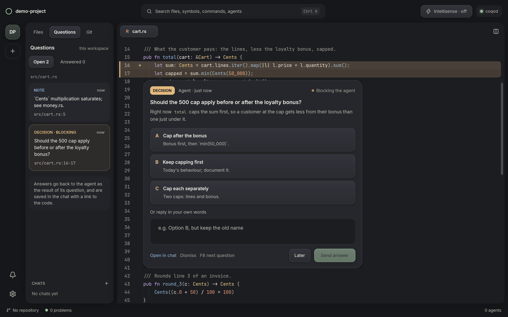
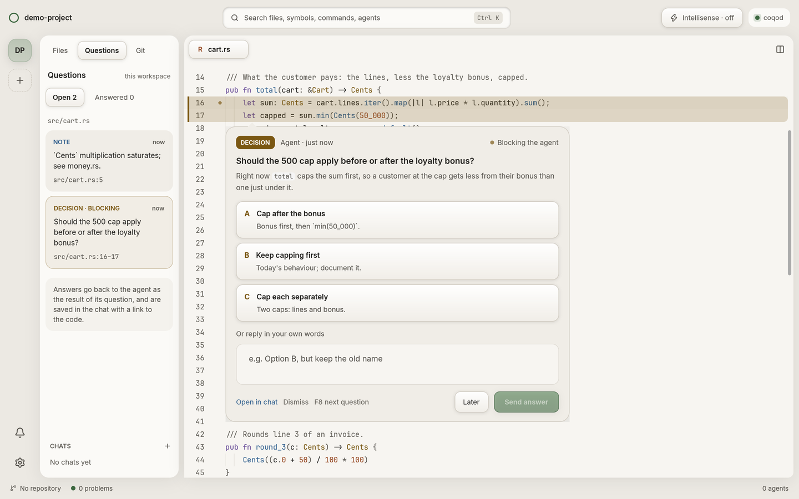
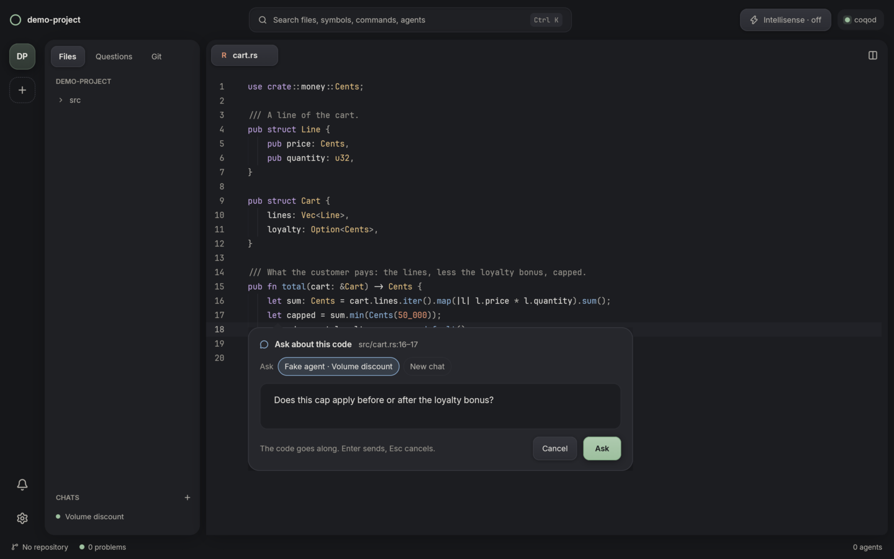
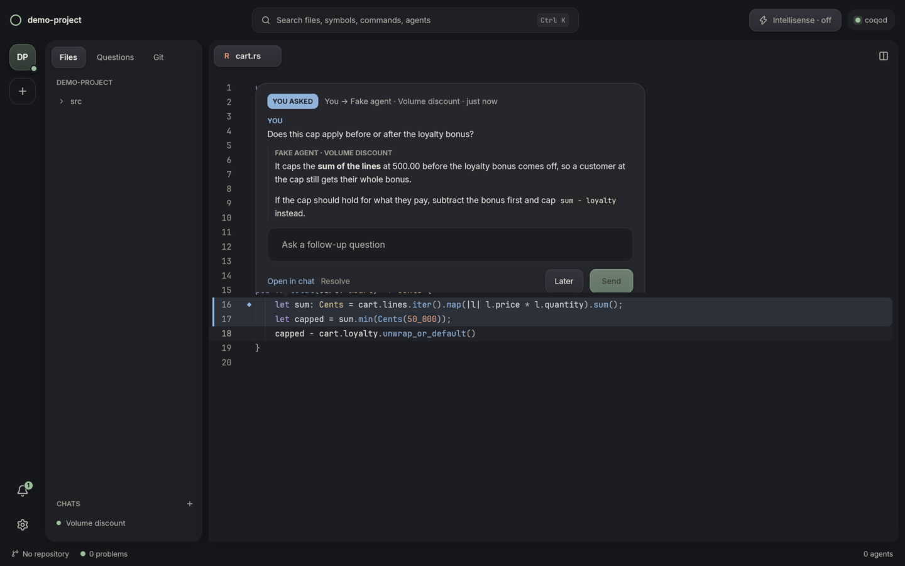
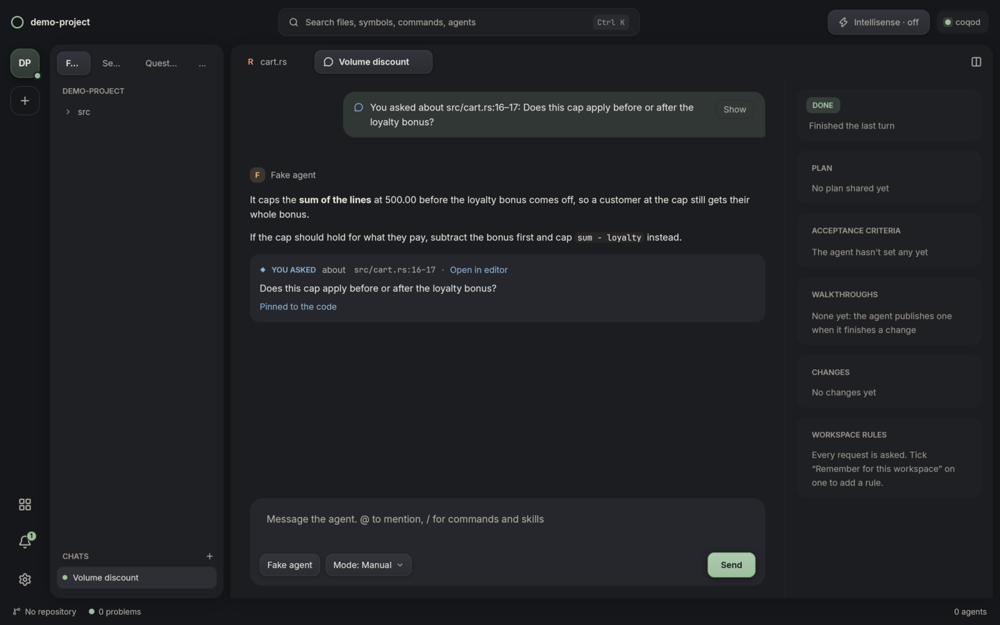
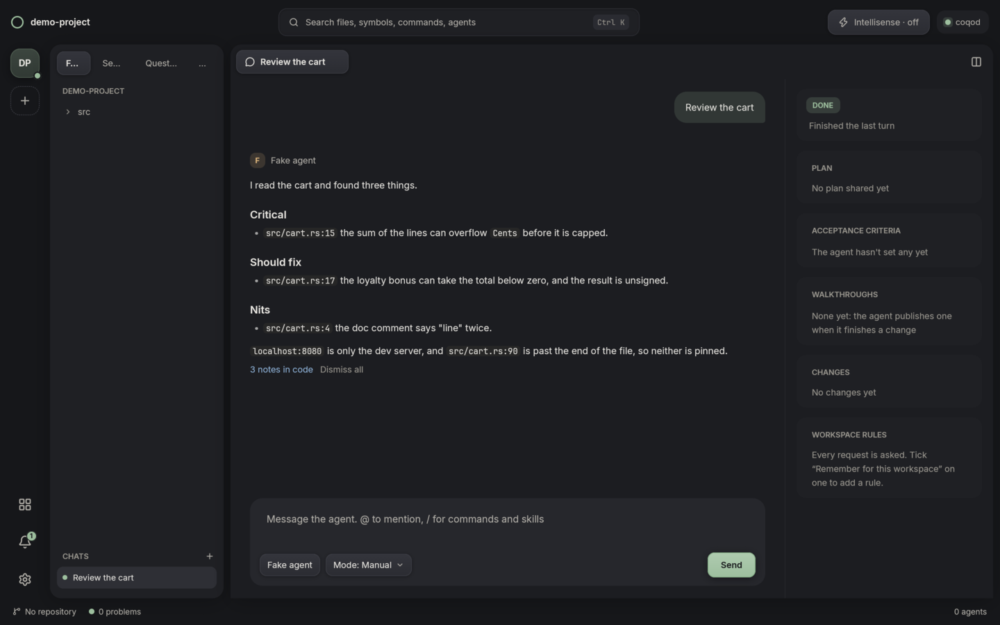
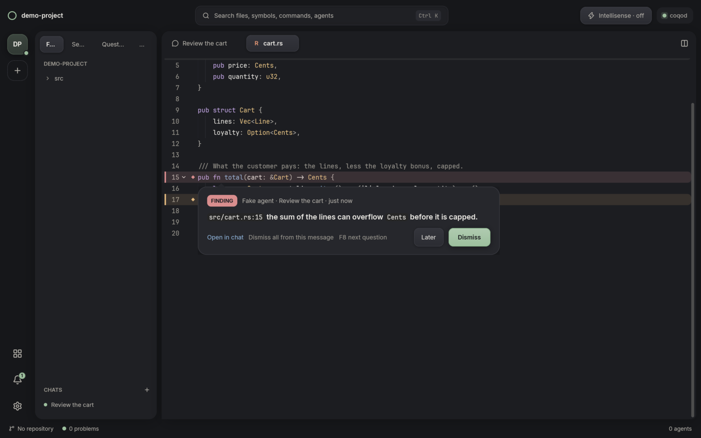

# Anchored questions

This is how a question or note that an agent pins to code shows up in Coqo (design board 2, PLAN §7.5, ADR 0016). The daemon side, meaning the store, the anchors and the `ask_question` / `await_answer` / `annotate` tools, is #73. This page covers the editor side.

The code lives in these places:
- `crates/coqo/src/questions/`: the store per workspace, the popover, the Questions pane and navigation.
- `crates/ui/src/editor/markers.rs`: markers and overlays on `CodeEditor`.
- `crates/coqo/src/chat/tab.rs`: the question card in the chat transcript.

## What the user sees

1. **An agent asks.**
   - A diamond marker appears in the gutter of every file tab that shows the anchored lines.
   - Those lines get a tint.
   - The Questions pane counts the question.
   - The asking chat gets a card for it.
2. **The agent blocks on it** (`waiting`, from `ask_question` or `await_answer`).
   - The marker pulses, and the popover opens by itself in any file tab on screen that shows the code.
   - The popover never takes the keyboard: whatever the user is typing keeps the focus.
3. **The user opens it.** Any of these does it, and each one opens the file tab if needed, scrolls the anchored line near the top and puts the keyboard in the popover:
   - a click on the marker;
   - `F8` / `Shift F8`;
   - a click on a card in the Questions pane;
   - a click on the chat card;
   - opening its alert (an alert-center row or the toast's Open).
4. **The user answers.**
   - The answer is an option, a typed reply, Yes/No, or OK.
   - Sending it calls `questions/answer`. Dismiss calls `questions/dismiss`.
   - The waiting agent gets the result, and the marker, the popover and the pane card go away.
   - The chat card changes to "Answered: …".

## Markers

- **Diamond:** a 9 px `marker-diamond` icon in the 20 px gap between the line numbers (and fold icons) and the code, on the first anchored line.
  - The board draws it before the line number. The editor has no hook into the line-number column, so it sits after the number.
  - It is clickable (`code-marker` / marker id).
- **Strip:** the editor's 3 px gutter-decoration strip, in the marker colour, covering every anchored line.
- **Tint:** a band behind the anchored lines, 13 % of the marker colour (20 % while waiting), from the gutter to 10 px before the right edge, with the right corners rounded 8 px.
- **Colours:**
  - `sand` for a question that needs the user (decision, clarification, confirmation, info);
  - `blue` for an info note;
  - `rose` for a warning note.
- **Waiting:** while an agent is blocked on the question, the diamond pulses between 35 % and 100 % opacity, and the tint is stronger.
- **Edits:** markers track edits.
  - The ranges are the daemon's resolved ones (`questions/list` after `buffer/open`, then `questions/changes`). They are used as they are when the resolution matches the open buffer's revision; otherwise the editor's own tracked range is kept.
  - Typing above a question moves its marker immediately, and the daemon's next resolution agrees.
- **Orphaned anchors** (the code is gone) have no marker. The popover then opens at the top of the editor and shows the original snippet.
- **Sharing a line** with a walkthrough step or a review thread: the markers stack and a question wins; see [Markers on one line](walkthrough.md#markers-on-one-line).

## Popover

The popover is a floating card over the code, 620 px wide at most. It is placed by these rules:

- It goes below the anchored lines with an 8 px gap, and a `surface` caret at 40 px from its left edge points up at the lines.
- If it doesn't fit below but fits above, it goes above with the caret pointing down.
- If it fits on neither side, it goes on the roomier side and its content scrolls. It never covers the lines it asks about.

The board draws the popover inline, with the code pushed apart around it (a view zone). gpui-component's editor has no view zones, so Coqo floats it and scrolls the anchor near the top when it is opened instead. Follow-up: #228.

What the popover contains, top to bottom:

- **Header:**
  - the kind badge, upper case on the kind colour with `panel` text (DECISION `sand`, CLARIFICATION `blue`, CONFIRM `sage`, INFO `lavender`, NOTE `blue`, WARNING `rose`);
  - "provider · how long ago";
  - while the agent waits, "Blocking the agent" with a pulsing `sand` dot on the right.
- **Body:** the first line as a 15 px semibold title, then the rest as markdown.
- **Snippet:** when the anchor is orphaned or fuzzy, a `panel` box with a `sand` alert icon and "Code moved: it isn't here any more…" (orphaned) or "Code moved: it changed since it was asked…" (fuzzy), then the original lines in mono. Extra anchors are listed as "Also anchored: path:line".
- **Answer controls:**
  - *Decision:* option cards lettered A, B, C, with a label and description; the selected card gets a `sand` border. Below them, "Or reply in your own words".
  - *Clarification:* a reply field.
  - *Confirmation:* a Yes / No row.
  - *Info and notes:* no controls.
- **Footer:**
  - on the left: **Open in chat**, **Dismiss**, and the hint "F8 next question";
  - on the right: **Later**, and the primary button (**Send answer**, **OK** for info, **Dismiss** for a note). The primary button is disabled until there is an answer.

## Keyboard

| Key | Where | Does |
| --- | --- | --- |
| `F8` / `Shift F8` | anywhere in the window | Opens the next / previous open question. The order is file path, then line, across files, wrapping around. It starts from the open popover, else the cursor in the active file tab. |
| `Enter` | in the popover | Sends the answer. In the reply field, `Shift Enter` is a new line. |
| `Esc` | in the popover | Closes it without answering. The keyboard goes back to the code. |
| `Ctrl Shift /` (`Cmd Shift /` on macOS) | in a file tab | Asks about the selected lines (see "Asking about code"). |
| `Ctrl Shift M` (`Cmd Shift M` on macOS) | in a file tab | Starts a review comment on the selected lines (see [diff.md](diff.md#starting-a-thread-in-a-file-tab-311)). |

## Questions pane

The Questions pane is a sidebar pane, between Files and Git, showing the current workspace's questions and notes.

- **Tabs:** **Open N** and **Answered N**. The answered history is behind the second tab.
- **Open list:** grouped under file headers (mono, `text_subtle`), in F8 order.
- **Cards:**
  - the kind label in the kind colour, with "· BLOCKING" while an agent waits;
  - the age;
  - the title;
  - the location.
  - A waiting question's card has a `sand` border. A confirmation's card has inline Yes / No buttons.
  - A click on a card opens it in the editor.
- **Answered cards:** "Answered: …" or "Dismissed".

The board shows these cards in a right-hand column of the editor. Coqo puts them in a sidebar pane, so the editor keeps its width and the list works with any tab.

## Chat card

The chat card shows a `SessionUpdate::Question` in the asking chat's transcript. A later state of the same question replaces the card in place.

- **Contents:** a diamond, the kind label, "Asked about src/cart.rs:42 · Open in editor" ("Note on" for notes), the title, and the state ("Waiting for your answer", "Answered: …" or "Dismissed").
- **Click:** opens the popover.

## Asking about code (#229)

The user can ask too. Board 2 still has no frame for it (checked again for #248), so it reuses the question's markers, popover and pane in blue, the colour of a note (the user's own words, nothing waits on them). This blue variant is the confirmed design.

Light: [ask](screenshots/ask-light.png), [thread](screenshots/thread-light.png), [chat](screenshots/asked-chat-light.png).

1. **Ask.** A blue speech-bubble button sits in the diamond's gap on the line under the mouse and, while the editor has the keyboard, on the first selected line (not on a line with a marker). A click on it, or `Ctrl Shift /` (`Cmd Shift /` on macOS; also `Ctrl ?` / `Cmd ?`) in a file tab, opens the **ask popover** under the selected lines (the cursor's line with no selection; a selection ending at the start of a line leaves that line out). Alt-click (`Option`-click) on the button starts a review comment instead (#311, [diff.md](diff.md#starting-a-thread-in-a-file-tab-311)); the button's tooltip says so: "Ask an agent (Alt-click: add review comment)" ("Option-click" on macOS; just "Ask an agent" where there are no review comments, as in a walkthrough player's tab). While the ask popover is open its lines follow edits, as a marker does (#248): a line typed, or written by an agent, above them moves the popover, its "src/cart.rs:7–8" and the lines it sends down with them.
2. **Choose the chat.** A row of pills: up to four of the workspace's open chats, the default first, and **New chat**. The default is the chat shown in the workbench (the active tab, then the other groups' visible tabs, then any open chat tab), else the workspace's most recently active chat, else **New chat**. A new chat uses Claude when it is available, else the first available provider, and is listed under CHATS.
3. **Send** (`Enter`, or **Ask**; `Esc` or **Cancel** closes it). `questions/ask` pins the thread and prompts the chat with the question and the code. The ask popover gives way to the **thread popover** at the same lines, with a blue marker.
4. **The thread.** A "YOU ASKED" badge and "You → Claude · <chat> · <age>", then each of the user's messages and, under it, the agent's reply to it streamed from that turn of the chat ("Thinking…" until it starts). The conversation scrolls past 240 px and stays at its end while a reply streams in or a message is added, unless the user scrolled up to read; scrolling back to the end follows it again, and sending a follow-up jumps there. The field below sends a follow-up (`questions/reply`), which empties it once sent. **Open in chat**, **Resolve** (closes the thread, `questions/dismiss`), **Later** (closes the popover).
5. **Afterwards.** The marker stays on the lines and follows edits and restarts like a question's; a click on it reopens the thread. F8 skips threads (they need nothing from the user) and badges do not count them. In the chat the thread is a card, "YOU ASKED about src/cart.rs:42–48", with "Pinned to the code" or "Resolved"; the agent's answer is an ordinary turn of the chat. The prompt shows in short (#248), in the user's bubble with a blue speech bubble: "You asked about src/cart.rs:16–17: <the question's first line>…" ("Follow-up on …" for a follow-up). **Show** / **Hide** opens the whole prompt with the attached code, as the "Review sent" card does. The chat recognises these prompts by their text (`ThreadPrompt` in the protocol, which the daemon writes them with).

The Questions pane lists threads with the questions. Under the Open / Answered tabs a filter shows **All**, **Agents** (questions and notes) or **Yours** (threads).

To regenerate these screenshots, run `COQO_SHOT_DIR=<dir> cargo test -p coqo -- --ignored ask_screenshots` and downscale to 1440×900 as `ask-<appearance>.png`, `thread-<appearance>.png` and `asked-chat-<appearance>.png`.

## For other parts of the UI

`WorkspaceQuestions` (one per workspace, `questions::questions_for`) holds:
- the live list;
- `open_count`, `waiting_count` and `note_count` for badges and alerts (#76); `open_count` leaves out the user's threads;
- `QuestionsEvent::Waiting(id)` when an agent starts waiting.

To regenerate the screenshots, run `COQO_SHOT_DIR=<dir> cargo test -p coqo -- --ignored questions_screenshots` (offscreen, needs a GPU) and downscale the 2× PNGs to 1440×900 as `questions-<appearance>.png`.

## Findings written as text (#345)

Review skills report findings as text: `src/cart.rs:42 - the sum can overflow`. Coqo shows them in the code as gutter notes, linked to the chat message they came from. The skill is never changed (ADR 0030).

Light: [chat](screenshots/findings-chat-light.png), [code](screenshots/findings-code-light.png).

1. **When.** A completed agent message that arrives while its chat is open is scanned once. History (a chat reopened, the replay after a restart) and the user's own messages are never scanned. `questions.findings_in_gutter` in `settings.toml` turns it off; it is on by default.
2. **What counts.** References outside fenced code: `path:12`, `path:12-14`, `path#L12`, bare continuations (`` `a.py:17`, `:32` ``), "`path` ... (line 12)", "line 12 of `path`" and GitHub blob links. Each is checked against the workspace: the file must exist under a root (an exact path, or the one file the name ends with, narrowed by the files the turn touched) and the line must be in range. Anything else (`localhost:8080`, a stale name, a line past the end) is dropped without a word.
3. **The note.** An annotation (ADR 0016) whose origin is the message, anchored like any other, so it follows edits and renames (#288). Its badge says FINDING and its body is the message's line. F8 skips findings: there can be many and nobody waits on them.
4. **Colour by severity words.** The nearest heading's words set the level, else the line's:

   | Words | Level | Colour |
   |---|---|---|
   | critical, blocker, bug(s), error(s), high | critical | rose |
   | warning(s), should, important, major, medium | warning | sand |
   | nit(s), suggestion(s), minor, low, or none | note | subtle text |

5. **Marker priority.** `layer::FINDING` = 8: below everything made on purpose (waiting question 50, question or note 40, review thread 30, step 20, the user's own thread 10) and above only a resolved review thread (5). Findings are automatic and many; they must never hide a question, a thread or a step on the same line.
6. **Back to the message.** Under the message: "N notes in code" (shows the first note) and "Dismiss all". A note's popover has **Open in chat**, which scrolls the chat to the message and marks it for a moment, **Dismiss** for itself and **Dismiss all from this message** when it has siblings.

To regenerate the screenshots, run `COQO_SHOT_DIR=<dir> cargo test -p coqo -- --ignored findings_screenshots` and downscale to 1440x900 as `findings-{chat,code}-<appearance>.png`.
