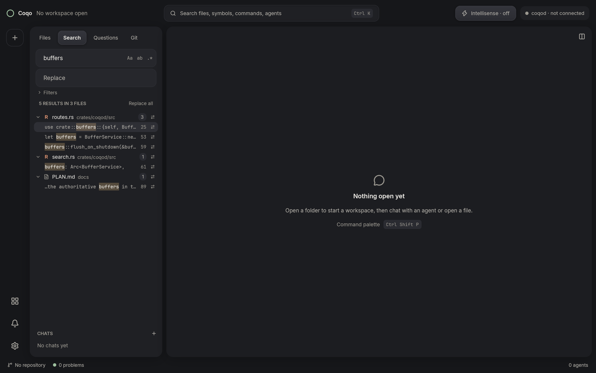
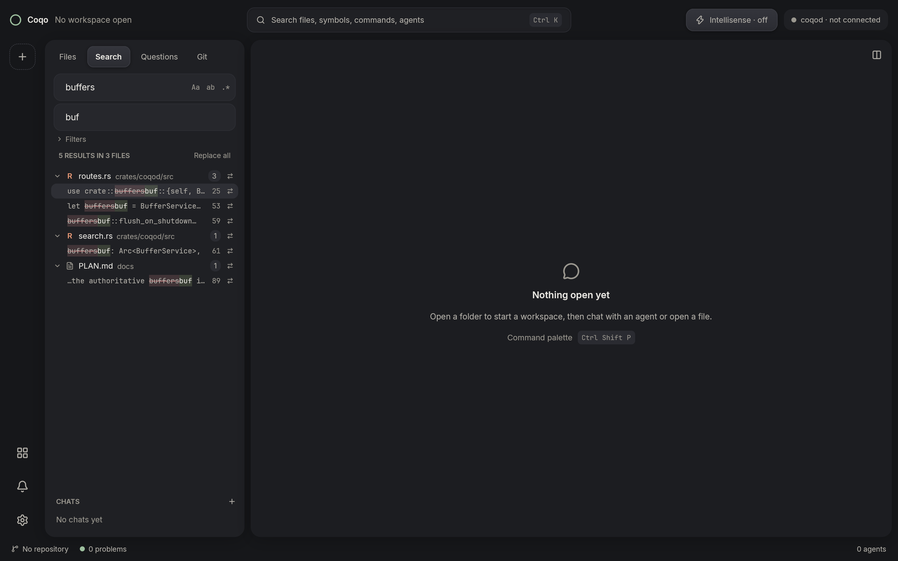

# Search pane

This page covers the Search sidebar pane: project search and replace (PLAN §6 `search`, #45).

- **Code:** `crates/coqo/src/search/`. It moves into the search mod once the mod API carries UI contributions (#147).
- **Data:** the daemon's `search/run` topic and `search/replace` method, served by the `coqo.search` mod ([ADR 0025](../adr/0025-search-mod.md)).
- **Screenshots:** offscreen renders from `search_screenshots`.
- **Board:** board 1 has no search pane. Search is another sidebar tab, between Files and Questions, built from the same parts as the Files and Git panes.

## The pane

From top to bottom:

- **Query field:** a one-row `PromptInput` on `surface`, with the field radius and a `border` hairline. On its right are three toggle chips (22 × 20 px, radius 6, mono `text_xs`):
  - `Aa` match case, `ab` whole word, `.*` regular expression.
  - Off, a chip is bare `text_subtle` (`text_muted` on hover). On, it is `raised` with `text`.
  - In the pane, `Alt+C`, `Alt+W` and `Alt+R` toggle them.
- **Replace field:** the same field, with no chips. `Enter` in it asks to replace all.
- **Filters:** a `text_subtle` disclosure link at `text_xs`. Open, it shows two more fields: "Files to include" and "Files to exclude", each a comma-separated list of globs. A glob without wildcards (`src`) also covers everything under it.
- **Banners**, each only when it applies:
  - an error (a bad regex, no daemon) on a `rose` 12% band in `rose` text;
  - the replace confirmation (below);
  - after a replace, a one-line note in `sage`: "Replaced 4 matches in 2 files", plus any failures.
- **Header:** a section label, `N RESULTS IN M FILES` (`SEARCHING…` before the first file, `NO RESULTS` when done empty), then "· more not shown" in `sand` when the daemon's match limit cut the search short, and a "Replace all" link in `text_subtle` on the right.
- **Results:** a `uniform_list` of 24 px rows, radius 9, with a `surface` hover.

## Result rows

- **File row:** a chevron (12 px, `text_subtle`) that folds the file's matches, the file-type glyph, the file name in `text` at `text_sm`, its folder in `text_subtle` at `text_xs`, the match count in a `surface_strong` pill, and an 18 px replace button (the `arrow-right-left` icon). Clicking the row folds or unfolds it.
- **Match row:** indented 26 px, mono `text_xs` in `text_muted`. It shows the line with the match:
  - With no replacement typed, the match is `text`, semibold, on `sand` 28%.
  - With a replacement typed, the match is struck through in `rose` on `rose` 18%, and the replacement follows it in `text` on `green` 20%:

  

  - Long lines are trimmed by the daemon to a window around the match, with `…` where text was cut. Leading whitespace is dropped.
  - The line number (1-based) sits on the right in `text_subtle`, then the replace button for that one match.
  - The selected match has the `surface_selected` background.

## Behaviour

- **Showing it:** `Ctrl+Shift+F` (`Cmd+Shift+F` on macOS) selects the Search tab and focuses the query with its text selected. A single-line selection in the active editor becomes the query.
- **Searching:** 150 ms after the last keystroke (at once on `Enter` or a toggle). Results stream in, sorted by path. Typing again drops the subscription, and that cancels the search in the daemon. Unsaved text in open buffers is searched, not the disk.
- **Opening:** clicking a match opens its file with the match selected and scrolled into view. `F4` and `Shift+F4` open the next and previous match from anywhere in the window, wrapping around.
- **Replacing:**
  - "Replace all" first shows a confirmation on a `sand` 12% band: "Replace 12 matches in 4 files with “x”?" (or "Delete …?" when the replacement is empty), with a primary "Replace" button and a "Cancel" link.
  - The buttons on a file row or a match row replace just that, with no confirmation.
  - A file open in a tab of this window takes the edits as one undoable edit of the tab, unsaved. Another open buffer is edited by the daemon, unsaved and revertible. A file that is not open is written to disk.
  - The search runs again afterwards.
