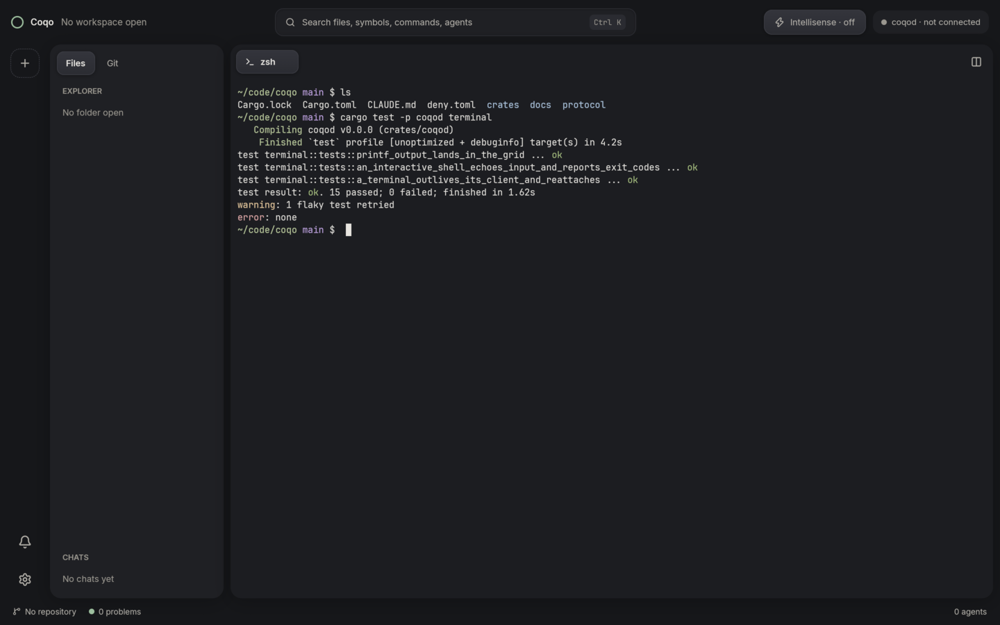
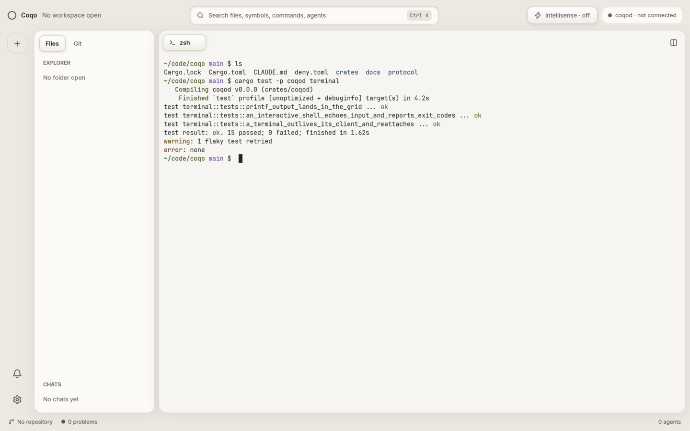

# Terminal tabs

Terminals are ordinary dock tabs (kind `terminal`), so they split, drag and mix with files and chats. No design board shows a terminal yet, so the tab follows board 1's visual language. Issue #46 added them.

## Where the terminal lives

The PTY, the process and the emulator state (grid, 10 000 lines of scrollback, modes) live in `coqod` (`crates/coqod/src/terminal/`, built on `portable-pty` and `alacritty_terminal`). The tab only mirrors the rows in view. This has a few consequences:

- **Quitting Coqo leaves terminals running.** The saved layout keeps each tab's terminal id, and on the next start the tab reattaches: it fetches a snapshot, then follows the `terminal/output` stream from the snapshot's `seq` (see the Terminals section of [`protocol/README.md`](../../protocol/README.md)).
- **Closing the tab ends the terminal.** Coqo sends SIGHUP to the process group and to the PTY's foreground job, then SIGKILL after 1.5 s. A terminal shown in two tabs, after a split, ends only when its last tab closes.
- **When a process exits, its tab stays open** with a "Process exited with code N" pill in the corner, so the last output can still be read.
- **Running terminals keep the daemon awake.** Each one holds a busy guard, so the daemon's idle timer doesn't stop it. Daemon shutdown kills them all.

## Look

- The grid is drawn straight on the dock panel (`panel`), inset 10 px, in **JetBrains Mono** at `text_md` (13 px) with a 1.4 line height.
- Colours come from `TerminalPalette` in `crates/ui/src/theme.rs`, derived from the zen palette rather than hard-coded. The ANSI colours are the accents: red `rose`, green `green`, yellow `sand`, blue `blue`, magenta `lavender`, and cyan halfway between `blue` and `sage`. Black and white are `border_strong` and `text_muted` in dark, and `text` and `border_strong` in light. The bright variants move 30% towards `text`. The rest of the 256-colour palette (the 6×6×6 cube and the grey ramp) is computed as xterm computes it. The theme tests check that every ANSI colour from red to cyan, plain and bright, reaches 4.5:1 on the panel in both appearances.
- Bold text with a basic colour uses the bright variant. Dim text is at 60% opacity, and inverse swaps the foreground and background.
- The cursor is a `text`-coloured block (or a beam or underline if the program asks for one) while the tab has focus, and a hollow block when it doesn't. The selection is `blue` at 35%.
- The tab icon is Lucide `terminal`. The title is the program's own (OSC 0/2), falling back to the program name.

## Keys

| Key | Does |
|---|---|
| ``Ctrl ` `` | New terminal: the login shell, in the active group |
| `Ctrl Shift C` / `Ctrl Shift V` | Copy the selection / paste (`Cmd C` / `Cmd V` on macOS) |
| Everything else | Goes to the program, xterm-style: arrows (with application cursor mode), `Ctrl` letters as control bytes, `Alt` as an `ESC` prefix, F1–F12, Home/End/PgUp/PgDn |

In a terminal, `Ctrl W`, `Ctrl \`, `Tab` and `Escape` go to the program, not to the dock or focus navigation. The mouse wheel scrolls the scrollback, or sends arrow keys to full-screen programs on the alternate screen. Pasted text uses bracketed paste when the program has turned it on.

To regenerate the screenshots, run `COQO_SHOT_DIR=<dir> cargo test -p coqo -- --ignored terminal_screenshots`. This renders offscreen and needs a GPU. The committed PNGs are downscaled to 1440×900.

## Not yet

#156 covers mouse reporting to programs, IME composition, and a scrollback viewport per view (today every attached view shares one). #157 covers injecting shell integration scripts (today cwd and exit codes are picked up only when the shell already emits OSC 7 and OSC 133) and spawning terminals in the workspace root.
