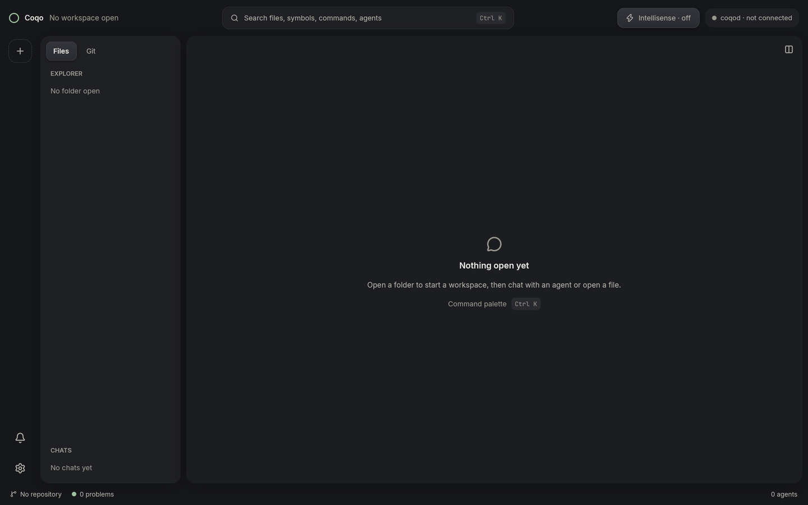
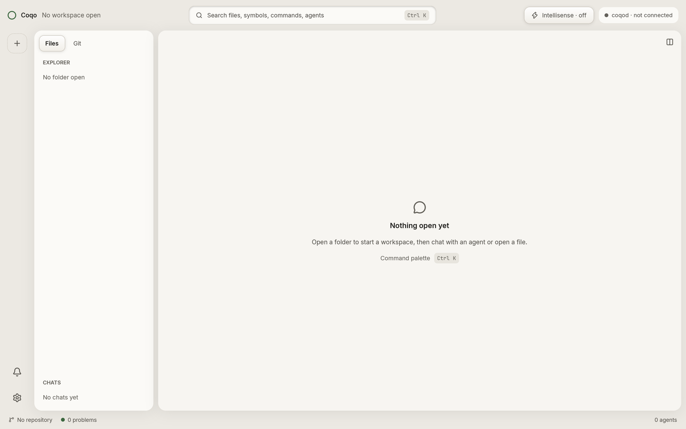

# Zen theme tokens

The visual language from PLAN §14, as implemented in [`crates/ui/src/theme.rs`](../../crates/ui/src/theme.rs). Views read these through `cx.tokens()` and never hard-code colours. The values come from design board 1 (Workbench). The light palette isn't on a board yet; it's derived from the dark one, with accents darkened to keep contrast.

## Appearance

`Appearance::System` (the default) follows the OS and switches live when the OS changes. `Dark` and `Light` force one palette. gpui-component's theme is mapped from the same tokens, so its widgets match.

## Colours

| Token | Dark | Light | Used for |
|---|---|---|---|
| `ground` | `#16171A` | `#ECE9E3` | Window background the panels float on |
| `panel` | `#1C1D21` | `#F7F5F1` | Main tab area |
| `panel_raised` | `#1F2024` | `#FBFAF7` | Sidebar panel, inset fields (command search), pills |
| `surface` | `#26272C` | `#F0EDE7` | Cards and popovers |
| `surface_strong` | `#2A2B31` | `#E8E5DE` | Key caps, chips |
| `surface_selected` | `#2E2F35` | `#E4E0D8` | Selected list rows |
| `border` | `#2C2D33` | `#DEDAD2` | Hairlines, field borders |
| `border_strong` | `#3A3B42` | `#CFCAC0` | Raised controls, dashed "add" buttons |
| `raised_top` → `raised_bottom` | `#34353C` → `#2B2C32` | `#FFFFFF` → `#F1EEE8` | Raised-control gradient |
| `text` | `#E8E6E1` | `#23221F` | Primary text |
| `text_muted` | `#B4B1AA` | `#55524C` | Secondary text, inactive tabs, icons |
| `text_subtle` | `#9A978F` | `#64615A` | Labels, hints, empty states |
| `sage` | `#9DBF9E` | `#3D6840` | Primary / OK |
| `sand` | `#E2B97F` | `#7A5712` | Needs you (questions, waiting agents) |
| `bolt` | `#E6C384` | `#765610` | ⚡ language intelligence on |
| `blue` | `#8FB3D9` | `#2E5D8C` | Info, links, focus ring |
| `rose` | `#D98E8E` | `#9A3C3C` | Risk, removed lines |
| `lavender` | `#C4A7E7` | `#664A96` | Kotlin, syntax |
| `peach` | `#E69875` | `#94461F` | Java, syntax |
| `green` | `#A7C080` | `#4A6721` | Added lines, passing tests |

Attention colours (`sand`, `bolt`, `rose`) appear only when something needs the user. The empty shell, for example, shows the bolt in `text_muted`.

## Contrast

Every text token meets WCAG AA (4.5:1) on every background token in both appearances. `theme::tests` enforces this. These are the worst cases, which are all on `surface_selected`:

| Text token | Dark | Light |
|---|---|---|
| `text` | 10.70:1 | 12.08:1 |
| `text_muted` | 6.23:1 | 5.91:1 |
| `text_subtle` | 4.57:1 | 4.69:1 |
| `sage` | 6.59:1 | 4.90:1 |
| `sand` | 7.29:1 | 4.99:1 |
| `bolt` | 7.94:1 | 5.13:1 |
| `blue` | 6.11:1 | 5.21:1 |
| `rose` | 5.22:1 | 5.17:1 |
| `lavender` | 6.37:1 | 5.34:1 |
| `peach` | 5.79:1 | 5.06:1 |
| `green` | 6.67:1 | 4.90:1 |

When you add or change a colour, keep it in `Palette::text_pairs` so the test covers it.

## Metrics

| Token | Value | Used for |
|---|---|---|
| `gap` | 10 px | Gap between panels, and window padding |
| `radius_panel` | 16 px | Floating panels |
| `radius_control` | 10 px | Tabs, buttons |
| `radius_field` | 12 px | Command search, pills, bolt button |
| `radius_rail` | 14 px | Workspace-rail buttons |
| `rail_width` / `rail_button` | 52 / 42 px | Workspace rail |
| `sidebar_width` | 250 px | Sidebar panel |
| `text_md` / `text_sm` / `text_xs` / `text_label` | 13 / 12.5 / 11.5 / 11 px | Body / controls / status bar / upper-case labels |

## Surfaces

These are built in [`crates/ui/src/widgets.rs`](../../crates/ui/src/widgets.rs):
- **Panel:** `panel_raised` or `panel` fill, 16 px radius, soft drop shadow (`0 4 14`, 25% black in dark, 8% in light).
- **Raised control:** the `raised_top` → `raised_bottom` gradient, a `border_strong` hairline, an inner 1 px top highlight (7% white in dark, 90% in light), and a `0 1 3` drop shadow.
- **Inset field:** `panel_raised` fill, `border` hairline, inner shadow.

## Type

The UI font is **Inter** (400, 500, 600, 700) and the code font is **JetBrains Mono** (400, 500). Both ship with the app under the SIL Open Font License 1.1 (`crates/ui/assets/fonts/`). Icons are **Lucide** (ISC), bundled per icon in `crates/ui/assets/icons/`.

## Light appearance

To regenerate both screenshots, run `COQO_SHOT_DIR=docs/design/screenshots cargo test -p coqo -- --ignored shell_screenshots`. This renders offscreen and needs a GPU. The test writes 2× PNGs; the committed ones are downscaled to 1440×900.
