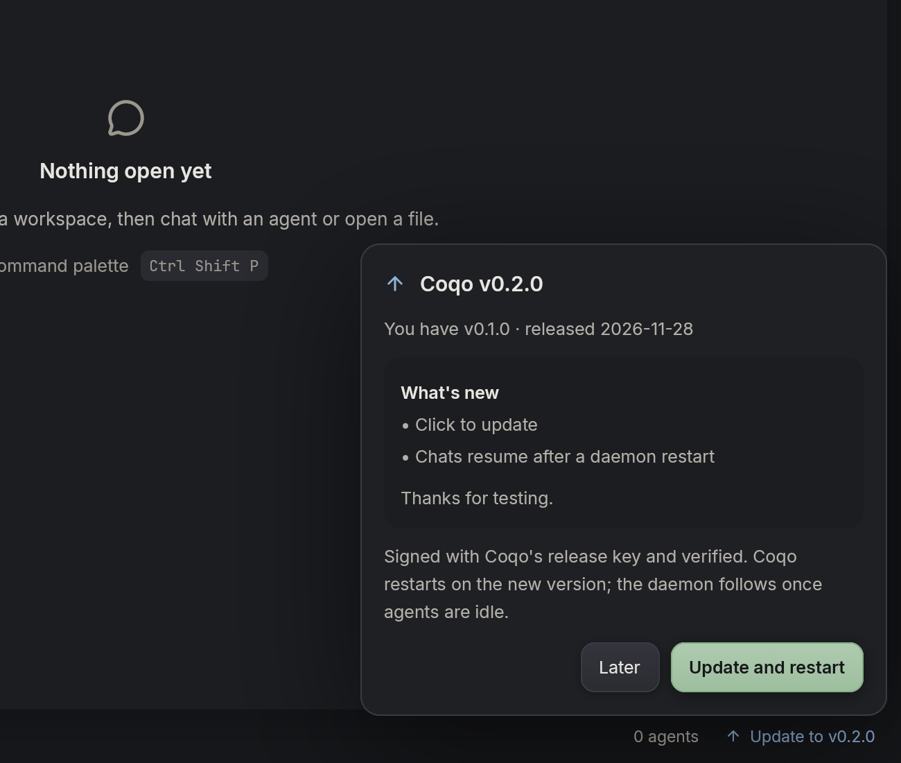
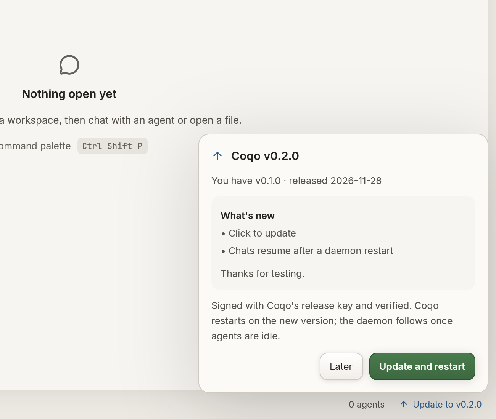
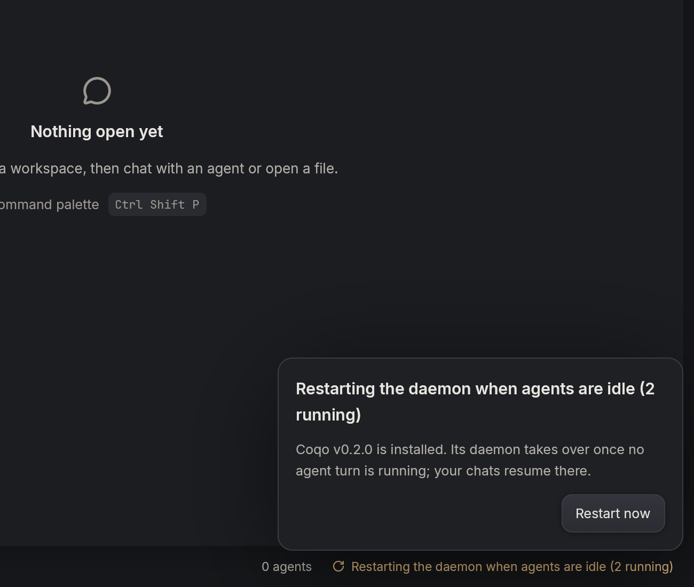
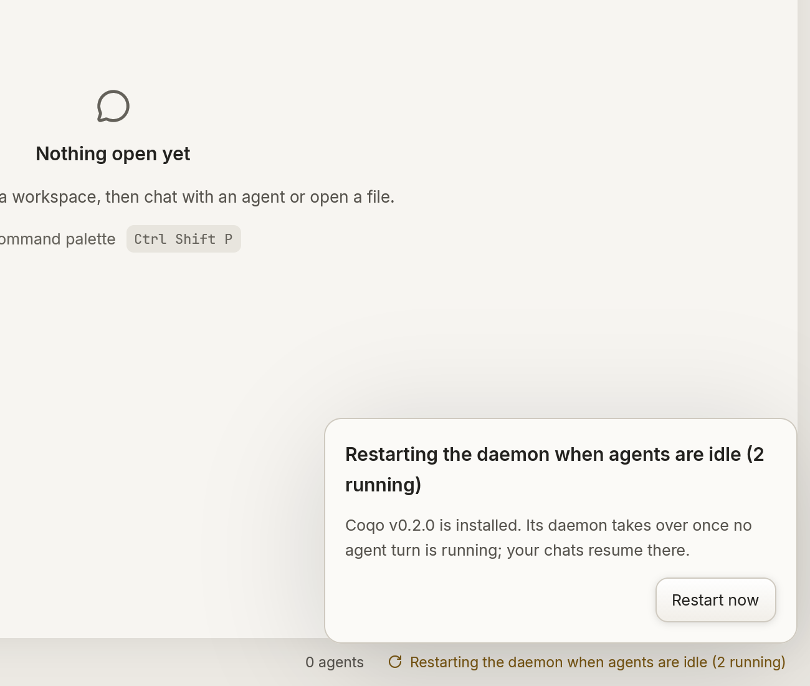

# Updates

The status-bar item and popover for the in-app updater (issue #349, [ADR 0031](../adr/0031-in-app-updater.md)), in the status bar's style from board 1 and the settings cards of board 8. The UI side is `crates/coqo/src/update/`; the daemon side `crates/coqod/src/updates.rs` and `crates/updater/`.

## Status-bar item

At the right end of the status bar (`StatusBarEnd`, after the agents count). A 12 px icon and a label in the status bar's text size, coloured by what it says; hover brightens it to `text`. It is **hidden when there is nothing to do** (up to date, development build, updates off), unless its popover is open.

| State | Icon | Colour | Label |
|---|---|---|---|
| Update ready | arrow up | `blue` | Update to v0.2.0 |
| Downloading / checking | spinner | `text_muted` | Downloading v0.2.0… |
| Waiting for idle agents | rotate | `sand` | Restarting the daemon when agents are idle (2 running) |
| Refused or failed | alert circle | `rose` | Update to v0.2.0 failed |
| Rolled back (until seen) | alert circle | `rose` | v0.2.0 rolled back |

A click toggles the popover; a click outside closes it.

## Popover

380 px wide on `panel_raised`, the popover's radius, border and shadow, 16 px padding and 10 px between blocks, anchored above the item's right edge.

- **Ready:** an arrow-up icon in `blue` and "Coqo v0.2.0" (15 px, semibold); "You have v0.1.0 · released 2026-11-28" in `text_muted`; the release notes (headings, bullets and paragraphs of the Markdown, 240 px at most, scrolling) on a `panel` box with a 12 px radius; one line on what happens ("Signed with Coqo's release key and verified…"); **Later** (raised) and **Update and restart** (primary, sage), right-aligned. In a development build the primary button is dimmed and does nothing.
- **Waiting for the daemon:** the waiting text as the title, "Coqo v0.2.0 is installed. Its daemon takes over once no agent turn is running; your chats resume there." and **Restart now**. Restart now first shows a warning box (`ground` mixed 14 % with `sand`) ("Restarting now stops 2 running agent turns. Their chats resume, but each turn stops where it is."), with **Cancel** and a primary **Restart now**.
- **Failed:** the reason in `rose`, and **Try again**.
- **Up to date / off:** "Coqo v0.1.0 is up to date" (or "Running a development build", "Update checks are off (updates.check = false)", "This build has no release key, so it can't verify updates") and **Check again** where checking makes sense.
- **Rolled back:** a box (`ground` mixed 14 % with `rose`) with "v0.2.0 didn't start, so Coqo went back to v0.1.0" and the daemon's reason in mono.

## Palette

All under **Coqo**: **Check for updates**, **Update and restart**, **Restart the daemon now** (warns while turns run) and **Show update**.

## Screenshots

`cargo test -p coqo -- --ignored update_screenshots` (offscreen, needs a GPU) writes `coqo-update-{ready,waiting}-{dark,light}.png` to `$COQO_SHOT_DIR`; the ones above are their bottom-right corners.
