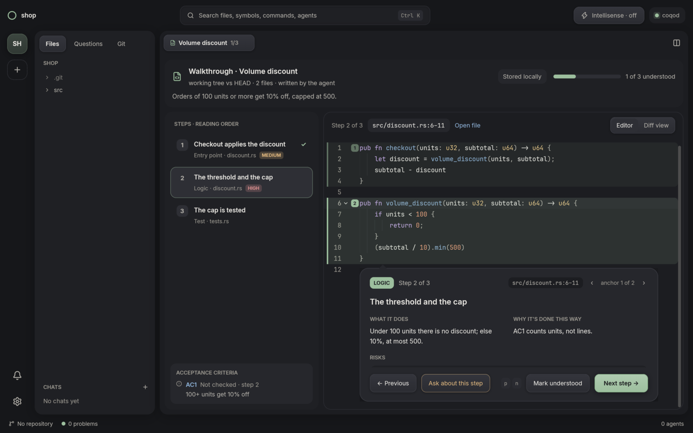
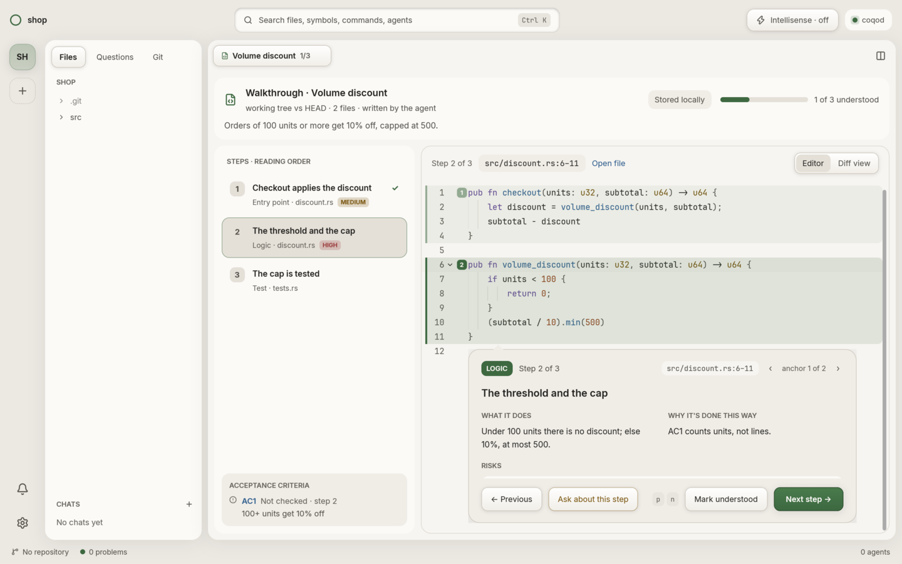
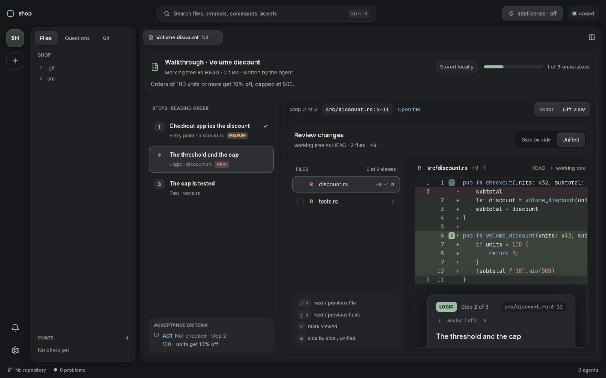

# Walkthrough player

This page covers the player of board 3 ("Code walkthrough"): an agent's walkthrough of a change, replayed step by step at the code. It comes from PLAN §7.6, issue #100 and [ADR 0020](../adr/0020-walkthroughs.md) (the data), on the diff view of [ADR 0021](../adr/0021-diff-view.md).

- **Code:** `crates/coqo/src/walkthrough/` (`player.rs` the tab, `popover.rs` the step popover, `diff.rs` the walkthrough's `DiffSource` and `DiffOverlay`). The step markers and the popover's place in a file use the editor hooks of the questions (#74): `StepMark` / `show_step` on `FileEditor`, and labelled `CodeMarker`s and `overlay_room` in `coqo_ui::editor`.
- **Screenshots:** offscreen renders from `walkthrough_screenshots`:
  `COQO_SHOT_DIR=<dir> cargo test -p coqo -- --ignored walkthrough_screenshots`, downscaled to 1440×900.

Light: [diff](screenshots/walkthrough-diff-light.png).

## Opening it

- The chat's card "Walkthrough published: <title> · n steps" and the rows of the session panel's "Walkthroughs" card dispatch `OpenWalkthrough`. The workbench opens the walkthrough's tab (or shows it if it is open) at the **first unread step**, with its popover at the code and the keyboard in the popover.
- The tab kind is `walkthrough`, keyed by the walkthrough id. Its saved state is `{ workspace, id, step, mode }`, so a restored tab comes back at the same step.

## Layout

The tab is padded 10 px, with 10 px between its parts, as the board's window is.

- **Header card:** `panel_raised`, at the panel radius.
  - A 20 px code-file icon in `sage` (the board's book glyph is not in the icon set).
  - "Walkthrough · <title>" at 15 px semibold. Below it, at 12.5 px in `text_muted`: the scope (`working tree vs HEAD`, `feature vs main`), the number of files the steps are in, and "written by <provider>".
  - On the right: where it is kept ("Stored locally", "In .coqo/walkthroughs") on a `surface` chip, then the progress: an 8 px bar on `surface_selected` filled in `sage`, and "n of m understood".
  - The summary (markdown, `text_muted`) under them.
- **Step list:** 320 px wide, `panel_raised`, 12 px padding. Board: 300 to 330 px.
  - The `STEPS · READING ORDER` label.
  - A row per step, radius 12: a 24 px number badge on `surface_selected`, the title (semibold) over "<kind> · <file>" in `text_subtle` with a `MEDIUM` / `HIGH` badge for the step's worst risk, and the state on the right: `✓` in `sage` (understood) or `?` in `sand` (asked about).
  - The shown step is `surface_selected` with a `sage` hairline at 45%; other rows get a `surface` hover. A click goes to the step.
  - At the bottom, on `surface`: **ACCEPTANCE CRITERIA**, each with its status glyph (as in the session panel), its id in `blue`, "Met · steps 1, 3", and its text. The board has one line ("AC1 steps 1, 3"); the status and text were added because the scope asks for the criteria with their status.
- **Main card:** a `border` hairline at the panel radius.
  - **Bar:** "Step n of m" in `text_subtle`, the anchor as `path:start–end` in mono on `surface`, **Open file** (a file tab at the lines), and on the right the segmented **Editor | Diff view** toggle.
  - **Body:** the step's file in an editor (the file's live buffer: it can be edited, and its questions show), or the walkthrough's diff.

## Step markers

- **In the editor:** every step anchored in the file has a numbered badge in the gutter gap (16 px high, radius 5, 10 px bold `panel` text on `sage`), a 3 px `sage` strip and a 13% `sage` band over its lines. Steps other than the shown one are at half strength. A click on a badge goes to that step and anchor.
- **In the diff:** the same badges in the diff's gutter lane on each step's first line (new side), a 13% `sage` tint over the shown step's lines, and the popover in a slot under its last line. The diff is the scope's base (the commit it resolved to when published) against the working tree, or against the head commit for `commits` and `pr` scopes, untracked files included. It opens unified so the popover has room beside the step list; `m` switches as anywhere.

## Step popover

A `popover` card (radius 18, 20 × 18 px padding, 14 px gaps), under the step's lines with the caret pointing at them, like a question's (see [questions.md](questions.md)). Top to bottom:

- **Header:** the kind badge (upper case, `panel` text on `sage`), "Step n of m", the anchor as `path:lines` on `panel`, and with several anchors "‹ anchor 1 of 3 ›" to cycle through them.
- **Title:** 16 px semibold.
- **Question field** while asking (see below).
- **Content**, which scrolls when the editor is short of room, so the buttons stay in sight (the editor reports the height it gives the overlay):
  - **Code moved:** when the anchor is fuzzy or orphaned, a `panel` box with a `sand` alert, "Code moved: …", **View as diff**, and the code as published in mono. An orphaned anchor has no marker; its popover sits at the top of the editor.
  - **WHAT IT DOES** and **WHY IT'S DONE THIS WAY** side by side (each at least 240 px, wrapping), markdown.
  - **RISKS:** a row per risk on `panel_raised`, radius 12, with its badge: `HIGH` `rose`, `MEDIUM` `sand`, `LOW` `sage`, as text in the colour on a 22% tint of it. The board uses dark tinted badges with pastel text; this keeps them legible in the light appearance.
  - **MEETS:** the criteria the step refers to, with status glyph, id in `blue` and text. **READ FIRST:** the steps it depends on, as links.
- **Buttons:** **← Previous**, **Ask about this step** (raised, `sand` text and hairline, as the board's amber button), then on the right the `p` `n` key caps, **Mark understood** / **✓ Understood** and the primary **Next step →**. Previous and Next dim at the ends.

### Asking about a step

**Ask about this step** opens a field under the title ("Ask <provider> about this step"). `Enter` or **Ask** sends it, `Esc` or **Cancel** closes it. The question goes to the agent session that published the walkthrough as a thread pinned to the anchor's lines (`questions/ask`, #229), so the agent gets the code with it and its answer shows in the thread's popover and in the chat. The step is marked `question` (`?` in the list), and the popover shows "You asked <provider> about this step. Open the thread". If the session is busy or gone, the field shows why in `rose`.

## Keyboard

Key context `WalkthroughPlayer`. A focused text field (the code, the question) gets its characters first.

| Key | Does |
| --- | --- |
| `n`, `→` | Next step |
| `p`, `←` | Previous step |
| `u` | Mark understood, or unread again |
| `d` | Editor or diff |

## Progress

**Understood** and asking call `walkthroughs/setStepState`; the list, the bar and the tab's "n/m" change at once. The player follows `walkthroughs/changes` for its workspace and reloads its walkthrough when it changes (another window's marks show live; a deleted walkthrough says so). Reloads re-resolve the anchors; markers keep following edits made in the meantime.

## Not yet

- **Coverage guard** (board 3's banner, "14 of 15 changed hunks covered"): #99.
- **Attach to PR** (board 3's header button): M8.
- Step markers show in the player's editor only, not in other file tabs of the same file.
