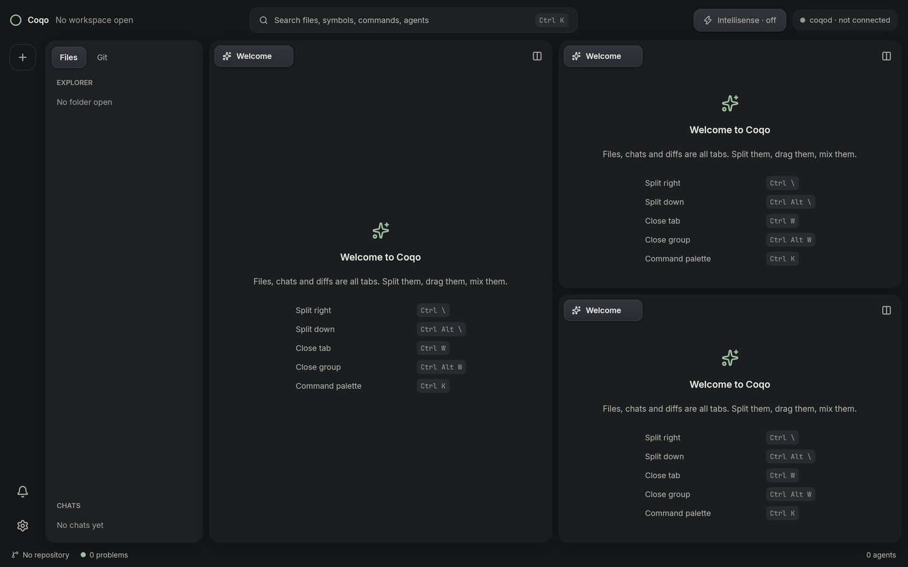

# Workbench layout

How the workbench window (design board 1) is arranged and how code adds to it. The engine is `coqo_ui::dock` ([ADR 0004](../adr/0004-workbench-layout.md)); the window is `crates/coqo/src/shell.rs`.



## Regions

- **Top bar:** brand, then the `TopBarStart` slot, the command search, and the `TopBarEnd` slot (the bolt and the `coqod` pill today).
- **Workspace rail:** 52 px, unchanged from #23.
- **Sidebar panel:** `panel_raised`, 250 px by default, 180 to 520 px by dragging the gap to its right. A tab strip switches between registered panes; the Chats section stays at the bottom.
- **Main tab area (the dock):** tab groups in splits. Each group is its own floating `panel` with a tab strip and a split button; groups are 10 px (`gap`) apart.
- **Status bar:** the `StatusBarStart` and `StatusBarEnd` slots.

## Behaviour

- **Split:** the split button (right; shift-click for down), `Ctrl \` (right) and `Ctrl Alt \` (down) duplicate the active tab into a new group beside it. An empty group splits off a Welcome tab.
- **Drag a tab:** onto another tab to insert before it, onto a tab strip to append, onto the middle of a group to move into it, or onto a group's outer quarter to split off a new group on that side. A blue overlay (`blue` at 10% with a 45% border) previews where it lands.
- **Resize:** drag the gap between two groups. Each group keeps at least 160 px.
- **Close:** the × on a hovered tab, middle-click, `Ctrl W` for the tab and `Ctrl Alt W` for the group. An emptied group closes and its split collapses; the last group stays and shows the empty state.
- **Restore:** the layout (sidebar width and pane, splits, sizes, tabs and their saved state) is saved 300 ms after a change and on quit, and restored on start. Until #140 it lives in `$XDG_DATA_HOME/coqo/ui/layouts/default.json` (`~/Library/Application Support/Coqo/ui/layouts/` on macOS; `COQO_DATA_DIR` overrides the base).

On macOS, `Cmd` replaces `Ctrl`.

## Adding to the workbench

**A tab kind** (editor, chat, diff, …): implement `TabItem` on the view, register a builder so saved tabs come back, and open tabs through the `Dock`.

```rust
impl TabItem for EditorTab {
    fn kind(&self) -> SharedString { "file".into() }
    fn title(&self, cx: &App) -> SharedString { self.file_name() }
    fn key(&self, cx: &App) -> Option<SharedString> { Some(self.path_string()) } // de-duplicates
    fn save(&self, cx: &App) -> serde_json::Value { json!({ "path": self.path }) }
    fn focus_handle(&self, cx: &App) -> Option<FocusHandle> { Some(self.focus.clone()) }
}

register_tab_kind(cx, "file", |state, window, cx| {
    let path = state.get("path")?.as_str()?;
    Some(AnyTab::new(cx.new(|cx| EditorTab::open(path, window, cx))))
});

dock.update(cx, |dock, cx| dock.open_tab(AnyTab::new(editor), window, cx));
```

`open_tab_at(tab, TabTarget::Split { group, edge }, …)` opens beside a group, and `TabItem::render_label` replaces the default icon and title (for a file-type letter, or a "needs input" badge).

**A sidebar pane** (file tree, git): register a `SidebarPane`. Its builder gets the window's dock, to open tabs.

```rust
SidebarPanes::register(cx, SidebarPane::new("files", "Files", 0, |dock, window, cx| {
    cx.new(|cx| FileTree::new(dock, window, cx)).into()
}));
```

**A top bar or status bar item:** `Slots::register(cx, Slot::StatusBarStart, "git.branch", 0, |window, cx| …)`. Registering the same id again replaces the item, so a mod replaces the built-in placeholders (`bolt`, `daemon-status`, `branch`, `problems`, `agents`).

## Light appearance


