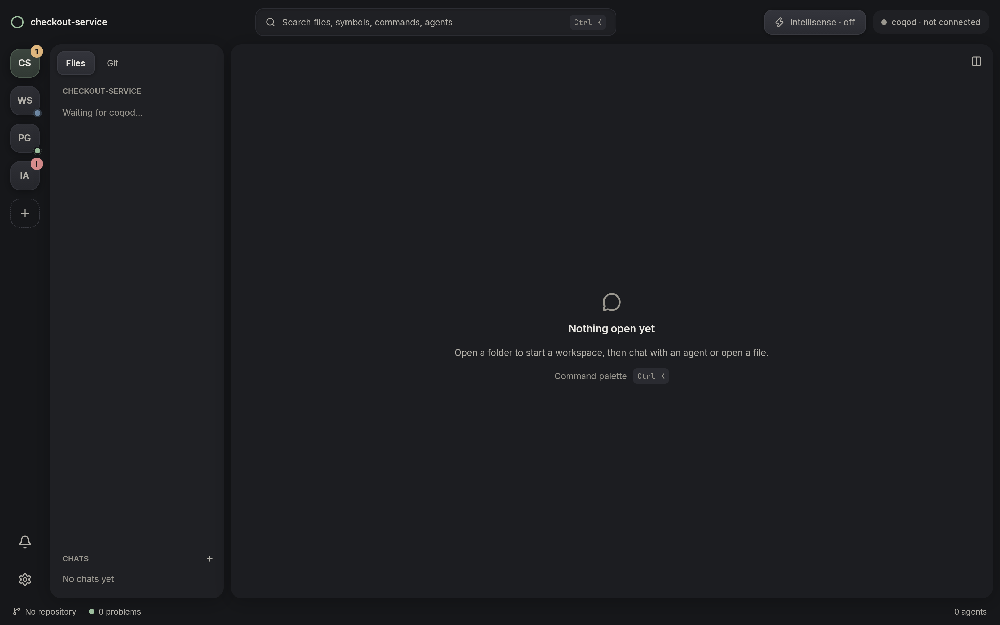
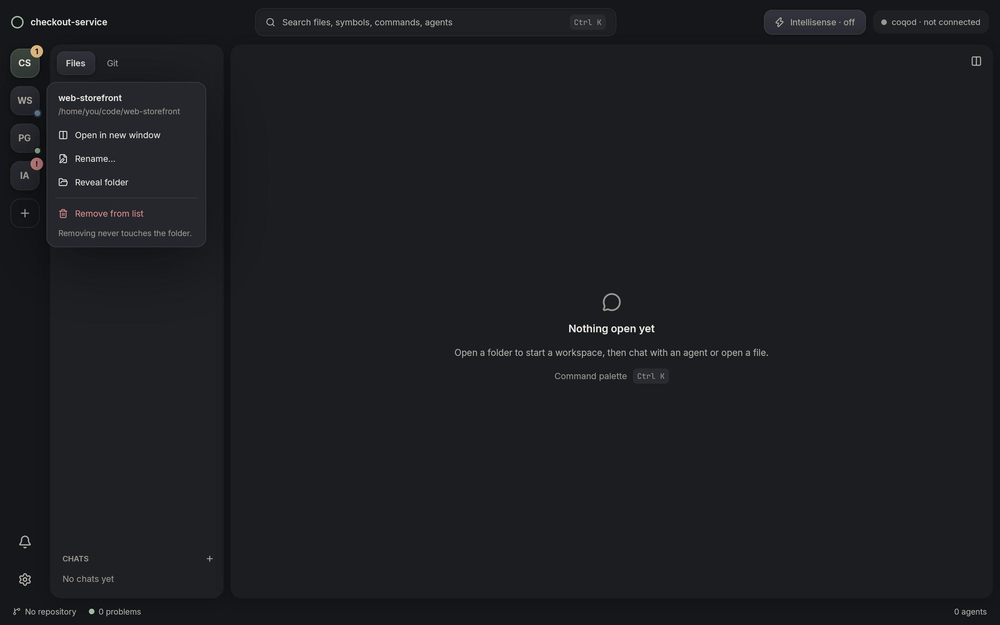
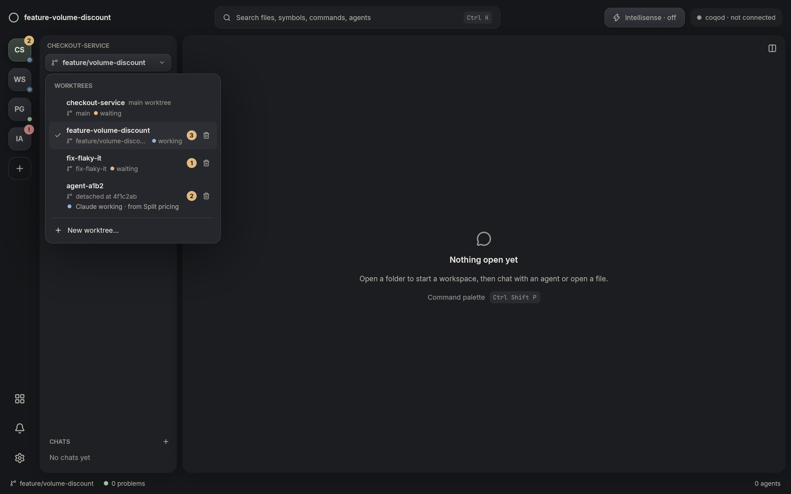
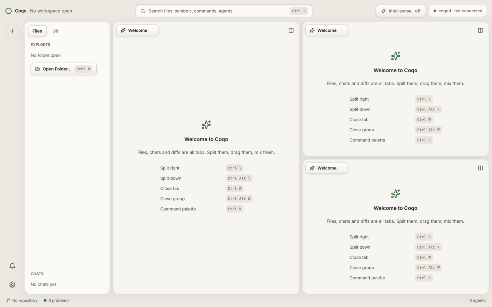
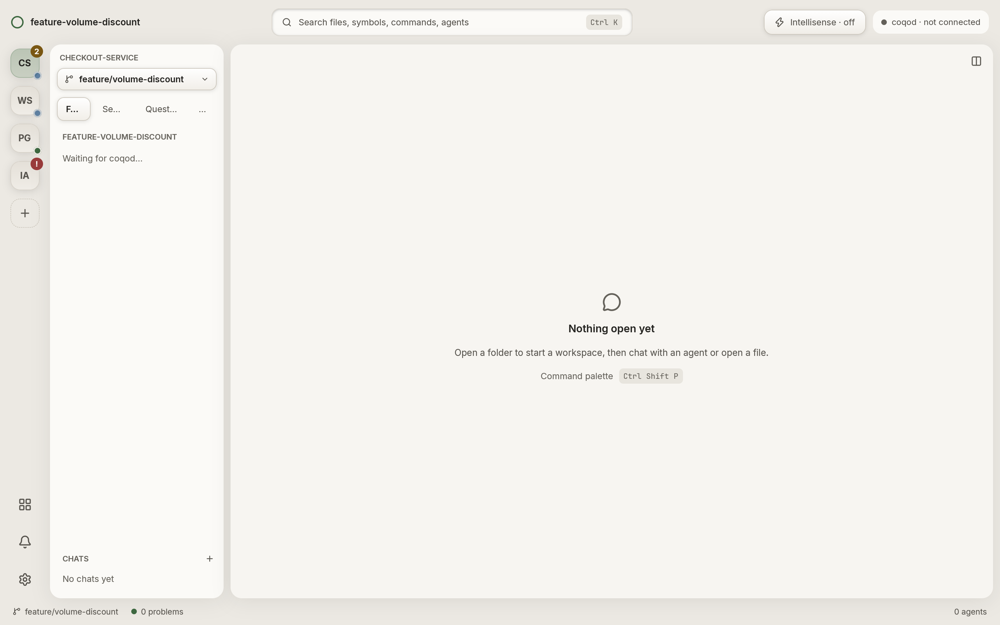

# Workbench layout

How the workbench window (design board 1) is arranged and how code adds to it. The engine is `coqo_ui::dock` ([ADR 0004](../adr/0004-workbench-layout.md)); the window is `crates/coqo/src/shell.rs`.


## Regions

- **Top bar:** the brand ring and the current workspace's name ("Coqo · No workspace open" without one), then the `TopBarStart` slot, the command search (a click or `Ctrl K` opens the command palette under it, see [palette.md](palette.md)), and the `TopBarEnd` slot (the bolt and the `coqod` pill: a grey dot while connecting, a sage dot with a halo when connected, a rose dot with **Retry** when not connected).
- **Workspace rail:** 52 px. One 42 px button per project (a repository with all its worktrees, or a folder in no repository) with its initials (the window's own lit in sage), then the dashed **+** that opens a folder. See [Workspace rail](#workspace-rail) below.
- **Worktree switcher:** at the top of the sidebar, above the pane tabs, when the workspace is in a git repository. See [Worktree switcher](#worktree-switcher) below.
- **Sidebar panel:** `panel_raised`, 250 px by default, 180 to 520 px by dragging the gap to its right. A tab strip switches between registered panes; the CHATS list of the workspace's agent sessions stays at the bottom ([chat.md](chat.md)).
- **Main tab area (the dock):** tab groups in splits. Each group is its own floating `panel` with a tab strip and a split button; groups are 10 px (`gap`) apart.
- **Status bar:** the `StatusBarStart` and `StatusBarEnd` slots.

## Behaviour

- **Split:** the split button (right; shift-click for down), `Ctrl \` (right) and `Ctrl Alt \` (down) duplicate the active tab into a new group beside it. An empty group splits off a Welcome tab.
- **Drag a tab:** onto another tab to insert before it, onto a tab strip to append, onto the middle of a group to move into it, or onto a group's outer quarter to split off a new group on that side. A blue overlay (`blue` at 10% with a 45% border) previews where it lands.
- **Resize:** drag the gap between two groups. Each group keeps at least 160 px.
- **Close:** the × on a hovered tab, middle-click, `Ctrl W` for the tab and `Ctrl Alt W` for the group. An emptied group closes and its split collapses; the last group stays and shows the empty state.
- **Restore:** the layout (sidebar width and pane, splits, sizes, tabs and their saved state) is saved 300 ms after a change, when the window closes and on quit. It belongs to the workspace: the daemon keeps it in the workspace's state (`ui.layout`), and it comes back when any window opens that workspace, also after a UI restart. While `coqod` is unreachable it is written to `$XDG_DATA_HOME/coqo/ui/layouts/<workspace id>.json` instead (`~/Library/Application Support/Coqo/ui/layouts/` on macOS; `COQO_DATA_DIR` overrides the base) and moved into the daemon on the next save after reattaching. A window with no workspace keeps its layout in `default.json`; the first workspace it opens that has no layout of its own takes it over (this is how layouts from before #140 are imported, once).

On macOS, `Cmd` replaces `Ctrl`.

## Workspaces and the daemon

The UI attaches to `coqod` on start (`crates/coqo/src/daemon.rs`), spawning it if needed, and reconnects once by itself when the connection drops (then the pill's **Retry**). `coqo <folder>`, the rail's **+** and `Ctrl O` open a folder with `workspace/open`; `coqo` alone reopens the most recently opened workspace (`crates/coqo/src/workspace.rs`). The Files pane and file tabs are described in [files.md](files.md), chat tabs and the CHATS list in [chat.md](chat.md).

**Attach and reattach (PLAN §4.3).** The rail follows every workspace with a snapshot (`workspace/list`, with its `seq`) and a `workspace/events` subscription from that `seq`. After a daemon restart or a dropped connection it resubscribes from the last `seq` it saw, so what changed meanwhile (a rename, a workspace opened by another client) is replayed exactly once; if the daemon can't resume from there (`RESUME_GAP`), it takes a fresh snapshot. Each window then reopens its workspace, re-fetches its state, and the Files pane lists again (`fs/changes` is live-only); the dock and its tabs stay as they are. `crates/coqo/src/resume.rs` (`Resumable`) does the snapshot + resume for any topic: chat sessions (`sessions/get` + `sessions/updates`) and buffers use it the same way.

**Windows.** **New Window** (`Ctrl Alt N`, `Cmd Alt N` on macOS) opens another workbench window. Windows share one daemon connection; each has its own workspace, dock and Files pane, and every rail shows changes from any window or client as they happen. A workspace is shown in at most one window: opening or switching to one that another window shows focuses that window. Switching a window to another workspace saves the current layout and shows the other workspace's (or the default). Closing the last window quits the UI; `coqod` keeps running under its idle policy.

## Workspace rail

Boards 1 and 6; `crates/coqo/src/shell/rail.rs`.



- **Projects ([ADR 0028](../adr/0028-worktrees-and-projects.md)):** one button per repository, however many worktrees of it have a workspace; worktrees are grouped by the repository's git common directory (`WorkspaceInfo.project`), so ones made outside Coqo join too. A folder in no repository is a project of its own. The button is named after the main worktree's workspace (so renaming it renames the button), else the repository's folder.
- **Order:** every project, in the order its first workspace was added, so a button and its `Ctrl/Cmd+1..9` stay put while you switch (most-recently-opened order would reshuffle the rail on every switch). A new project goes at the bottom, next to **+**.
- **Button:** the initials of the name (`checkout-service` → `CS`), bold 13 px, in a 42 px button with a 14 px radius. The window's own workspace has the sage-tinted gradient (`ground` mixed 28 % → 20 % towards `sage`, a 42 % hairline); the others have the `surface_selected` → `surface` gradient. Hovering shows the name and its key, then up to five of the project's busy sessions, across all its worktrees (not idle; waiting ones first, then failed, working and done), each with its status dot, title and the agent's status line (or why it waits) in `text_muted`.
- **Badges** add up every agent session in every worktree of the project (`sessions/list` + `sessions/changes` across all workspaces, `crates/coqo/src/activity.rs`), so background workspaces stay live. Top right: a `sand` count of sessions waiting for you (a question, a permission request, or blocked), else a `rose` **!** when one failed. Bottom right: a pulsing `blue` dot while an agent works, else a `sage` dot when one finished its turn.
- **Switch:** a click or `Ctrl/Cmd+1..9` shows the project's most recently opened worktree in this window (a click on the window's own project does nothing; switch worktrees in the sidebar): the layout of the one you leave is saved and the other's comes back (see Restore above). Agents keep running in the daemon. A workspace another window shows focuses that window instead.
- **Bell** (bottom of the rail, above settings): the alert center, with an unread count in the colour of the most urgent unread alert. See [alerts.md](alerts.md).
- **Context menu** (right-click): **Open in new window** (the most recent worktree; disabled while a window shows it), **Rename…** (the main worktree's workspace, or the folder's; Enter renames for every client, Esc cancels), **Reveal folder** (the main worktree, else the first root, in the platform's file manager), and **Remove from list** (`workspace/remove` for every workspace of the project: the daemon forgets them and their daemon-side data, such as their layouts, but never touches a folder; a window showing one is left with no workspace).



## Worktree switcher

Boards 1 and 6's visual language (the boards predate it); `crates/coqo/src/worktrees.rs`, [ADR 0028](../adr/0028-worktrees-and-projects.md). Each worktree of a repository is its own workspace (files, chats, terminals, git state); the switcher moves the window between them, and agents in the others keep running.



- **Header:** the project's name as a `text_label` caption (`CHECKOUT-SERVICE`), and under it a raised button with the branch icon, the window's branch (semibold) and, when the folder says something else, the folder (`text_subtle`), and a chevron.
- **List** (a click on the button, or **Switch worktree** in the palette): `git/worktrees`, so worktrees made with `git worktree add` outside Coqo are there. Each row: a sage check on the window's own, the folder (and `main worktree` on the main one), the branch (or `detached at …`), what the worktree's agents do (a `sand` dot for waiting, `rose` failed, `blue` working, `sage` done, as the rail), the changed-file count in a `sand` pill, and a trash button (not on the main worktree, nor a locked one). A click switches the window to that worktree's workspace, opening one on its folder the first time. The popover is 320 px wide.
- **Live** (#359): a worktree made, removed or pruned outside Coqo (an agent's `git worktree add`, Claude Code's `.claude/worktrees/agent-…` for its subagents, another tool) appears in or leaves the open list within about a second, with no reload (`git/changes` reports `worktrees`). Nothing opens and nothing takes focus: it is a row, and a click opens it like any other.
- **Work from another chat** (#359): when a chat's tool calls touch files in another worktree of the project (a subagent of it working in `.claude/worktrees/agent-…`), that row gets a third line, `text_xs` in `text_muted`: a state dot (`blue` working, `sand` waiting, `rose` failed) and "Claude working · from <chat title>", truncated. It goes when the chat's turn ends, or after 30 s without a touch there. No session is made for it: the work is that chat's, so the project's rail button already counts it.
- **New worktree…** (or **New worktree** in the palette): a branch name and a base (the current branch, filled in); `Enter` or **Create** runs `git/addWorktree` (`git worktree add`, in `<repo>-worktrees/<branch>` beside the repository; an existing branch is checked out as it is) and switches the window to the new workspace. git's refusals (a branch checked out elsewhere) show under the list in `rose`.
- **Remove** (the trash): `git/removeWorktree`, never with `--force`. Uncommitted changes stop it with a `sand` warning that says to commit or stash first (and no way round it); commits no other branch has ask for **Remove anyway** (the branch stays, so they are kept). Removing the window's own worktree shows the main one. The workspaces on a removed worktree are forgotten.

## Adding to the workbench

**A tab kind** (editor, chat, diff, …): implement `TabItem` on the view, register a builder so saved tabs come back, and open tabs through the `Dock`.

```rust
impl TabItem for EditorTab {
    fn kind(&self) -> SharedString { "file".into() }
    fn title(&self, cx: &App) -> SharedString { self.file_name() }
    fn key(&self, cx: &App) -> Option<SharedString> { Some(self.path_string()) } // de-duplicates
    fn save(&self, cx: &App) -> serde_json::Value { json!({ "path": self.path }) }
    fn focus_handle(&self, cx: &App) -> Option<FocusHandle> { Some(self.focus.clone()) }
}

register_tab_kind(cx, "file", |state, window, cx| {
    let path = state.get("path")?.as_str()?;
    Some(AnyTab::new(cx.new(|cx| EditorTab::open(path, window, cx))))
});

dock.update(cx, |dock, cx| dock.open_tab(AnyTab::new(editor), window, cx));
```

`open_tab_at(tab, TabTarget::Split { group, edge }, …)` opens beside a group, and `TabItem::render_label` replaces the default icon and title (for a file-type letter, or a "needs input" badge). `TabItem::on_close` runs when the user closes the tab or its group, never when the window or app closes, so a tab that owns something outside the UI (a terminal, see [terminal.md](terminal.md)) can end it there and keep it across restarts.

**A sidebar pane** (file tree, git): register a `SidebarPane`. Its builder gets the window's dock, to open tabs.

```rust
SidebarPanes::register(cx, SidebarPane::new("files", "Files", 0, |dock, window, cx| {
    cx.new(|cx| FileTree::new(dock, window, cx)).into()
}));
```

`SidebarPane::with_badge(|window, cx| …)` adds a badge after the tab's title (the Git tab's "Git 5"). It runs on every render of the shell and brings its own leading space. For a badge that updates by itself, return the element of a view kept per window that observes its data.

**A top bar or status bar item:** `Slots::register(cx, Slot::StatusBarStart, "git.branch", 0, |window, cx| …)`. Registering the same id again replaces the item, so a mod replaces the built-in placeholders (`bolt`, `daemon-status`, `problems`, `agents`). The git module registers the status bar's `branch` ([git.md](git.md)).

## Light appearance




